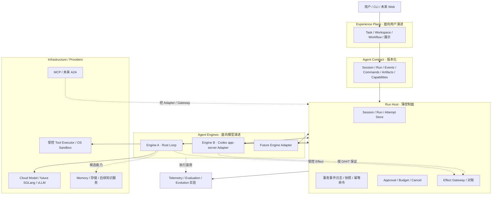
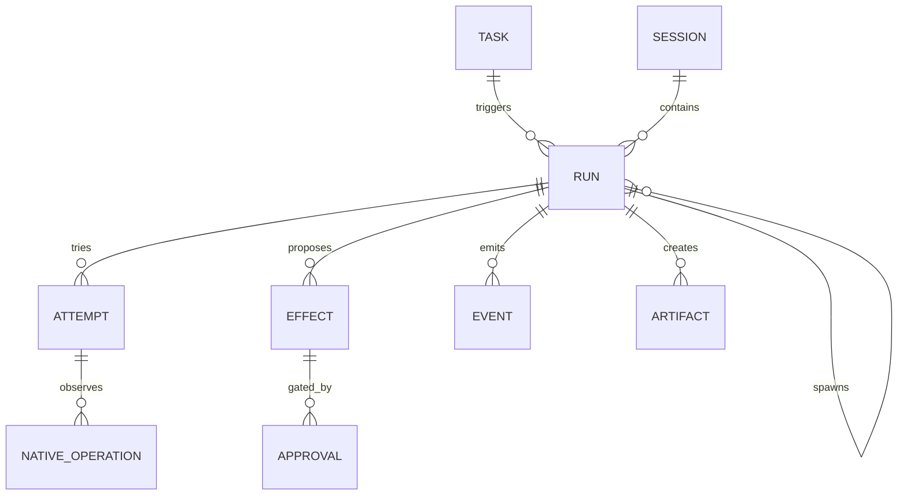
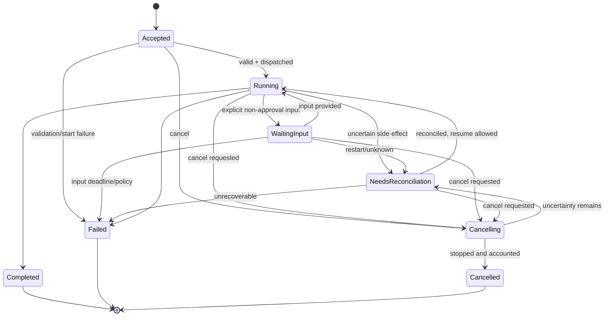
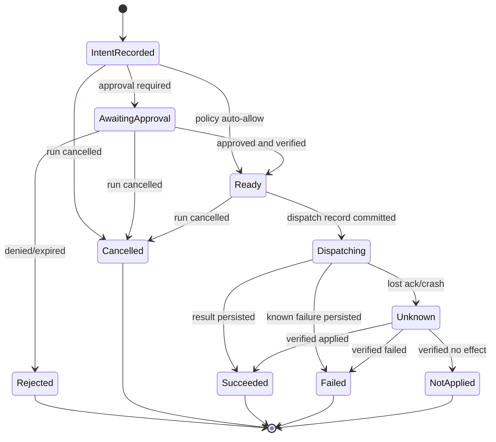
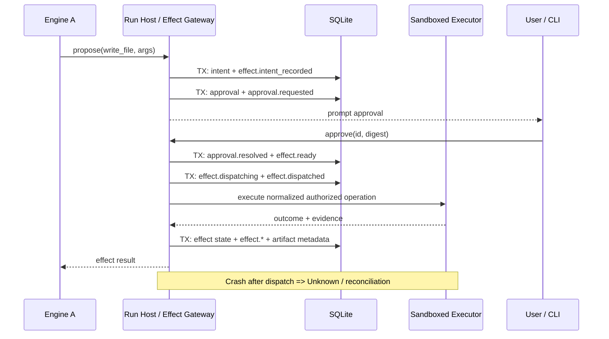
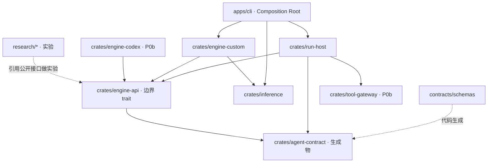

# FluxAxiom（暂定）：个人 Agent 系统总体架构与实施方案 V0.3

> **本次修订**：项目命名与 Monorepo 研发组织补充版；保留 V0.3 原有运行时、治理、安全和实施设计。

> **建议项目名称**：**FluxAxiom**（当前首选，尚待最终确认）  
> **建议 GitHub 仓库**：`FluxForgeLab/FluxAxiom`（拟定路径，不代表已创建或完成名称/商标核验）  
> **架构文档版本**：V0.3（仓库组织补充修订） / P0a 开工基线、P0b 实施约束草案；**不等于软件发布版本**  
> **日期**：2026-10-20  
> **依据**：V0.1、V0.2 方案；《V0.1 评审意见》《V0.2 评审意见》；2026-10-20 前后可核验的 Codex app-server 与 MCP/rmcp 官方资料。  
> **重要决定**：**暂不引入 Cordis**；不建设通用插件运行时，不把 FluxAxiom 绑定到任何特定 Agent 框架；初期使用 **Rust Workspace + Modular Monorepo**。  
> **文档状态**：可指导 P0a 开发；涉及 Codex 的配置、Capability 与保证等级仍需在锁定版本后通过 P0b 验证。示例 Schema 和 Rust 代码仅表达语义，并非已通过编译的 API。

---

## 0. 执行摘要

### 0.1 目标

建设一套个人长期使用的 Agent 系统：**Experience Plane 贴近用户、Agent Engine 贴近模型，以版本化 Contract 与轻量 Run Host 控制二者耦合，同时具备接受新模型、新执行模式和外部能力的弹性。**

首个场景是个人 Coding/Repository Agent：分析真实仓库、保留运行证据，后续在隔离工作区内审批写入并运行测试。工程实践也是学习 Rust/Tokio、Agent Harness、可靠性与架构设计的载体。

不把 V0.3 称为“最终架构”：所有尚未经 A/B 或故障注入证明的部分标为 **设计决策 / 待验证假设 / 未来预留**。

**项目命名理由（建议，不构成商标或名称可用性结论）**：Flux 表示模型与智能技术的持续变化；Axiom 表示系统必须保留的执行语义、安全与可靠性不变量。名称不绑定 Coding、特定 Agent 框架或推理后端。

### 0.2 V0.3 相比 V0.2 的变化

| 主题 | V0.3 决定 | 依据与目的 |
|---|---|---|
| Cordis | **暂不引入**；使用最小 Rust trait/Adapter | 避免引入第二套插件生命周期与 TypeScript 运行时 |
| Codex 接入 | 原 D/T 改为 **D / H / T**；决策权、执行方、绑定保证分别声明 | 承认 app-server 的审批回调能力及其局限 |
| Codex 安全 | Adapter **RPC 方法白名单**、独立 `CODEX_HOME`、锁定 Schema、独立工作区 | 禁止误用沙箱外的特权客户端 API |
| Codex 取消 | `turn/interrupt` 后核查后台进程与副作用；不能确认则 `unknown` | 不把 Turn 停止误报成执行器已停止 |
| 预算 | `pre_call` 与 `post_hoc_interrupt` 分级，不能伪造硬上限 | Engine A 与 B 的实际治理能力不同 |
| Session | **Host 唯一持有**；Application 仅引用；Engine context 私有 | 解决状态归属冲突 |
| Effect | 补 `Cancelled`、`NotApplied`、显式重试/`supersedes` | 避免未知副作用的隐性重复执行 |
| 事件 | 状态变更与事实事件同事务提交；定义可测试 reducer | 防止状态、事件与 UI 快照不一致 |
| UI | 从运行状态派生 `blocked_on`；审批与输入请求分别建模 | 支持并行审批，消除 WaitingInput 混用 |
| MCP/rmcp | 明确 Discover、MRTR 人工接管、requestState 完整性、订阅边界 | 避免 SDK 默认行为绕过 Host 治理 |
| P0b 顺序 | **先 A 的 Effect/可靠性，再 Codex B，最后 E-001** | 故障定位与验收更可靠 |

### 0.2.1 本轮项目组织讨论的新增决定（2026-10-20）

| 项目组织事项 | 当前决定 / 状态 |
|---|---|
| 命名 | **FluxAxiom** 为首选项目名；最终确认前在文档中标记为暂定 |
| 仓库策略 | 采用**一个模块化 Monorepo**；不先拆 Memory、GPU、Engine 等多个独立仓库 |
| 代码边界 | `Experience / Host+Contract / Engines / Providers / Research+Evaluation` 分开组织，但首先是逻辑模块而非微服务 |
| 研发路线 | Runtime & Reliability、Agent Intelligence、Inference Systems、Experience、Evaluation & Evolution 五条主线并行规划 |
| 实验隔离 | `research/` 用于假设验证，正式运行路径不得反向依赖实验代码；达到晋升标准后才进入正式模块 |
| 工作流 | `main` 可运行、短期分支/Worktree、Issue→必要时 ADR→实现→测试证据→PR |
| 初期范围 | P0a 仅创建必要的 workspace 成员，不提前铺满未来目录；P0b 增量引入 Engine B/Gateway |

此处不改变既定的 **Cordis 暂缓、P0a 单 Engine、P0b 验证 Codex D/H/T** 决策。

### 0.3 当前不做什么

- 不引入 Cordis，也不自行实现 Cordis 式依赖树、Fiber 热替换、HMR 或通用插件市场。
- P0a 不实现 Web、长期 Memory、Multi-Agent 平台、Evolution 自动发布、本地 SGLang/vLLM/GPU 调度。
- P0b 不承诺 Codex 所有内部工具均经过 Host 逐次审批，也不承诺完整上下文迁移、强制实时 Token 硬限额或任意 Shell 的 exactly-once 执行。
- 不为了统一抽象压低第三方 Engine 的能力；以 Capability/保证等级报告真实差异。

---

## 1. 需求、范围与架构不变量

### 1.1 核心需求

| 编号 | 需求 | 可观察验收 |
|---|---|---|
| R1 | 能执行真实的仓库分析任务 | CLI 提交、查看结果和持久轨迹 |
| R2 | 用户体验与 Engine 独立演进 | 不修改业务侧代码即可替换 Engine A/B |
| R3 | 危险副作用有真实强制边界 | 越权写/执行受隔离或 Gateway 阻止 |
| R4 | 能识别执行不确定性 | 崩溃后有 Unknown/核对，不隐式重放 |
| R5 | 支持长期扩展 | Memory、子 Run、GPU Provider 不破坏最小 Contract |
| R6 | 能量化演进收益 | 保存真实样本、版本/成本/结果，支持评测 |
| R7 | 深度学习 Agent Engineering | Rust/Tokio、状态机、错误处理、测试与 ADR 保留源码证据 |
| R8 | 多研发方向可独立迭代 | 单一研究方向变更无需连带修改无关模块；跨模块影响有记录 |
| R9 | 单人研发成本可控 | 主干可运行、模块按需求渐进创建、实验可废弃、PR 可追踪 |

### 1.2 必须守住的不变量

1. **Host 对系统级 Session/Run/Approval/持久事实拥有唯一写入权**；Engine 自带 Thread/Turn 只是映射对象。
2. Engine 不能通过自述的 Capability 取得权限；**能力保证等级由测试与有效强制点决定**。
3. 系统产生的受控外部 Effect 必须先持久记录意图；未知执行结果不得自动假定失败或成功。
4. 凡是具有强治理要求的任务，执行路径必须能被 Host Gateway 或经验证的 OS 沙箱强制约束。
5. 取消指令的接收不等于进程已退出，更不等于副作用被撤销。
6. 同一 Run 的持久事实事件顺序可重放；跨 Run 仅保证因果关联，不制造全局总序。
7. 不透明 reasoning/provider state 只在适用 Provider 的安全通路内保存/往返，不默认写明文日志或跨模型转换。
8. 新设计须有对照实验、回退路径和复审触发器；避免因为“可能有用”就永久扩大核心。
9. 正式运行模块不得反向依赖 `research/` 中未晋升的实验实现；跨语言 Contract 以 `contracts/schemas/` 为事实来源。
10. `main` 始终维持最小可构建、可测试的集成状态；多方向研发通过短期工作分支与实验边界协调。

### 1.3 首个用户任务

> “读取指定仓库的 runtime 相关模块，给出职责、调用链、状态变化、风险点和改进建议；展示证据文件与执行过程。”

P0a **只读**；P0b 增加可审批的 `write_file` / `apply_patch` 与测试，默认作用于可丢弃工作区。

---

## 2. 双演进面总体架构



**注意**：上图展示逻辑归属，**不表示 Codex 的所有内部操作必然经过 Effect Gateway**。B 的路径随 D/H/T 模式改变，必须有独立的强制点与证据。

### 2.1 分层职责

| 层 | 拥有与决定 | 不应拥有 |
|---|---|---|
| Experience | 用户任务、工作区选择、交互与结果展示、业务编排 | Engine 的思考循环和原生线程状态 |
| Contract | 可观察的操作、对象与最低兼容语义 | 具体 Tool/Provider/Engine 私有结构 |
| Run Host | Session/Run/Attempt、事件/命令、审批、预算、取消、核对 | Prompt、规划算法、Memory 排序、GPU Scheduler |
| Agent Engine | 模型交互、上下文组织、规划、工具意图、子 Run 策略 | 绕过已声明的强制边界、直接修改 Host 事实 |
| Providers | 推理、检索、工具与沙箱、外部 Agent | 决定用户权限或批准高危操作 |

**Run Host 是逻辑角色，不是额外服务**：P0a 默认为 Rust 模块化单体；Engine B 可以单独启动 app-server 子进程。

### 2.2 为什么不用 Cordis

Cordis 的插件依赖、作用域和生命周期机制可供以后研究，但当前仅有一个自研 Engine、一种 Provider、少量工具，不足以证明通用插件运行时的收益。引入 Cordis 会增加 TypeScript/Node 与 Rust 的协调、热替换期间的状态管理和额外故障模式。**当前用显式构造 + trait + Adapter**；当第二类真实运行时内部插件有需求时重新评估。其理念可学习，不绑定其依赖。

---

## 3. 核心领域模型与状态归属

| 对象 | 所有者 | 主要字段 / 语义 |
|---|---|---|
| `Task` | Application | `task_id`、用户目标、工作区、业务进度；可关联多个 Run |
| `Session` | **Run Host** | `session_id`、对话事实索引、运行引用、授权范围；不等于 Engine thread |
| `Run` | **Run Host** | `run_id`、`session_id?`、`task_id?`、`parent_run_id?`、状态和预算 |
| `Attempt` | Run Host | `attempt_id`、`run_id`、`engine_id`、`engine_version`、开始/结束与外部 ID |
| `Effect` | Run Host（受控操作） | 意图、参数摘要、授权、分发、结果、核对与 `supersedes` |
| `NativeOperation` | Engine Adapter + Host 观测索引 | 第三方 Engine 的不透明原生操作；不冒充 Host 强制的 Effect |
| `Approval` | **Run Host** | 审批范围、摘要、来源、时限、裁决与操作者 |
| `InputRequest` | Run Host | 普通用户问题；与危险操作授权分开 |
| `Event` | **Run Host** | 单 Run durable `sequence`、事件事实、关联 ID |
| `Artifact` | Host 元数据 / Artifact Store | diff、报告、诊断信息、版本和引用；不等于工作区写入 |
| `EngineContext` | Engine 私有 | Prompt、压缩结果、opaque reasoning、内部 thread 状态 |
| `CapabilityManifest` | Adapter 声明 + Host 测试校准 | 功能、保证、模式、适用配置及证据 |



### 3.1 Session 与上下文迁移

- Host 独立存放 Session 主键、用户输入、可见消息/工具事实、Artifact 引用；Application 只引用，不同时承担 Session 持久化的权威写入。
- Adapter 维护 `(session_id, engine_id, engine_version) ↔ external_thread_id`，同一 Session 可以跨多个 Run；跨 Engine **新建外部 Thread** 并生成迁移报告。
- Engine 可持有压缩/缓存/不透明原生块，不要求统一成文本消息；不可因此承诺跨 Engine 等价恢复。
- `context_portability`：`engine_private | summary_export | transcript_export | replayable_context`；等级仅指可以导出的材料，不保证效果相同。
- 真正需要保留的事实进入 Host 对象或经批准的 Memory；内部思考内容不作为默认可转移状态。

### 3.2 Task 与 Run 的关系

`Task 1:N Run`，`Session 1:N Run`，`Run 1:N Attempt`，`Run 1:N Effect`。一个 Run 只有一个归属 Session（可选）；父子 Run 以 `parent_run_id` 关联。无业务 Task 的临时任务允许 `task_id = null`。

---

## 4. Agent Contract v0.3：最小可验证语义

### 4.1 语义 API

```text
create_session(request)                       -> SessionHandle
submit_run(session_id?, task_id?, request)    -> RunHandle
get_run(run_id)                               -> RunSnapshot
list_runs(session_id?, task_id?)              -> RunSummary[]
subscribe_events(run_id, after_sequence?)     -> DurableFacts + LiveDeltas
send_command(run_id, Command)                 -> CommandReceipt
list_artifacts(run_id)                        -> ArtifactRef[]
get_capabilities(engine_id, effective_config) -> CapabilityManifest
```

P0a 为进程内 API，不强制暴露 REST。未来 Web、CLI、AG-UI 都应作为外部 Adapter。

### 4.2 RunRequest 示例（草案）

```json
{
  "contract_version": "0.3-draft",
  "request_id": "req_001",
  "session_id": "sess_001",
  "task_id": "repo_review",
  "engine_selector": { "preferred": "engine-a", "fallback": "reject" },
  "input": { "kind": "text", "text": "分析 runtime 模块架构" },
  "workspace_ref": "ws_readonly_01",
  "required_capabilities": ["events.durable", "tool.read_file"],
  "required_guarantees": { "workspace_write": "forbidden" },
  "budget": { "max_model_calls": 8, "max_tool_calls": 24 },
  "parent_run_id": null,
  "extensions": {}
}
```

`workspace_ref` 是 Host 预先验证过的资源标识；不得直接把 LLM 输出当绝对主机路径。Capability 检查是 Run 入场条件，不满足时报错，不隐式退化到更弱沙箱。

### 4.3 RunSnapshot

```json
{
  "run_id": "run_001",
  "session_id": "sess_001",
  "status": "Running",
  "last_sequence": 18,
  "blocked_on": {
    "approvals": ["approval_11", "approval_12"],
    "inputs": []
  },
  "cancel": { "requested": false, "executor_stopped": "unknown" },
  "effective_guarantees_ref": "manifest_run_001",
  "artifacts": ["artifact_01"]
}
```

`blocked_on` 根据未解决的 Approval/InputRequest 派生；**不是 Run 主状态的一种**。`Running` 与“等待两项审批”可以同时成立。若 Run 因所有工作均等待输入而停滞，前端依 `blocked_on` 展示，不创造状态机矛盾。

### 4.4 Schema 与版本策略

- 单一事实来源 `contracts/schemas/*.json`（JSON Schema Draft 2020-12 候选），Rust 类型由生成或受合约测试约束的映射产生。
- Contract v0.3 是讨论版，P0a 仅冻结核心字段、事件头、错误模型；完成 A/B 映射后再决定 v1 兼容承诺。
- 统一 Error：`code`、`message`、`retryable`、`details_ref`；Unknown 不可用模糊 Error 隐藏。
- `extensions` 按 `vendor.namespace` 命名，不进入保证断言；未知可选字段可忽略，未知关键命令/保证必须拒绝。
- 第三方 Codex Schema **不等于** Agent Contract：放在 `contracts/third_party/codex/<pinned-version>/`，Adapter 负责转换。

---

## 5. Run Host：治理控制面与可靠性边界

### 5.1 最小职责

1. Session、Run、Attempt 的创建、状态与幂等键。
2. 将业务状态变更与 durable fact 事件**在同一 SQLite 事务中提交**，分配单 Run `sequence`。
3. 审批请求/裁决、输入请求、预算预留/消费、取消传播。
4. 对受控 Effect：持久意图、权限与参数校验、调度执行、状态对账。
5. 为不受 Host 逐次拦截的原生 Engine 操作记录真实的观测与保证等级。
6. 重启后核对未终结 Run/Effect/原生进程，而不是盲目重放。

不在 Host 实现规划策略、Prompt、Memory 排序、LLM 优化和业务页面。

### 5.2 决定：事务状态表 + 持久事实日志，不采用全量事件溯源

**选择**：`runs / attempts / effects / approvals / commands / events` 表为事务性权威数据，事件日志是同事务写入的 durable 审计与对外订阅数据；`RunSnapshot` 可以由权威表生成。对关键状态提供**事件投影一致性测试**，但不假设所有业务视图都可仅凭日志重建。

这区别于严格 Event Sourcing：

- 重启恢复先读权威状态表，再核对未决外部副作用；
- 所有 Run/Effect/Approval/Attempt 状态变更必须产生对应 durable fact，避免 UI 事件词表缺口；
- 可用 reducer 从事件验证关键状态，但不要求重建 Secret、第三方 opaque 内容或全部 Provider 内部状态；
- commit 成功后才对外发布 durable event；订阅者依据 `after_sequence` 补读，杜绝“发出了尚未提交”的确认事实。

需要状态+事件同事务提交的原因是防止状态已更新、审计日志未更新，或反过来出现不一致。与外部命令执行之间**仍不存在跨进程原子事务**，必须保留 Unknown。

---

## 6. Run、Approval、InputRequest 与取消语义

### 6.1 Run 状态机



- Approval **不会**将 Run 强制转换到 `WaitingInput`。审批超时：按策略向 Engine 返回 rejected，或令 Run Failed；不伪装普通输入请求。
- `WaitingInput` 只表示非审批性质的用户明确输入，且其请求有独立 `input_request_id`。
- `Cancelling` 不能仅凭 JSON-RPC interrupt ACK 就变成 Cancelled；进程停止不可证实时，停留待核对并给出 `unknown`。
- `Cancelled` 不撤销先前已执行的副作用。终态不能被原地逆转；恢复或重试新增 Attempt/Run 并保留证据。

### 6.2 Approval 安全结构

```json
{
  "approval_id": "approval_01",
  "run_id": "run_01",
  "effect_id": "effect_01",
  "external_operation_id": null,
  "source": "engine_a",
  "tool_id": "workspace.write_file",
  "args_digest": "sha256:<normalized-op>",
  "workspace_ref": "ws_copy_01",
  "scope": "once",
  "risk_level": "workspace_write",
  "expires_at": "2026-10-20T02:00:00Z",
  "status": "pending"
}
```

`Effect`/`external_operation_id` 二选一关联真实授权对象；高风险 Effect 在执行前对解析后的工具、工作区、规范路径、内容 Hash、权限等重新核验。不能仅用字符串 Hash 解决 symlink/文件描述符 TOCTOU，执行器仍需要 OS 安全文件访问。审批命令引用 `approval_id + args_digest + command_id`，过期/重放/越范围一律拒绝。

P0b 仅允许 `scope=once`，不暴露 `acceptForSession` 或批准并修改 execpolicy 的选项。

### 6.3 命令与确认等级

`Cancel / Approve / Reject / ProvideInput` 的 `CommandReceipt` 仅确认 Host 已接受或拒绝指令，不保证执行完成。命令幂等键为 `command_id`。

取消保证依次为：`no_more_steps` → `interrupt_requested` → `executor_stopped` → `effects_reconciled`。这些是**逐项已观察到的事实**，不是所有 Engine 都必然可达到的承诺。用 `unknown` 保留无法核实的状态，不能把未收到日志当作成功。

---

## 7. Effect Gateway：状态、日志与恢复

### 7.1 定义与边界

`Effect` 指 Host 控制执行路径的外部副作用，如写文件、运行 Shell、发送网络请求。**修改工作区本身是 Effect；diff、报告和测试摘要是 Artifact。** 第三方 Engine 内部执行、Host 无法逐次控制的操作标记为 `NativeOperation`，不可伪称具备 Host 级 write-ahead 保证。

### 7.2 Effect 状态机（V0.3）



**V0.3 简化重试原则**：只要需要再次分发外部操作，**一律创建新 Effect**，设置 `supersedes_effect_id`，旧 Effect 先核对为终态或保留待核对；不做 `Unknown → Ready` 同 ID 重试。对确有端到端幂等键的 Provider，未来可以设计可验证的同逻辑操作重试，但 P0b 不实现这个优化。这样比按“工具类别”推断幂等更保守且可审计。

`Rejected`、`Cancelled`、`Succeeded`、`Failed`、`NotApplied` 是终态；`Unknown` 是**未解决状态**，必须对账，不等于 Failure。Run 取消时已在 `Dispatching` 的 Effect 仍需停止确认/结果核对，不可直接强行标记 Cancelled。

### 7.3 事务性执行流程



**数据库外部的执行不与 SQLite 同一事务**。已经提交 `Dispatching` 并不意味着操作一定完成；重启后对未确认结果先转 `Unknown`，禁止自动重放。

### 7.4 恢复与人工核对

1. Host 扫描未终止 Run/Effect/Approval 和正在执行的 Attempt。
2. 未发出执行请求的 `IntentRecorded/Ready`：按取消/有效期与策略处理；不能因原来是 Ready 就默认批准已过期操作。
3. `Dispatching` 无结果：进入 `Unknown`，收集工作区 hash/diff、OS 进程信息及 Provider 返回的可靠证据。
4. 文件确定已按意图写入则 `Succeeded`；明确未发生则 `NotApplied`；明确已失败且有证据则 `Failed`；否则继续 `Unknown`，Run 进入 `NeedsReconciliation`。
5. 人工重新执行必须创建带 `supersedes_effect_id` 的**新 Effect**，在原 Effect 未能确认时须显式警告重复副作用风险，不允许未警示下重放。
6. Shell、发邮件、远程 API 不能只靠 `effect_id` 推导是否执行；不存在普遍 exactly-once 保证。

### 7.5 Durable Event 词表与状态映射

事件采用领域可读命名，但由同事务 reducer/写入服务维护；表中的状态必须全部覆盖。

| 对象 | 状态变化/事实事件 | 含义 |
|---|---|---|
| Run | `run.accepted`, `run.started`, `run.waiting_input`, `run.resumed` | 入场、开始、等待普通输入、继续 |
| Run | `run.cancelling`, `run.cancelled`, `run.needs_reconciliation`, `run.completed`, `run.failed` | 取消、核对和终态 |
| Attempt | `attempt.started`, `attempt.ended` | Engine 的执行尝试生命周期 |
| Effect | `effect.intent_recorded`, `effect.approval_requested`, `effect.ready`, `effect.dispatched` | 分发前控制 |
| Effect | `effect.succeeded`, `effect.failed`, `effect.unknown`, `effect.rejected`, `effect.cancelled` | 执行/授权结果与不确定性 |
| Effect | `effect.reconciled` | 带 `resolved_status=Succeeded/Failed/NotApplied` 及核对证据 |
| Approval | `approval.requested`, `approval.resolved`, `approval.expired` | 审批创建/裁决/过期 |
| Input | `input.requested`, `input.resolved`, `input.expired` | 普通用户输入，不等同 Approval |
| Other | `artifact.created`, `budget.updated`, `command.accepted`, `engine.notice` | 产物、账本、命令与可观察说明 |

**验证规则**：枚举每条合法状态转移，断言数据库状态与对应事件在同一事务提交；测试 reducer 重放一致性（关键状态/关联关系），并覆盖断电点、重复 command_id、乱序外部通知。`effect.reconciled` 的 payload 必须明确最终目标状态，不能只存一句“已处理”。

### 7.6 Durable 与 Ephemeral 分流

- durable event：审批、状态、工具意图/结果、核对、Artifact；Host 分配 **单 Run 单调递增** `sequence`，按 `after_sequence` 读取。
- ephemeral delta：Token、临时日志逐块输出；**不占 durable sequence**，不逐 Token 写 SQLite。重连时提供稳定快照/已完成文本，不能保证逐 Token 续传。
- 先持久化再通知；消费者遇重复事实事件应按 `(run_id, sequence)` 幂等处理。

---

## 8. Engine 机制与可插拔接口

### 8.1 Engine A：最小 Rust Loop

Engine A 支持：模型推理、只读工具调用、结果聚合、EventSink、取消令牌；P0b 接入 Host Effect Gateway。允许在 Engine 内自由实验 ReAct、Plan-and-Execute、Context 策略，不将这些策略写进 Contract。

```rust
// 伪代码：表达职责，签名/并发所有权在实现阶段确定
trait EngineAdapter {
    async fn start(&self, request: EngineRunRequest, sink: EventSink) -> Result<EngineHandle>;
    async fn command(&self, handle: &EngineHandle, command: EngineCommand) -> Result<CommandAck>;
    async fn inspect(&self, handle: &EngineHandle) -> Result<ObservedEngineState>;
    fn capabilities(&self, config: &EngineConfig) -> CapabilityManifest;
}
```

`EngineAdapter` 是**整体替换边界**；P0a 不实现内部 Provider Registry。`InferenceProvider` 和 `ToolExecutor` 可先用显式 trait 与构造器注入；未来第三方能力需要时再独立抽象。

### 8.1.1 HostPort 与 Blob

P0 执行方案把上述替换边界落实为 `EngineAdapter::run` 与 `HostPort`。`HostPort` 放在 `engine-api`，由 `run-host` 实现，由具体 Engine 调用。`apps/cli` 作为组合根把二者装到一起。它是内部 Rust 接口，不进入对外 JSON Schema。

`HostPort` 是 Engine 向 Host 提交观测、blob 和预算的唯一入口。Engine 不写数据库，也不发出 `run.*` / `attempt.*`。Run 终态由 Host 根据 `EngineOutcome` 决定。一次调用的顺序是：

1. Host 先创建 Session、Run、Attempt，并写入 `run.accepted`、`run.started`、`attempt.started`。
2. Host 调用 `EngineAdapter::run`，传入 `HostPort`。
3. Engine 在每次模型或工具调用前执行 `reserve`。预算耗尽时 Host 返回错误，Engine 收尾并交回部分结果。
4. 模型返回后，Engine 用 `put_blob` 保存请求、响应和 `reasoning_content`，再用 `observe` 提交摘要。`observe` 返回时，对应的 durable event 已经写入。
5. 只读工具同样先 `put_blob` 再 `observe`。
6. Engine 只返回 `EngineOutcome`。Host 再写入产物、Attempt 结束和 Run 终态。
7. Engine 通过 `cancellation` 观察取消。`propose_effect` 与 `request_input` 的签名在 P0a 固定，实现留到 P0b；P0a 返回不支持。

Blob 是 Host 按内容保存的原文。`put_blob` 接收字节，Host 以 sha256 作为地址写入自己的数据目录，并返回 `BlobRef`；相同内容只存一份。事件只保存 `request_ref`、`response_ref`、`result_ref` 这类引用。模型请求与响应、`reasoning_content`、工具结果和 Artifact 正文进入 blob；事件中的模型别名、用量、延迟和摘要不替代这些原文。样本必须能从 blob 重建完整模型请求。Blob 与样本使用同一保留和删除策略。该存储在 P0a 的持久化阶段实现，契约阶段只冻结引用字段。

### 8.2 Engine B：Codex app-server

以 Codex app-server 作为 E-001 的 Engine B 候选，约定 `Host Session ↔ Codex Thread`、`Run Attempt ↔ Codex Turn` 的实际映射；兼容差异通过 Adapter 显式记录。Thread/Turn、审批回调、sandboxPolicy、interrupt、事件通知与原生工具不被强行抹平。

**只有在固定二进制版本、导出 Schema、配置锁定并执行互操作与安全测试后，才可把某项能力从 candidate 升级为 verified。**

### 8.3 三种第三方执行模式（D / H / T）

| 模式 | 决策者 | 执行/强制点 | 绑定/核对保证 | 适用边界 |
|---|---|---|---|---|
| **D：Delegated** | Host | Host Effect Gateway + OS 沙箱 | 执行前核验规范化参数与授权，可做 Host write-ahead | 强保证写操作；前提是无旁路 |
| **H：Host-decided** | Host 对收到的审批作裁决 | Codex 原生工具与其沙箱 | **声明操作的审批 + 事后可核验**；无法断言所有工具都经过审批 | 充分保留 Codex 原生能力的受控实验 |
| **T：Trust Partition** | Codex 自身策略，Host 限整体权限 | 独立 OS 沙箱或明确配置的 Codex 沙箱 | 工作区级限制、结果 diff/进程复核；无逐次批准保证 | 可丢弃/隔离任务 |

**H 模式关键限制**：

1. Codex 的审批请求只覆盖触发其 `approvalPolicy` 的操作。自动允许的内部命令 Host 不会逐次收到；“Host 会决定收到的审批”≠“全部调用须 Host 审批”。
2. Adapter 响应映射默认只开放 `accept`、`decline`；禁止 Session 扩权、execpolicy 扩权选项，并核实特殊网络权限请求的含义。若操作字段缺失或不能解析，不应发出不受控的 `accept`。
3. `item/completed` 只能证明 Codex 报告的操作结果；若要声称 `post_hoc_verified`，还需能对比执行前声明与执行后可观察结果（例如文件 diff）。无法核对时 `binding=declared_only` 或 `unknown`，不可假报 `pre_execution_enforced`。
4. 未通过强制路径的原生操作登记为 `NativeOperation`，不是 Host 已保证的 `Effect`。

**D 模式两条探针**：

- `dynamicTools` / `item/tool/call`：app-server **实验性接口**，需要 `initialize.capabilities.experimentalApi=true`；可由 Host 代执行这些被调用的工具。
- Codex 配置挂载 Host 的 **MCP Server**：MCP 路径本身**不是当然的实验性协议**；但“是否能关闭 Codex 内置敏感工具并保证没有旁路”仍是待验证命题。

两条路径的存在**都不能证明**原生 Shell/apply_patch 已被全部替代。若旁路无法关闭，D 模式不可宣称强保证，应退回 H/T 或拒绝需要强保证的 Run。

### 8.4 Capability 细化：谁裁决、谁强制、能核验到哪一步

```json
{
  "engine_id": "codex-app-server",
  "engine_version": "PINNED_BEFORE_P0B",
  "mode": "H",
  "approval": {
    "decision": "host",
    "enforcement": "engine_sandbox",
    "binding": "declared_only",
    "scopes_allowed": ["once"],
    "coverage": "policy_triggered_operations_only"
  },
  "cancel": {
    "interrupt": "supported",
    "background_process_cleanup": "unknown"
  },
  "budget": { "enforcement": "post_hoc_interrupt" },
  "context": { "portability": "engine_private" },
  "evidence": { "status": "candidate", "report_ref": null }
}
```

**以上不是 Codex 已验证能力结论**。`mode=H` 的 `binding` 只有实测后才能升到 `post_hoc_verified`。`budget` 也不能因为 Host 会监控 Token 就变为硬上限；Engine A 可以提供 `pre_call` 限制模型请求数/输出上限，但 Token 总量仍须区分估算与 Provider 真实上报。

### 8.5 A/B 到 Contract 映射表

| 语义 | Engine A | Codex B 映射/差异 | P0b 验证证据 |
|---|---|---|---|
| Session | Host 持久对象 | Codex thread；独立映射 | Thread 恢复与切换 |
| Run / Attempt | 自研一次启动 | Turn + Adapter Attempt | Turn 终态和重复启动 |
| Durable fact | Engine 事实交 Host | 通知去重/转换，Host 落库 | 消息丢失、重复、顺序 |
| Delta | 原生模型流 | `item/*Delta` | 断线后的展示 |
| Approval | Host Effect 审批 | Codex approval JSON-RPC 请求 | H 模式策略覆盖率 |
| Effect | Host Gateway 全控制 | D 可映射 Host Effect；H/T 为 NativeOperation | 审计诚实性 |
| Cancel | CancellationToken + executor | `turn/interrupt` + 后台清理/核对 | 进程实际退出 |
| Budget | pre-call 审批预算 | token usage 通知，事后中断 | 超额延迟与上界 |
| Context | Engine 自有 | Thread 私有 | 可导出内容/损失 |
| Recovery | Intent Log + 对账 | 原生进程/Thread 状态 + 宿主核对 | 无盲目重试 |

每行最终分类 `native / adapter_derived / simulated / unsupported / unknown`，注明实验环境、SDK/Schema 版本与可重复日志。**不允许只适配 B 容易实现的子集就宣称 E-001 完全通过**。

---

## 9. Codex Adapter 安全设计与隔离 ADR

### 9.1 默认拒绝：RPC 方法白名单

**原则**：Adapter 只能调用经过明确审查的 Codex app-server 客户端方法，未知方法及新增方法默认拒绝；UI 不持有原始 JSON-RPC 通道。

P0b 起始允许集候选：`initialize`、`thread/start`、`thread/resume`（若必要）、`turn/start`、`turn/interrupt`、只读状态/事件查询（以锁定 Schema 验证），以及以“服务端向 Adapter 发起审批请求”形式暴露的审批响应。清单在代码中明确枚举并测试，**不是以此前示例自动确定**。

明确禁止发起/放行：

| 禁止入口 | 原因 / 处理 |
|---|---|
| `thread/shellCommand` | 官方说明沙箱外完全权限执行；Adapter 禁用 |
| `process/spawn` 与 `process/*` | 实验性沙箱外进程控制；Adapter 禁用 |
| `command/exec` | 可配置高危策略；P0b 直接禁用，未来单独审计 |
| `fs/*` | 客户端绝对路径文件操作；P0b 禁用 |
| `dangerFullAccess` / 未受约束 `externalSandbox` | 参数层禁止高权限策略；外部沙箱模式仅在独立 ADR+实测下启用 |
| Session 审批扩权与 execpolicy 修订 | 超过 `scope=once`；Adapter 不暴露和不返回 |

**不能只靠白名单安全**：它防止 *我们的客户端* 意外调用特权 API；Codex 在其合法 Turn 中仍可能使用原生工具，因此必须配置沙箱、凭据隔离和工作区权限。

### 9.2 沙箱方案：P0b 默认立场与实验分支

**P0b 默认**：Codex 自带 `readOnly` 或受限 `workspaceWrite` 沙箱 + **可丢弃工作区副本** + 独立 `CODEX_HOME` + 非必要凭据移除 + 测试子进程默认禁止网络。若宿主机对沙箱的保证不足，改用外部容器/VM；不能在缺乏 OS 隔离时声明沙箱有效。

**外部沙箱实验分支**：`externalSandbox` 只能在 Codex 进程本身已被 OS 沙箱限制且网络出口已设计好时使用。不能因为配置项名字叫 externalSandbox 就认为安全；同时运行模型请求与不可信测试代码时，要考虑模型 API 网络例外被子进程继承的问题，可用受控代理/网络命名空间隔离。

**隔离决策待实机锁定**：Linux 容器/bubblewrap、macOS Seatbelt、Windows 受限容器/VM 选择和网络出口规则须写 OS 专项 ADR。未核对系统的地方不可声称 P0b 已达到同等保证。

### 9.3 独立运行配置与指令来源

- Engine B 使用独立 `CODEX_HOME`、独立工作目录/临时工作区、最少环境变量；不继承用户日常 Codex 的 MCP 配置、Skill、插件、SSH/云端凭据。
- `AGENTS.md`、仓库其他 Agent 指令文件与 README、测试输出一样是**潜在提示注入输入**，记录 Codex 报告的 `instructionSources` 文件路径引用；敏感内容不直接写入常规日志。
- Workspace 必须显式授权模型读取范围，避免把不相关 Secret 送往云端模型。仓库测试脚本按不可信代码处理；仅 Prompt 禁令不构成安全边界。

### 9.4 Codex 取消流程

```text
Host 接受 Cancel（幂等）
  -> Run=Cancelling，阻止新的外部授权
  -> Adapter 发送 turn/interrupt
  -> 获取 turn 结束/失败结果
  -> 若已启用并验证后台终端实验性 API：list -> terminate/clean
  -> 从 OS 进程树/工作区核对残留进程与效果
  -> 可确认退出且效果已核对：Cancelled
  -> 任一关键结果不可确认：NeedsReconciliation + unknown
```

后台终端 API 属实验性，不为了“能清理”就默认开启全部实验权限。优先依赖外部 OS 进程隔离提供可验证的进程组清理；Codex 自带机制仍可作为辅助。`turn/interrupt` 的成功响应**只代表请求处理成功**，不等于所有子进程已停止。

### 9.5 Codex Schema 锁定与升级策略

- P0b 选择一个具体 Codex CLI/app-server **版本或 commit**，记录启动参数、模型、沙箱/审批配置和外部依赖。
- 用匹配的官方 Schema 生成命令导出 JSON Schema/TypeScript 定义，存入 `contracts/third_party/codex/<version>/`；需要时据此生成 Rust 类型。
- 每次升级先 Schema diff，再跑审批类型/白名单/取消/运行/沙箱的互操作矩阵。
- 默认 `experimentalApi=false`；只有验证 D 模式动态工具或后台终端清理等明确的实验接口时，才在独立测试配置中开启，并保持最小方法白名单。

### 9.6 最低威胁模型

| 攻击面 | 风险 | 强制措施 / 测试 |
|---|---|---|
| 仓库 AGENTS.md / README / 源码 / 测试日志 | Prompt injection，诱导越权 | 外部输入不可信；Host/OS 执行权限不由 Prompt 决定 |
| Codex 客户端特权 API | 通过 `thread/shellCommand`, `process/*`, `fs/*` 越权 | 方法白名单与参数验证；逐方法否定测试 |
| Codex 内部 Shell/apply_patch | 绕过 Host 的逐次 Effect 授权 | D 模式验证通路；H/T 模式如实标明较弱保证和 OS 限制 |
| 动态 MCP 工具 / 远程 MCP | 权限扩展、MRTR 自动授权、恶意内容 | Host Tool Gateway + MRTR 手动流转 + 最小 Scope |
| 测试与安装脚本 | 非可信代码读取密钥、外网外泄 | 沙箱默认禁网、独立凭据域、隔离工作区 |
| symlink/path traversal/TOCTOU | 审批 A 写成实际 B | 参数摘要 + 规范化 + OS 安全路径操作 |
| 崩溃/断网/后台进程 | 重复写或取消后仍执行 | 事务意图、Unknown、进程核对 |
| 云模型输出/推理存储 | 用户文件误外传、opaque state 泄露 | 明确模型数据策略；日志最小化与脱敏 |

---

## 10. MCP / rmcp：按真实需求启用的第三方工具入口

**P0a 不做 MCP。P0b 若进行 D/MCP 探针，再按锁定版本接入。** 当前官方 MCP 版本基线为 `2026-07-28`；不把协议的无状态请求与 FluxAxiom 有状态 Run 混淆。

| rmcp 注意事项 | V0.3 约束 |
|---|---|
| `serve()` 默认可能使用旧 Initialize 生命周期 | 新服务显式选 `serve_with_lifecycle(Discover)`；兼容旧服务器用 Auto 并记录版本 |
| 高层 `call_tool` 自动推进 MRTR | 对需要 Host 审批的工具选 `call_tool_once`，由 Host 驱动 `input_required`；不许默认 ClientHandler 自行批准 |
| `requestState` 为客户端回传的不可信字节 | Server 校验完整性/关联主体/有效期；有意义状态使用 SDK `RequestStateCodec` 或等价 HMAC |
| subscriptions/listen 不跨重连担保 | 不把 MCP 订阅流当 Run durable fact 权威源；Host 的 SQLite 事件独立管理 |
| 传输允许多并发调用 | 由 Effect Gateway 控制工具并发、审批和预算，不把 SDK 默认值当安全边界 |

**重要语义**：`input_required` 可能请求用户输入、采样、授权等不同事项；Host 必须识别真正风险，不能无条件把任何输入请求当做“已授权”。对同一逻辑工具调用的 MRTR 循环保留稳定关联标识，但不能靠它获得 exactly-once。

---

## 11. Inference Provider：为 SGLang / vLLM 预留，P0 先做云端

### 11.1 统一语义，但保留后端特性

- **Common**：模型请求、流式响应、工具调用意图、错误、Usage、取消与能力检查。
- **Native extension**：后端专属推理模式、缓存亲和性、请求优先级、KV Cache 指标、调度提示；不要求所有 Provider 支持。
- **Opaque round-trip**：对同一模型 API 需要再次传回的 reasoning/thinking blocks、opaque items 保持原样，不强制转换为普通字符串；日志只持有安全引用。

P0 提前记录 `run_id / attempt_id / model_id / provider_id / prompt_layout_version / cached_input_tokens(unknown allowed) / latency / TTFT(if available) / token usage`。

### 11.2 GPU 阶段的实验假设

| 目标 | Agent 独有信息 | 实验比较 |
|---|---|---|
| Prefix Cache | 同 Session 稳定前缀、工具目录版本 | 相同质量下的缓存命中、首 Token 与成本 |
| Agent-aware Routing | Run Tree、预算、用户等待优先级 | p50/p95 端到端延迟与吞吐 |
| 多模型路由 | 任务类型、保证/成本约束 | 等预算质量、等质量成本 |
| 并发调度 | 依赖关系和可并行子任务 | GPU 利用率与任务完成时间 |

区分：模型 KV Cache、Prompt Layout、长期 Memory。**不提前实现 GPU Scheduler**；将来先对现有 SGLang/vLLM 的能力做受控 A/B，再决定是否需要 Agent 特化优化。

---

## 12. Memory、Multi-Agent 与 Evolution 的长期边界

### 12.1 Memory

- Working Context 属 Engine 当前任务；Execution Trace 可生成 episodic memory 索引；长期用户/项目事实在受权限约束的 Memory 服务中持久化；经验证的 Skill/Policy 为 procedural memory。
- P0a 用用户可编辑的 `AGENTS.md`/项目说明文档作基线，同时把它视为输入注入面，不赋予绕过权限。
- P1 对照 `无 Memory / 人工项目说明 / 自动 Memory`，衡量完成率、事实错误、Token/纠错成本。自动提取默认 Candidate，经确认才成为高可信记忆；SQLite+FTS 先行。
- 暂不为了未来向量检索实现通用 Memory Plugin Registry。

### 12.2 Multi-Agent

- 统一于 `Run Tree`，子 Run 拥有自己的 Attempt、事件、Artifact 与有限预算，**权限不得大于父 Run**。
- 并行与协作是 Engine 策略，资源额度与 Run 事实由 Host 记录；不为本地子 Run 强制引入 A2A。
- P2 对比单 Agent 和 Multi-Agent 相同预算下的成功率、延迟、返工量；无可重复收益则不默认启用。

### 12.3 Evolution（不是已实现的 RSI）

- 产生候选 → 隔离验证 → 锁定保留集评测 → 独立批准 → 灰度监控/回滚；候选不能修改自身评测门槛。
- 可逐步改进 Prompt、Context、Memory 检索、Skills、Workflow、Engine 实现；后者变更须更高安全级别。
- P0a 即积累输入、仓库 commit/快照引用、模型与 Prompt 版本、结果、人工评价。P3 前手工执行 Evolution 闭环即可。
- 非确定性任务需重复试验、置信区间/Bootstrap、质量-成本比较；LLM 裁判要单独评估稳定性。

---

## 13. 技术选型与模块结构

| 对象 | P0a/P0b 选型 | 备注 |
|---|---|---|
| CLI + Host + Engine A | Rust + Tokio | 单进程优先，体现学习目标 |
| Contract | JSON Schema + Rust 类型 | Contract 源头与语言解耦 |
| Store | SQLite（WAL） | 状态/事件同事务，不能跨外部操作事务 |
| Model | 一个云端 Provider | 第一阶段不依赖 GPU |
| Engine B | Codex app-server 子进程 | 锁二进制/Schema/配置与权限 |
| 安全执行器 | OS 沙箱 + 可丢弃工作区 | 按宿主机平台验证 |
| Evaluation | Python + pytest | 回放、故障注入、统计 |
| MCP | rmcp；**P0b 仅按需探针** | 锁版本、显式生命周期、审批接管 |
| Web | React + TypeScript（P1+） | 独立消费 Contract |
| Cordis | **不引入** | 以后有真实复用/热替换需求再 ADR 复审 |

### 13.1 仓库策略：Rust Workspace 主导的 Modular Monorepo

**决策**：优先采用单仓、多模块、按需提取。当前主要开发者人数少，Host/Engine/Contract 的接口仍在被 E-001 和故障注入实验检验。此时拆成多个仓库，会把代码边界问题转化为跨仓库版本管理与联调成本。Monorepo 的目的不是把一切耦合在一起，而是让跨模块修改在**同一个 PR 中可见、可测、可回退**。

**明确区分三层结构**：

1. **代码边界**：由依赖规则和接口约束；不是仅靠文件夹名称。
2. **编译与发布边界**：由 Cargo Workspace 成员及后续应用包决定；默认不做多服务拆分。
3. **部署边界**：按真实需求分进程，例如 Codex app-server、OS Sandbox 或未来 GPU 模型服务。

### 13.2 目标目录结构（渐进创建，不等于 P0a 全量范围）

```text
FluxAxiom/
├── apps/
│   ├── cli/                         # P0a: Rust CLI / composition root
│   └── web/                         # P1+: React + TypeScript
├── crates/
│   ├── agent-contract/              # Agent Contract 的生成类型/验证（非事实来源）
│   ├── run-host/                    # Session/Run/Effect/命令/事件治理
│   ├── engine-api/                  # Engine trait 与调用边界（按需要提取）
│   ├── engine-custom/               # 自研 Loop / Context 策略
│   ├── engine-codex/                # P0b: Codex app-server Adapter
│   ├── inference/                   # Provider 接口，未来 SGLang/vLLM 适配
│   ├── tool-gateway/                # P0b: 权限与副作用执行边界
│   └── storage/                     # 重复使用时再提取；初期可内嵌 Host
├── contracts/
│   ├── schemas/                     # 语言无关 Contract source of truth
│   ├── examples/                    # 样例请求、事件、快照
│   ├── conformance/                 # 兼容性 / 行为测试用例
│   └── third_party/codex/           # 与运行版本对应的原生 Schema
├── research/                        # 不参与默认正式运行依赖
│   ├── memory/
│   ├── multi-agent/
│   ├── evolution/
│   └── inference-optimization/
├── evaluations/                     # 数据集 / runners / reports
├── docs/
│   ├── architecture/                # 版本化总体方案与模块图
│   ├── adr/                         # 有复审触发器的技术决策
│   ├── development/                 # 代码阅读、调试与协作工作流
│   └── experiments/                 # E-001/E-002 等独立实验报告
├── tests/
│   ├── integration/
│   ├── failure-injection/
│   └── security/
├── Cargo.toml                       # workspace；成员随阶段扩展
└── README.md
```

**命名一致性说明**：`crates/run-host` 是先前讨论的 `host`；`crates/engine-custom` 是 `engine-loop`；`evaluations/` 与口头说的 `evals/` 指同一评测域。只保留一套正式名称，避免代码仓库出现两套别名。

### 13.3 代码依赖方向与组合根



图中 `engine-api`、`tool-gateway` 和部分独立 crate 是**目标边界**，不要求 P0a 立即全部拆开。P0a 可将 Engine trait 暂放在 `run-host` 的窄接口模块，等 Engine B 加入再提取为 `engine-api`；不得因此让 Host 反向依赖 Engine 的具体实现。CLI 作为组合根负责选择具体 Engine/Provider 并注入 Host。

**依赖规则**：

- Application 可以依赖 Contract 和 Host 的公开 API，不直接绑定 Engine 内部事件或私有 Context。
- Host 依赖抽象的 Engine 边界，不能静态依赖 `engine-custom` / `engine-codex` 的具体实现；两种实现都由组合根组装。
- Engine 通过受控接口提出工具执行意图，不能绕过 Effect Gateway 宣称强治理保证。
- `contracts/schemas` 定义跨语言对外语义；Rust crate 只使用生成/校验结果，不另外维护第二份独立手写 Schema。
- `research/*` 可以导入公开 API、运行实验；**正式 crates 和 apps 不得引用未晋升的 research 代码**。
- 禁止为了扩展性形成循环依赖或提前引入一个万能 Context、通用插件总线。

### 13.4 五条长期研发主线

| 主线 | 主要范围 | 默认落点 | 验证与演进驱动力 |
|---|---|---|---|
| Runtime & Reliability | Run Host、状态机、审批、取消、对账、沙箱 | `crates/run-host`、`crates/tool-gateway`、`tests` | 故障注入与可验证安全保证；变化谨慎 |
| Agent Intelligence | Loop、Context、Planning、Memory、Multi-Agent | `crates/engine-custom`、`research/memory`、`research/multi-agent` | 真实任务完成率/质量；允许快速实验 |
| Inference Systems | 模型适配、Opaque Reasoning、缓存亲和、SGLang/vLLM、GPU 调度 | `crates/inference`、`research/inference-optimization` | 成本、吞吐、TTFT、p95、缓存命中 |
| Experience | CLI、Web、场景 Workflow、任务工作台 | `apps/cli`、`apps/web` | 用户任务完成效率与交互反馈 |
| Evaluation & Evolution | 数据集、Trace、回放、对照、候选改进 | `evaluations/`、`research/evolution` | 可重复实验、独立评测与可回滚发布 |

**主线不是团队/仓库划分**：一个 Issue 可以跨主线，但应声明单一主要验收目标；跨主线 Contract 变动必须标注受影响模块并做回归验证。

### 13.5 P0a 真实初始结构：先跑通闭环

首个提交只创建有明确使用点的目录，不要提前生成未来尚不存在的 Rust crate：

```text
FluxAxiom/
├── apps/cli/
├── crates/
│   ├── agent-contract/               # 仅必要的 Contract Rust 类型和校验
│   ├── run-host/                     # SQLite + Session/Run/Event + 窄 Engine 边界
│   └── engine-custom/                # Agent Loop + 初始云模型 Adapter
├── contracts/schemas/
├── docs/architecture/
├── docs/adr/
├── evaluations/datasets/
├── Cargo.toml
└── README.md
```

这相当于 3 个库 crate + 1 个 CLI workspace member；如果生成类型或复用边界暂不充分，也可合并到更少 crate。`inference`、`engine-api`、`storage`、`web`、`research/*` 等目录在工作真正开始时创建，**不以空目录代表已实现能力**。P0b 再引入 `engine-codex`、`tool-gateway` 与独立 `engine-api`（若提取必要）。

### 13.6 GitHub 管理与 AI Coding 工作流

统一使用**一个 GitHub Project** 跟踪 P0a/P0b 与后续路线。Issue 表达需求或可证伪实验，PR 体现一份可审查的实现证据。

| 分类 | 建议标签样例 | 含义 |
|---|---|---|
| `area:*` | `area:host`、`area:engine`、`area:inference`、`area:experience`、`area:evaluation` | 主要代码与职责域 |
| `type:*` | `type:feature`、`type:experiment`、`type:bug`、`type:refactor` | 工作类型 |
| `phase:*` | `phase:p0a`、`phase:p0b`、`phase:p1` | 开发阶段 |

推荐路径为 `Issue →（涉及持久边界决策时 ADR）→ Implementation → Tests / Evidence → PR Merge`。ADR 仅适用于跨模块契约、状态语义、安全保证、依赖倒置、重大技术选型或需长期维护的取舍，**不是每个 Issue 都写 ADR**。

每个复杂 PR 至少记录：问题及验收标准、涉及模块与依赖、关键状态/事件变化、验证命令与结果、已知风险和回退办法。AI Coding 可以负责实现和产生候选修改，但**人工负责边界决策及验证证据**；任何“已通过”须有执行的测试结果支持，不以模型自述替代。

### 13.7 分支、Worktree 与主干质量门槛

- `main` 保持能够构建和运行 P0a 最小链路；所有合并通过必要的 `fmt`、`clippy`、单元测试、Contract 示例校验，以及受影响模块的集成测试。
- 采用**短生命周期特性/实验分支**，例如 `feat/p0a-run-host`、`feat/engine-loop`、`exp/memory-retrieval-v1`、`exp/prefix-cache-routing`。按任务需要使用 `git worktree` 并行开发。
- **不长期维护** `memory` / `multi-agent` / `gpu` 等大分支；必要时保留实验数据和报告，而非长期维护无法合并的代码。
- 实验进入正式模块的门槛：定义基线和假设 → 可复现样本与版本固定 → 至少一组对照/故障测试 → 验收数据、失效条件与安全风险明确 → ADR/PR 决策与回退预案。
- 软件版本与架构文档版本分别维护。`V0.3` 是方案基线，不意味着仓库第一版必须发布为 `v0.3.0`。

### 13.8 何时才拆成多个仓库？

暂不拆分。只有当一个模块需要独立发布与版本节奏、独立权限/团队管理、独立服务部署或已经出现显著隔离收益，并且跨仓库集成成本可承受时才重新评估。未来 GPU 推理服务可能独立部署，但**独立进程不必然等于独立仓库**。

对此记录 **ADR-018（Monorepo 与研究隔离）**，以“跨模块联动频率、构建/CI 负担、接口变更成本、独立发布需要”等真实数据触发复审。

---

## 14. P0a / P0b 交付顺序与门槛

### 14.1 P0a：真实可用的最小单 Agent（可开工）

| 顺序 | 工作包 | 交付及验收 |
|---|---|---|
| A-1 | **FluxAxiom 仓库初始化** | Cargo Workspace、README、最小目录、`main` 基础 CI、Issue/PR 模板与 ADR-018；不生成空的未来 crate |
| A0 | Run/Session/Event 最小 Contract | 示例 JSON Schema + 合同测试；明示非冻结项 |
| A1 | Run Host/SQLite | 创建 Session/Run/Attempt，状态与 durable event 同事务提交、读回 |
| A2 | Engine A | 调用一个模型 + 只读工具，生成仓库分析 Artifact |
| A3 | CLI | `run/status/events/artifacts`；中断 CLI 后能重新读取 durable facts |
| A4 | Usage/样本 | 记录模型/Token/延迟、用户反馈、仓库 commit/快照引用 |
| A5 | 最低安全 | 工作区显式授权、受限读取、不得自动写，凭据不入日志 |

**P0a 不要求**审批全流程、写操作的崩溃对账、Codex、Web、MCP、Cordis、Multi-Agent、长期 Memory、GPU、通用插件容器、多仓库发布流水线。只保留 Contract 中的必要语义和迁移空间。

### 14.2 P0b：先验证可靠性，再验证可替换性

| 顺序 | 工作包 | 交付及验收 |
|---|---|---|
| B3 | **Engine A + Effect Gateway** | `write_file`/`apply_patch`，审批仅 `once`，digest 检查，隔离工作区 |
| B4 | **事务/取消/恢复** | 写前意图、Unknown、人工核对、取消进程核实、事件一致性 |
| B6-A | **Engine A 安全测试** | 路径/权限/注入/凭据/网络边界通过 |
| B1 | **Codex Adapter** | Schema 固定、方法白名单、独立 CODEX_HOME、外部 Thread/Turn 映射 |
| B5 | **模式探针** | 先 T（独立隔离），后 H（Host 决定审批），最后 D（工具委托可行性） |
| B6-B | **Codex 安全测试** | 特权 RPC 禁止、退出对账、自动放行覆盖率、误降级拒绝 |
| B2 | **E-001 对照报告** | 同业务/任务 A/B，对保证差异、模拟语义和维护成本出具证据 |

**阶段门槛**：B3/B4 的状态与恢复语义在 Engine A 测试通过前，暂停 B1/B5 的业务适配；避免分不清 Contract 错误与第三方模型限制。

### 14.3 P0 通过标准

- P0a：日常仓库分析可用，存在可追踪的真实样本，并明确知道当前无法写入/恢复的限制。
- P0b：对 Host-owned Effect 的授权/取消/未知副作用具备可复现证据；Codex T/H/D 分别报告真实保证，无严重越权通路；E-001 的业务修改量和 UI 特化分支能被审计。
- 如果 B 只有 T 模式可用，则 E-001 判定为“**业务可替换、治理保证不等价**”，而非完整通过。
- 若真实用户任务使用价值不足，重新审视场景，不以继续堆架构替代使用价值验证。

---

## 15. 故障注入、安全与一致性测试矩阵

| 故障/攻击 | 预期状态 | 不允许发生 |
|---|---|---|
| Run 创建提交后崩溃 | 可按 ID/事件恢复；无幽灵重复 | 再次启动产生不关联任务 |
| durable event 写库前连接断开 | 重连只看到已提交事实 | UI 把 delta 当 durable |
| 审批参数修改（A→A′） | digest 不符，拒绝执行 | 拿旧批准运行新参数 |
| 多条并行审批 | `blocked_on` 多项，分别裁决 | 一个同意释放全部 |
| 审批过期 | 对应 Effect Rejected 或 Run Failed | 审批过期后继续执行 |
| 意图入库后、执行前崩溃 | 可证尚未 dispatch 时按策略处理 | 未批准被直接执行 |
| 已 dispatch、结果未落库崩溃 | Effect Unknown / NeedsReconciliation | 自动重放非幂等命令 |
| 取消时进程仍存活 | Cancelling / 待核对 | 立即虚报 Cancelled |
| Codex `turn/interrupt` ACK | 核查后台进程/工作区 | 将 ACK 视作已停止 |
| Codex 客户端调用 `thread/shellCommand` | Adapter 默认拒绝 | 绕过沙箱命令执行 |
| Codex 客户端调用 `process/*`, `fs/*`, `command/exec` | Adapter 默认拒绝 | 越权执行/文件写入 |
| Codex 返回 `acceptForSession`/execpolicy 扩权 | Adapter 不选择 | 无限期扩大授权 |
| Codex 自动放行内部工具 | Capability 记录覆盖缺口；OS 沙箱仍有效 | H 模式宣称每次都由 Host 审批 |
| 恶意 AGENTS.md/README | 不突破受限工作区/凭据/网络 | Prompt 决定权限边界 |
| MRTR 请求隐藏再次执行 | Host 接管回合，保留关联并防重复副作用 | SDK 自动批准或无审计重放 |
| Session/Run/Effect 状态与事件不同步 | 同事务回滚/一致性测试失败 | 分别提交后不可复现分歧 |
| 未知 Event 类型/旧 Schema | 忽略非关键类型或明确拒绝关键动作 | 未知字段导致权限升级 |

测试在**可丢弃环境**执行，使用假凭据/假外部端点而不是真实账户和真实密钥。

---

## 16. E-001：Engine 可替换性实验

### 16.1 假设

H1：同一业务 Task，在 A/B 切换时不修改 Experience 核心代码；不同 Engine 的治理保证可准确报告且能阻止需求不满足时启动。

### 16.2 实验设计

固定：仓库 commit、输入任务、资源上限/同等可比较预算、模型能力要求、用户可见业务流程和输出验收。分别运行 Engine A 与 Codex B（T、H、D 可用则各组），保存原生事件→Contract 映射、未知/模拟语义、原生工具路径、进程与工作区验证信息。

### 16.3 指标与判定

| 指标 | 判定目标 |
|---|---|
| 业务文件改动数量 | 0；不能因选择 B 而修改业务逻辑 |
| UI Engine 专用分支 | 0；通过通用 Capability/Guarantee 视图展示真实差异 |
| 映射覆盖率 | 核心必需事件必须映射，缺失需显式失败/降级 |
| Adapter 模拟语义 | 逐项列出数量与维护/错误成本 |
| 权限/安全 | 没有违反声明边界的可复现绕过 |
| 取消/预算 | 真实等级与上报一致，不冒充强保证 |
| 任务质量/延迟/成本 | 保留真实结果，不因性能差异篡改验收标准 |

合同测试不仅测 API 响应，还测试行为语义、故障恢复及权限。**部分通过是合法结果**，应出具失败原因并触发 ADR，而不是删除难测的标准。

---

## 17. 后续 P1–P4 路线

| 阶段 | 主要工作 | 进入条件 | 退出证据 |
|---|---|---|---|
| P1 | Memory 对照、Session/Context 精细化、可选 Web/AG-UI | P0 有真实样本 | 自动 Memory 相比人工基线真实收益或否证 |
| P2 | Run Tree、Multi-Agent、必要时 A2A | 单 Run 稳定可控 | 同预算复杂任务的质量/时间增益 |
| P3 | Evolution Candidate → Eval → Promote | 样本与独立保留集成熟 | 重复实验显示净收益，可回滚 |
| P4 | SGLang/vLLM、本地 GPU、请求调度实验 | 模型/硬件/负载具体化 | 质量/吞吐/TTFT/p95/成本可比较 |

本地推理的研究可作为平行实验提前开始，但不依赖 FluxAxiom 一开始就拥有完整 GPU Scheduler。

---

## 18. ADR、可证伪假设与复审门槛

### 18.1 ADR 决策记录

| ADR | V0.3 状态 | 复审触发器 |
|---|---|---|
| ADR-001 双演进面 + Agent Contract | 维持 | 更换 Engine 需要修改大量业务代码 |
| ADR-002 薄 Run Host | 维持 | Host 混入 Prompt/模型算法或无法提供共享保证 |
| ADR-003 Task/Session/Run/Attempt | **Session 明确归 Host** | 跨 Engine 会话关联无法表达 |
| ADR-004 JSON Schema 为源头 | 维持候选 | 生成/兼容成本明显过高 |
| ADR-005 Engine A Rust / B Codex | 维持 P0 候选 | B 不可安全隔离或映射成本过高 |
| ADR-006 Codex D/H/T 三模式 | **新增 H，按证据分级** | 原生审批/执行接口有变化 |
| ADR-007 Durable Fact 与 Delta 分离 | 维持，补事务提交 | 实际重连需要更细粒度保证 |
| ADR-008 Intent/Unknown/Reconciliation | **重试新 Effect，补状态事件** | 有可验证的端到端幂等语义 |
| ADR-009 Memory 人工基线 | 维持 | 实验证明自动 Memory 优于基线 |
| ADR-010 Multi-Agent Run Tree | 维持候选 | 协作模式需要新的通用语义 |
| ADR-011 Evolution 独立发布 | 维持 | 候选影响评测或发布门槛 |
| ADR-012 Inference Common+Opaque | 维持 | Provider 不可无损往返 |
| ADR-013 Rust/Tokio 为学习主线 | 维持 | 学习成本持续阻滞真实任务 |
| ADR-014 事务状态 + 事实事件 | **新增** | 状态与日志仍出现不可恢复分歧 |
| ADR-015 沙箱/凭据/网络隔离 | **新增、待实机选型** | 无法证明隔离有效 |
| ADR-016 Cordis 暂缓 | **新增** | 出现多种内部插件/热替换的可测需求 |
| ADR-017 MCP/rmcp 明确治理 | **新增、P0b 按需** | SDK/规范变更或自动 MRTR 不可控 |
| ADR-018 Modular Monorepo 与实验隔离 | **本轮新增：采用** | 需要独立发布/权限、CI 负担过高或跨模块协作成本反向增加 |
| ADR-019 模块依赖方向与晋升门槛 | **本轮新增：采用原则，待代码验证** | 正式模块依赖研究代码、依赖环或实验晋升无法回滚 |

### 18.2 关键假设

- **H1** Engine 替换无需重构业务代码且保证差异可见。
- **H2** 自动长期 Memory 相比人工项目笔记能带来可复现的任务增益。
- **H3** Multi-Agent 在等预算下改善质量/关键路径延迟。
- **H4** Evolution 能在留出集上提升且不降低安全性。
- **H5** GPU 上利用 Run/Prefix 信息改善缓存/延迟/吞吐曲线。
- **H6** 薄 Host 带来的治理收益大于新增适配复杂度。
- **H7** 引入通用插件运行时当前**没有必要**：在真实内部替换需求出现前，显式 Adapter/trait 更低成本；未来通过对比实验复核。
- **H8** 单仓、模块化依赖与短期分支能降低当前单人项目的跨模块集成成本；若 CI/版本/依赖冲突持续上升，以数据重新评估仓库拆分。

---

## 19. 风险、未定事项与最小下一步

### 19.1 已决定

- 项目名称 **FluxAxiom 为当前首选（待最终确认）**，拟采用 `FluxForgeLab/FluxAxiom`；仓库暂不因命名建议而假定已创建或可取得相关权利。
- 采用 Rust Workspace 主导的 Modular Monorepo；实验与正式依赖隔离；主干保持可运行，目录渐进创建。
- Cordis 暂不引入；保留 EngineAdapter 作为系统级替换边界。
- Host 拥有 Session、Run、Effect、Approval、Command 和 durable fact 记录；Engine 保留智能策略私有状态。
- P0a 只读可用优先，P0b 先做 A 的 Effect/恢复，再做 Codex B。
- Codex 接入按 D/H/T 声明各自的执行保证，不混同。
- Schema source of truth 为语言无关的 Agent Contract；第三方 Codex Schema 另行版本锁定。

### 19.2 仍需实验回答

1. 实际开发宿主 OS、沙箱机制及网络出口能否实现声明的隔离？
2. Codex 锁定版本下 H 模式的审批覆盖率、参数预览充分性和原生操作可观测性如何？
3. 是否能完全关闭原生敏感执行通路并实现 D 模式？不能就不得声明 D 强保证。
4. Codex 取消后的后台终端如何核对，若实验 API 未启用时能否依靠 OS 进程组清理？
5. A/B 上下文迁移、使用量与缓存数据实际能记录到什么程度？
6. 哪一种云端模型 Provider 对 reasoning opaque blocks、Token Usage 和工具调用的要求最适合 P0？
7. `FluxAxiom` 名称、仓库地址和未来发布标识是否最终确认？
8. 哪些能力实际形成第二份实现，足以证明独立 `engine-api` / `inference` / `storage` crate 的必要性？

### 19.3 P0a 开工检查清单

- [ ] 确定项目最终名称，初始化 Monorepo 和最小 Cargo Workspace，记录 ADR-018 与 README 范围。
- [ ] 配置 `main` 的基本构建/测试门槛，以及最小 Issue/PR 模板；不创建未使用的未来模块。
- [ ] 将首个仓库分析任务与真实仓库 commit 选为样本。
- [ ] 冻结最小 Session/Run/Attempt/Event 语义及 ID 规则。
- [ ] 实现 SQLite 同事务状态+事件写入，补最小恢复测试。
- [ ] 实现只读 Engine A + 一个云模型 + 最小 CLI。
- [ ] 明确工作区数据可发送云端模型的范围；日志不得持有凭据。
- [ ] 记录任务样本、版本、Token/延迟及人工判断。
- [ ] P0b 开始前完成 OS 隔离 ADR、Codex Schema 版本锁定与 Rpc 白名单设计。

---

## 20. 外部资料与规范版本

> 下列链接仅支持外部系统事实；**架构裁决、保障等级和待验证结论是本方案自己的工程假设**。真正落地前仍须锁定版本复核。

1. **Codex App Server 官方说明**（Thread/Turn、审批、Dynamic Tools、特权 API、后台终端、沙箱）：<https://learn.chatgpt.com/docs/app-server>。
2. **OpenAI Codex 开源源码与生成 Schema**：<https://github.com/openai/codex/tree/main/codex-rs/app-server-protocol>。
3. **MCP 2026-07-28 规范**：<https://modelcontextprotocol.io/specification/2026-07-28>。
4. **MCP Rust SDK（rmcp）**：<https://github.com/modelcontextprotocol/rust-sdk>。README 表明稳定支持 2026-07-28，包含 Discover/Auto、MRTR 单轮接口与不可信 `requestState` 处理说明。
5. **SGLang 官方文档**：<https://docs.sglang.ai/>。
6. **vLLM 官方文档**：<https://docs.vllm.ai/>。
7. **AG-UI / A2A**：<https://docs.ag-ui.com/>、<https://a2a-protocol.org/>，仅为后续外部互操作候选。
8. **内部评审依据**：《个人 Agent 系统架构方案 V0.1 评审意见》（2026-10-19）；《个人 Agent 系统架构方案 V0.2 评审意见》（2026-10-20）；V0.2 总体架构与实施方案。

---

## 附录 A：V0.2 评审意见处理记录

| 评审点 | V0.3 处理 | 是否已实现/验证 |
|---|---|---|
| D/H/T 三种模式 | 第 8.3–8.4 节；拆决策、强制、绑定等级 | **设计完成，实测待 P0b** |
| 审批扩权过滤 | H 模式仅 once/accept/decline | 实测待 P0b |
| Codex 特权 RPC 白名单 | 第 9.1/9.6 节 | 实测待 P0b |
| 取消后台进程 | 第 9.4 节；无法确认时 unknown | 实测待 P0b |
| 沙箱/网络/CODEX_HOME | 第 9.2–9.3 节 | OS 方案待锁定 |
| AGENTS.md/instructionSources | 第 9.3/9.6 节 | 日志收集待 P0b |
| Budget post_hoc_interrupt | 第 8.4 节 | Adapter 待验证 |
| Codex Schema 锁定 | 第 9.5 节 | 版本待选择 |
| rmcp Discover/MRTR/RequestState | 第 10 节 | P0b MCP 探针按需 |
| Effect 取消/未知/重试 | 第 7.2–7.4 节；每次重执行新 Effect | 设计明确，故障注入待 P0b |
| Effect/Event 对齐 | 第 5.2、7.5 节；同事务+reducer 对照 | 实测待 P0b |
| blocked_on/Session 归属 | 第 3、4、6 节 | Schema 草案 |
| P0b 工作包顺序 | 第 14.2 节 | 实施计划 |

## 附录 B：有意识地不做的抽象

- 不用 Cordis 或自研插件容器管理 Engine 内部所有机制；先明确 trait 和直接依赖注入。
- 不引入统一“万能 Context”来包装模型原生推理块、工具事实、KV Cache 与长期 Memory。
- 不把未知的 Engine 内部操作硬塞成 Host-owned Effect，避免虚假安全审计。
- 不为了重放 UI Token 把所有增量持久化。
- 不提前引入 Broker、Redis、分布式 Scheduler、K8s、向量数据库或通用多 Agent 编排平台。
- 不用未来 SGLang/vLLM 的性能假设决定 P0a 的 Agent Loop 结构。

## 附录 C：一句话架构定义

> **FluxAxiom（暂定）让 Experience 面向用户独立演进、Agent Engine 面向模型独立演进；Agent Contract 和轻量 Run Host 保留共同治理边界；使用模块化 Monorepo、受控研发实验和评测证据吸收新设计；Cordis 暂缓。**


## 附录 D：2026-10-20 项目命名与仓库组织增补记录

| 决策或建议 | 本轮结论 | 落点 |
|---|---|---|
| 项目名称 | FluxAxiom 为首选，待最终确认 | 文档头部、0.1、19.1 |
| 组织仓库 | `FluxForgeLab/FluxAxiom` 为拟定 GitHub 路径，不代表仓库或商标已获占用权 | 文档头部、13.2 |
| 仓库形态 | 单仓 Rust Workspace / Modular Monorepo | 13.1、ADR-018 |
| 逻辑结构 | Experience、Host/Contract、Engines、Providers、Research+Evaluation | 13.2–13.4 |
| 多方向演进 | 五条研发主线，不对应五个长期分支/仓库 | 13.4 |
| 实验生命周期 | Research → 测试/评测 → ADR/PR → 正式模块；允许失败保留报告 | 13.6–13.7 |
| 初期实施 | P0a 最小可运行目录，P0b 才增量扩展 Engine B / Gateway | 13.5、14.1 |
| 项目治理 | 一个 GitHub Project、Issue/ADR/PR、短期分支/Worktree、主干质量门槛 | 13.6–13.7 |
| 拆仓标准 | 独立发布、权限、部署和真实协作成本触发复审，不凭模块名拆仓 | 13.8 |

**更新说明**：本次修订只补充项目身份、仓库结构、依赖和迭代治理，不声称 Codex D/H/T 已完成实测，也不变更 V0.3 的执行安全保证等级。名称与拟定仓库路径在用户最终确认前仍属建议。
