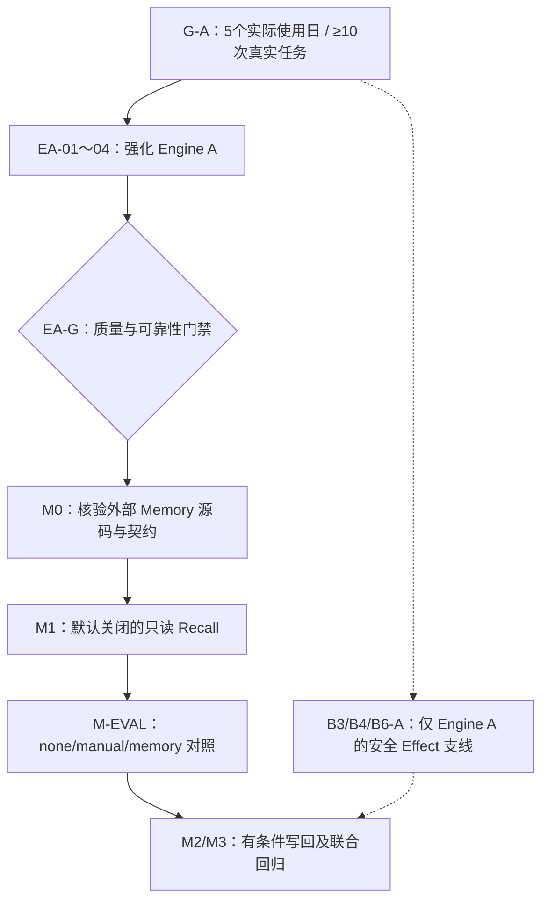
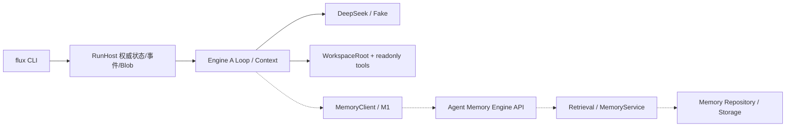

# Engine A 与 Agent Memory Engine 协同演进方案

> **2026-10-29 决议**：停止 Engine B/Codex Adapter/T-H-D/E-001。源码基线 `main@2aed418`；这是待实施计划。架构决策 [ADR-025](../adr/ADR-025-engine-a-first-memory-integration.md)，G-A 事实以 [验收报告](G-A验收报告.md) 为准。

## 1. 路线

G-A 前不引入 Memory，保留现有 P0a 无记忆基线。M1 不需要 B3；任何 Memory 持久写入必须另过授权、幂等、审计及对账。

## 2. 开发包与证据

| Issue/PR | 主要工作 | 必备验收 |
| --- | --- | --- |
| GA-00 | G-A 全部门禁与使用观察期 | 干净环境、真实 DeepSeek 质量、A5 负向安全、持久读取/中断恢复、5 天/10 次任务；CI success 不等于 G-A |
| EA-01 | `engine-custom` 的 Chat/SSE/Retry/Loop 协议稳健性 | malformed tool calls、usage/reasoning、流中断、length、取消/重试、错误分类 Fake/SSE 测试 |
| EA-02 | Context Builder、历史与工具返回裁剪、Prompt Layout 与预算 | 请求可重建、Token/上下文约束、未知用量真实标注、模型/工具预留不超支 |
| EA-03 | `WorkspaceRoot` 与只读 Tool 可用性/性能/安全 | ignore/symlink/TOCTOU/越界回归；大文件 `read_file` 分页性能基线，先测再优化（当前为 NUL 检查可能扫完整文件） |
| EA-04 | Trace/Artifact/Report 质量评测 | 固定仓库任务集的事实断言、路径证据、成本/耗时/调用数/人工返工与失败归因；区分一致性和答案正确性 |
| EA-G | Engine A 成熟度门禁 | 相同模型/仓库 commit/Prompt/预算下可复现基线，失败案例入样本，安全与可靠性不倒退 |
| M0 | 核对 Agent Memory Engine **当前**源码/API | 版本、FastAPI 路由、Schema、认证/scope、召回/删除、超时/错误/限流、Mock 契约测试；不改 Agent 主链 |
| M1 | 受限 `MemoryClient` 只读检索 + Context 组装 | 默认关闭；来源/版本/评分、token 预算、Scope、去敏、提示注入/跨项目拒绝、超时降级；关闭时旧任务行为稳定 |
| M-EVAL | none/manual/memory-recall 三组 | 同任务与预算对比事实正确率、证据质量、Token、延迟、调用次数、人工返工、负收益 |
| M2 | 记忆 Candidate 写回（条件工作） | 去敏、用户授权、幂等 ID、回执/Unknown、重复提交、删除撤销；未经测试默认不开 |
| M3 | 双项目联合质量/故障/隐私验证 | 断网、超时、旧记忆、跨项目泄漏、权限撤销、重试对账；Run 事实只在 Host |

## 3. 预期调用链（虚线为未来实现）

Memory 检索产生的是不可信 Context 数据，不授予工具/文件权限；查询不能默认传 secret、原始工作区全文和模型 reasoning。M0 锁定正式字段后再实现 `recall(query, principal_scope, project_scope, limits, timeout)` 等候选接口；**此处不是已存在的 Rust API**。Memory 错误对允许离线工作的任务 fail-open，对未授权或越权请求 fail-closed，并在评测中记录降级状态。

## 4. 两个项目共同演进的边界

历史 Memory 项目线索为 `agent-memory-engine-stage9`，FastAPI → MemoryService → Domain/Repository → Retrieval Pipeline → Adapter → LanceDB/Qwen，曾讨论 `POST /v1/memories/search`、`POST /v1/memories`、Embedding/Reranker 与 RRF；本次**未核验最新 Memory 源码**。M0 逐项检查并提供当前版本 HTTP fixtures，不能依据旧名称或猜测设计请求字段。

FluxAxiom 负责“执行任务及其事实证据”；Memory Engine 负责“跨任务记忆的安全存储/检索/候选”。两者之间只通过可版本化的 MemoryClient/API；不双写事实库，不将 Memory 当作 Runtime 状态恢复点，不因召回内容修改权限或让模型自行写记忆。记忆写回必须先有候选/用户确认/去重/幂等/回执与删除/撤销；失败未知时保持 Unknown 等待核对，不盲重试。

**B3/B4/B6-A** 的 Effect Gateway、一次性审批、OS 沙箱、外部写与崩溃恢复作为 Engine A 的独立安全支线保留；未经实机 OS 隔离证据不启用不可信工作区写操作。**B1/B5/B6-B/B2/E-001 均不实施**。不创建 `engine-codex` 或无使用点的 Memory Plugin Registry。

## 5. 每批记录什么

每 PR 留下 commit、测试命令、task/workspace commit/dirty、模型/Prompt 布局、预算、运行终态、事实断言、Token/耗时/成本、人工反馈、负向安全回归。Memory PR 另记 Memory 服务/Schema 版本、scope、召回开关、引用来源、裁剪/去敏、故障降级和授权写入情况。只有“接通 API”不能算完成；要证明质量与安全的净增益。
