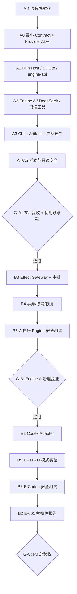
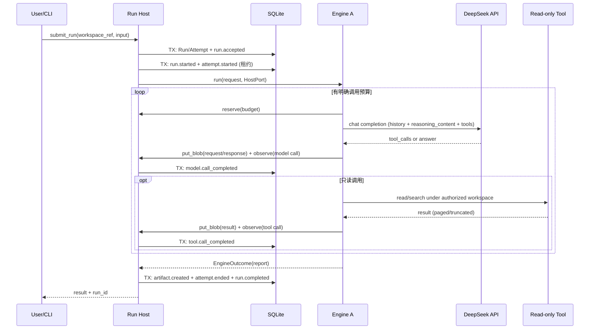

# FluxAxiom — P0 阶段执行方案 v1.1

> 规划日期：2026-10-20（v1.1 修订：2026-10-20）
> 依据：《个人 Agent 系统：总体架构与实施方案 V0.3》；《P0 阶段执行方案 v1.0》及其审查意见
> 命名：项目名定为 **FluxAxiom**；V0.3 中的工作代号 AgentOS 指同一项目，改名记录于 ADR-018
> 性质：执行计划，**不是对 V0.3 架构的重新冻结**
> 目标：先交付日常可用的仓库分析 Agent，再证明受控副作用与 Engine 替换能力
> 状态：**P0a 可启动；P0b 的沙箱、Codex 版本与治理等级待实测**

## 0. v1.1 修订记录

| 变更                                                                                                          | 位置                         |
| ------------------------------------------------------------------------------------------------------------- | ---------------------------- |
| 云模型 Provider 定为 **DeepSeek**（OpenAI 兼容 Chat Completions），具体型号为配置项                     | §1.1、§4.7、ADR-020        |
| 新增 `engine-api` crate，承载 `EngineAdapter` 与 `HostPort` 两个内部 trait，解决依赖方向                | §3、§4.6、ADR-019          |
|                                                                                                               |                              |
| P0a 事件词表新增 `model.call_completed` / `tool.call_completed`；模型请求以内容寻址 blob 存储，保证可重建 | §4.2、§6、A1.2 / A2.2 / A4 |
|                                                                                                               |                              |
| Attempt 状态机、Ctrl-C 与崩溃重启语义、执行租约；事件带 `schema_version`                                    | §4.2、§4.8、A3、ADR-021    |
| SQLite 多进程访问：`busy_timeout`、并发写测试、`events --follow` 轮询                                     | §4.5、§6、A1.1             |
| 只读工具分页与截断、输出 token 上限、预算耗尽的终态                                                           | §4.4、A2.2                  |
| §4.3 时序图修正：先提交 `run.started` / `attempt.started` 再启动 Engine                                  | §4.3                        |
| 使用观察期从“建议”改为 G-A 正式门槛                                                                         | §9                          |
| A0 先手写 serde 类型并以 JSON Schema 校验样例，暂不做代码生成                                                 | §4、A0                      |
| A-1 确定 `apps/cli` 包名 `fluxaxiom-cli`、二进制名 `flux`，Rust edition 为 2021                          | §3.1                        |
| A-1 的 CI 使用 `windows-latest`；Rust 版本只写在 `rust-toolchain.toml`，当前为 1.99.1                  | §3.1                        |
| A0 确定前缀 UUIDv7、`schema_version` 为 `0.3-draft`，手写类型并用 Draft 2020-12 校验样例                 | §4.2.1                      |

## 1. 成功定义与边界

P0 不以“模块数量”为成功标准，而以三个可观察结果为准：

1. **可用**：CLI 能分析真实仓库，输出带文件证据的报告，并保留可重新查询的 Run 与事件。
2. **可信**：Run Host 对自己管理的状态、命令、Effect 和事件不作虚假承诺；异常发生后可以明确区分已确认和未知结果。
3. **可替换**：在同一个业务流程下更换 Engine A / Codex B，业务逻辑不需要随 Engine 特化；无法提供相同治理保证时必须明确拒绝或降级呈现。

### 1.1 P0a（第一交付物）

只读 Coding/Repository Agent。允许的工具原则上只有 `list_files`、`read_file`、`search_code` 一类受控读取；**不开放任意 Shell**，不修改工作区。

- 模型：**DeepSeek 云端 API**，型号由配置决定（见 §4.7）。
- 技术栈：Rust + Tokio，SQLite，CLI，无 Web。

可接受的最低使用场景：

> 读取指定仓库的 runtime 相关模块，输出职责、调用链、状态变化、风险和改进建议；报告中引用对应文件路径，并能够查看 Run、Attempt、durable events 和 Artifact。

### 1.2 P0b（第二交付物）

先在 Engine A 上加入 `write_file` / `apply_patch`、`scope=once` 审批、受控沙箱、Effect 状态机、取消与故障恢复；完成后接入固定版本 Codex app-server，以 T→H→D 探针验证第三方 Engine 治理能力，并完成 E-001 对照报告。

### 1.3 明确不做

P0a 不做 Codex、Web、MCP、Cordis、长期 Memory、Multi-Agent、Evolution、SGLang/vLLM、本地 GPU、Broker/Redis、通用插件容器、任意工具执行、写副作用恢复，也不启用 DeepSeek 的服务端 Search/Fetch 工具。P0b 也不承诺第三方 Engine 全部工具可被 Host 逐次审批，不承诺任意 Shell exactly-once，不默认开启实验性 Codex 接口。

## 2. 关键路径与阶段门禁



**执行纪律**：G-A 通过前不开始 B 系列正式开发；G-B 通过前不让 Codex 的行为决定我们对 Host-owned Effect 的定义。研究可并行阅读，但不作为正式代码依赖。

## 3. P0a 仓库初始布局

```text
FluxAxiom/
├── apps/cli/                   # Rust 可执行程序、composition root
├── crates/
│   ├── agent-contract/         # 对外契约的 Rust 类型（手写 serde）与 Schema 校验
│   ├── engine-api/             # EngineAdapter / HostPort trait 与内部共享类型（不对外）
│   ├── run-host/               # SQLite / Session / Run / Attempt / Event / Blob 存储
│   └── engine-custom/          # Agent Loop / DeepSeek 客户端 / 只读工具
├── contracts/
│   ├── schemas/                # 对外契约唯一语义源
│   └── examples/               # 请求/事件/响应样例
├── evaluations/
│   └── datasets/               # 真实任务输入和人工评价（脱敏）
├── docs/
│   ├── architecture/           # 存放 V0.3
│   ├── adr/                    # 必要决策记录
│   └── development/            # 本计划与操作手册
├── .github/workflows/          # 最小 CI
├── Cargo.toml
└── README.md
```

**依赖方向（ADR-019）**：

```text
apps/cli ──> run-host ──> engine-api ──> agent-contract
    └─────> engine-custom ──> engine-api
```

- `run-host` 与 `engine-custom` 互不依赖，只通过 `engine-api` 中的 trait 交互；CLI 负责组装。
- `engine-api` 是内部 Rust 接口，不进入对外 JSON Schema；`agent-contract` 只放对外契约。
- DeepSeek 客户端暂放在 `engine-custom` 内；出现第二个 Provider 时再拆出 `inference` crate。
- `storage`、`tool-gateway`、`engine-codex`、`research/*` 按真实需求后续创建；`research/*` 的实验不得成为正式 crates 的依赖。

### 3.1 A-1 已确定的实现选择

§4.5 规定命令名为 `flux`，没有规定 Cargo 包名和 Rust edition。A-1 确定：

- `apps/cli` 的包名为 `fluxaxiom-cli`，二进制名仍为 `flux`。
- Rust edition 为 2021。后续 workspace 成员使用同一 edition。
- CI 运行环境为 `windows-latest`，在推送到 `main` 和 pull request 时执行 §7 的三条质量命令，不连接付费模型。
- Rust 版本的唯一来源是仓库根目录 `rust-toolchain.toml`，当前为 1.99.1。本地进入仓库与 CI 都使用该文件，工作流不再单独写版本号。

## 4. P0a：按 Issue / PR 执行的工作包

每项建议一个 Issue、一个可审查 PR；如工作包过大，可拆成多个小 PR，但不允许跨越验收定义。

| ID             | 产出                                                                                                                                                     | 前置依赖    | 关键验收证据                                                                                                                                                                                |
| -------------- | -------------------------------------------------------------------------------------------------------------------------------------------------------- | ----------- | ------------------------------------------------------------------------------------------------------------------------------------------------------------------------------------------- |
| **A-1**  | Cargo Workspace、README、CI、PR/Issue 模板、架构文档、ADR-018                                                                                            | 无          | `cargo fmt --check`、`cargo clippy --workspace --all-targets -- -D warnings`、`cargo test --workspace` 全部通过；没有空插件模块                                                       |
| **A0**   | `Session/Run/Attempt/Event` 最小 Schema（含 `schema_version`）、ID 与错误语义、P0a 事件词表、契约样例；手写 serde 类型；ADR-020（DeepSeek Provider） | A-1         | 序列化后的样例通过 JSON Schema 校验；明确哪些字段是草案，不承诺完整 Contract v1                                                                                                             |
| **A1.1** | SQLite 版本化迁移 / WAL / `busy_timeout`；Session、Run、Attempt 创建；`engine-api` crate 与两个 trait；Fake Engine                                   | A0          | 重新打开数据库可查询同一 Session/Run；重复请求有确定结果；两个进程并发写入不因 `SQLITE_BUSY` 失败；Fake Engine 经 `HostPort` 跑通一次 Run                                               |
| **A1.2** | Run 状态变更与 durable fact **同事务**、单 Run sequence、RunSnapshot；内容寻址 Blob 存储                                                           | A1.1        | 注入事务失败后状态/事件一起回滚；同一 Run 序号连续、单调；可读 `after_sequence`；blob 按 hash 去重并可读回                                                                                |
| **A2.1** | DeepSeek 客户端：Chat Completions、流式 SSE、工具调用、`reasoning_content` 回传、usage（含缓存命中字段）、凭据隔离                                     | A0          | Fake Provider 覆盖消息、错误、超时、400（缺少 reasoning 回传）、429/5xx 退避；真实 DeepSeek 端到端成功；密钥不写入日志                                                                      |
| **A2.2** | 最小 Engine Loop、三个只读工具、预算止损、工具输出分页与截断                                                                                             | A1.2 + A2.1 | 在固定仓库完成分析；工具只能读取授权根；超大文件/目录被分页并标注 `truncated`；模型/工具调用次数与输出 token 上限生效；预算耗尽时 Run 为 `Failed(budget_exhausted)` 并保留部分 Artifact |
| **A3**   | CLI `run / status / events / artifacts`；Artifact 写入 Host 数据目录；中断与重启语义                                                                   | A2.2        | 新进程仍能读取上一个 Run 的持久记录及报告；Ctrl-C 后 Run 为 `Cancelled`；`kill -9` 后重启，租约过期的 Attempt 为 `Orphaned`、Run 为 `Failed(host_restart)`；工作区文件未被修改      |
| **A4**   | 样本元数据与模型请求可重建：仓库 commit、Prompt 布局版本、模型别名与调用日期、Usage、耗时、人工反馈                                                      | A3          | 每个样本能从 `request_ref` 重建该 Run 的全部模型请求；记录缓存命中字段（缺失为 `unknown`）；无敏感明文                                                                                  |
| **A5**   | 最低只读安全与负向测试                                                                                                                                   | A2.2        | 路径越界、符号链接逃逸、写工具请求、不允许的文件/凭据访问被拒绝；模型输出无法改变工具权限                                                                                                   |

### 4.1 第一周 / 第一批 PR 的执行建议

先做 **A-1 → A0 → A1.1**，然后用 Fake Engine 经 `HostPort` 跑通状态与事件的贯通测试。不要第一天就接云模型或写 Tool Gateway。这样能尽早确认 Contract、存储和 Engine–Host 边界。

A0 的目标是几天内完成：手写 serde 类型，再用 JSON Schema 校验序列化样例，字段稳定后再考虑代码生成。

### 4.2 P0a 最小 Contract（仅冻结用到的部分）

- **Session**：由 Host 创建、持久化、拥有主键。
- **Run**：`run_id`、可选 `session_id`、`status`、`terminal_reason`、`input_ref`、`workspace_ref`、`budget`、时间戳。
  - P0a 状态：`Accepted → Running → Completed / Failed`，以及 `Running → Cancelling → Cancelled`。
  - `terminal_reason` 候选：`completed`、`cancelled`、`budget_exhausted`、`host_restart`、`engine_error`、`provider_error`。预算耗尽不新增 Partial 状态，以 `Failed(budget_exhausted)` 加部分 Artifact 表达。
- **Attempt**：`attempt_id`、`run_id`、`engine_id/version`、`owner`（进程标识）、`lease_expires_at`、错误原因。
  - 状态：`Starting → Running → Ended(outcome)`，或 `Orphaned`（执行进程失联且租约过期）。
- **Event**：`event_id`、`schema_version`、`run_id`、单 Run `sequence`、事件类型、关联对象、时间戳、非敏感 payload。
- **Artifact**：`artifact_id`、`run_id`、类型、存储引用、内容摘要；写到用户仓库之外的 Host 数据目录。
- **RunSnapshot**：从权威表查询组装，而非另建一套权威存储。

**P0a durable event 词表**：

| 对象     | 事件                                                                                                                                                                                                                             |
| -------- | -------------------------------------------------------------------------------------------------------------------------------------------------------------------------------------------------------------------------------- |
| Run      | `run.accepted`、`run.started`、`run.cancelling`、`run.cancelled`、`run.completed`、`run.failed`                                                                                                                      |
| Attempt  | `attempt.started`、`attempt.ended`、`attempt.orphaned`                                                                                                                                                                     |
| 模型调用 | `model.call_completed`：模型别名、usage（`prompt_tokens`、`completion_tokens`、`prompt_cache_hit_tokens`、`prompt_cache_miss_tokens`，缺失为 `unknown`）、`finish_reason`、延迟、`request_ref`、`response_ref` |
| 工具调用 | `tool.call_completed`：工具名、规范化路径或查询、`result_ref`、字节数、`truncated`、耗时                                                                                                                                   |
| Artifact | `artifact.created`                                                                                                                                                                                                             |

事件规则：

- 每个对象只发自己的状态事件；一个事务可以包含多个对象的事件。
- payload 只放引用与摘要，不放文件全文、prompt 原文或 `reasoning_content`。
- 只读工具调用与模型调用不是 Effect，不使用 `effect.*` 事件。

保留但不实现完全语义：Approval、Effect、CommandReceipt、复杂的取消保证、跨 Engine context portability。这些留待 P0b 进行行为测试后再进一步冻结。

### 4.2.1 A0 已确定的契约实现

- 包名 `fluxaxiom-contract`，目录 `crates/agent-contract`。JSON Schema 放在 `contracts/schemas/`，样例放在 `contracts/examples/`。
- ID 为带前缀的 UUIDv7：`sess_`、`run_`、`attempt_`、`evt_`、`artifact_`。
- `schema_version` 固定为 `0.3-draft`。这是草案，不是 Contract v1。
- JSON Schema 使用 Draft 2020-12。Rust 类型手写，测试用 `jsonschema` crate 校验样例，不做代码生成。
- Run 转移：`Accepted → Running`、`Accepted → Failed`、`Accepted → Cancelling`、`Running → Completed`、`Running → Failed`、`Running → Cancelling`、`Cancelling → Cancelled`、`Cancelling → Failed`。`Failed` 覆盖启动失败和 §4.8 的 `host_restart`。
- Attempt 转移：`Starting → Running`、`Starting → Orphaned`、`Running → Ended`、`Running → Orphaned`。

### 4.3 一个最小端到端调用链



**流程中唯一具有权威写入权的是 Run Host**。Engine 只通过 `HostPort` 提交观测、blob 和预算请求，不发 `run.*` / `attempt.*` 事件；Run 终态由 Host 根据 `EngineOutcome` 决定。中断与重启见 §4.8。

### 4.4 只读边界

- 不支持任意 shell、文件写操作、Git mutation 或网络工具；不启用 DeepSeek 服务端 Search/Fetch。
- 只读工具必须检查 Host 已授权工作区；规范化路径，安全处理符号链接与跨根访问。
- **工具输出上限**：
  - `list_files` 分页，单页条目有上限；
  - `read_file` 按行范围读取，单次字节有上限；
  - `search_code` 结果条数有上限；
  - 遵守 `.gitignore`，跳过二进制文件；用 Rust 的 `ignore` 与 `grep` 系列 crate 实现，不调用 shell；
  - 截断时在结果中显式标注 `truncated` 与续读方式，让模型可以继续翻页。
- 明确哪些仓库内容将发送到 DeepSeek 云端；默认不发送未授权的其他目录和 Secret；日志采用脱敏或引用。
- Prompt 内的 `AGENTS.md` / README 等视作任务输入和可能的注入来源，不是获取 Host 权限的途径。
- 工作区“只读”指 **FluxAxiom 提供的工具路径不允许写**；若需要抵御宿主代码执行，必须经过后续 OS 沙箱验证，不能靠 CLI 宣称已具备强 OS 隔离。

### 4.5 最小 CLI 验收示例（拟定接口，非已实现命令）

```bash
flux run --workspace /path/to/repo --prompt "分析 runtime 模块职责和关键调用链"
flux status <RUN_ID>
flux events <RUN_ID> --after-sequence 0
flux events <RUN_ID> --follow
flux artifacts <RUN_ID>
```

- CLI 可以同步等待最终结果，也可以打印进度；durable 事件先写库再显示。Token delta 可作为临时输出，不必每个 Token 入库。
- `status` / `events` 通常在另一个进程中读取正在运行的 Run。跨进程拿不到进程内推送，`--follow` 按 `after_sequence` **轮询** SQLite。
- 多个 `flux run` 可同时运行；SQLite 使用 WAL 与 `busy_timeout`，写事务保持短小。

### 4.6 Engine–Host 端口（`engine-api`，ADR-019 / ADR-021）

```rust
// 语义示意，签名在实现时确定
pub trait EngineAdapter: Send + Sync {
    fn descriptor(&self) -> EngineDescriptor; // engine_id / version / capabilities
    async fn run(&self, req: EngineRunRequest, host: Arc<dyn HostPort>) -> EngineOutcome;
}

pub trait HostPort: Send + Sync {
    /// 模型/工具调用观测；返回前 Host 已校验并提交为 durable fact
    fn observe(&self, o: EngineObservation) -> Result<()>;
    /// 内容寻址存储（请求、响应、工具结果、reasoning_content）
    fn put_blob(&self, bytes: Bytes, media_type: &str) -> Result<BlobRef>;
    /// pre_call 预算预留；耗尽时返回错误，Engine 应收尾并返回部分结果
    fn reserve(&self, b: BudgetRequest) -> Result<BudgetLease, BudgetExhausted>;
    fn cancellation(&self) -> CancellationToken;
    // P0b 实现；P0a 只定义签名，返回 Unsupported
    async fn propose_effect(&self, e: ProposedEffect) -> EffectOutcome;
    async fn request_input(&self, r: InputRequest) -> InputOutcome;
}

pub enum EngineOutcome {
    Completed { report: ArtifactDraft },
    Failed { reason: FailureReason, partial: Option<ArtifactDraft> },
    Cancelled { partial: Option<ArtifactDraft> },
}
```

规则：

- `observe` 同步提交。模型调用本身耗时远大于一次 SQLite 写入，同步提交可以保证“观测返回即已持久”，实现最简单。
- Engine 不直接写数据库、不发 `run.*` / `attempt.*` 事件。
- `propose_effect` 与 `request_input` 的签名现在就固定，避免 P0b 修改 Engine A 与 Host 之间最核心的接口。

### 4.7 DeepSeek Provider（ADR-020）

**决定**：P0 唯一云 Provider 为 DeepSeek，使用 OpenAI 兼容的 Chat Completions 协议（`base_url = https://api.deepseek.com`）。Anthropic 兼容端点与 Responses API 不在 P0 实现。

**型号**：配置项 `model`，可随时切换。

- 截至 2026-10-20，官方文档列出 `deepseek-flash`（当前由 DeepSeek-V4.1-Flash-1017 提供）与 `deepseek-v4-pro`（DeepSeek-V4-Pro-0813）。两者均为 1M 上下文、支持工具调用与 JSON 输出，思考模式默认开启。
- 建议日常分析默认 `deepseek-flash`，需要对照时切换 `deepseek-v4-pro`。以上为文档快照，使用时以官方当前列表为准。

**别名漂移**：官方会把模型别名改指新版本（例如旧名 `deepseek-v4-flash` 已被路由到 V4.1 Flash）。因此：

- 每个样本记录请求的模型别名、调用时间戳，以及当时文档所列的模型版本；
- 评测比较时把模型版本作为一个维度，不跨版本混算。

**思考模式与工具调用（实现硬约束）**：

- 请求携带 `tools` 时，历史所有 assistant 消息的 `reasoning_content` 都必须完整回传，即使该轮没有调用工具；否则 API 返回 400。Engine A 每次请求都带工具，因此这条规则始终生效。
- assistant 消息结构始终保留 `reasoning_content` 字段；内容为空时也写入空字符串。社区已报告过因省略空字段触发 400 的问题，需有专门测试覆盖。
- 流式响应中 `reasoning_content`、`content`、`tool_calls` 分别以 delta 返回，需各自拼接。
- `reasoning_content` 属于 opaque provider state：
  - 存入 Host 的 blob 存储（重建上下文和回放都需要它）；
  - 不写入 durable event payload 与普通日志；
  - 保留期限与样本保留策略一致。

**参数**：

- 思考强度用 `reasoning_effort`（`low` / `high` / `max`，默认 `high`），取值记录到样本。
- 思考模式下 `temperature` 与 penalty 类参数不生效（不报错），`top_p` 行为因型号而异。P0a 不把这些参数当作实验变量。

**缓存**：

- 上下文硬盘缓存默认开启，按“缓存前缀单元”完整匹配才能命中；属于尽力而为，闲置后几小时到几天被清除。
- usage 中的 `prompt_cache_hit_tokens` / `prompt_cache_miss_tokens` 原样记录，缺失记为 `unknown`。
- Prompt 布局：system 与工具 schema 固定在前并版本化（`prompt_layout_version`），历史只追加不改写，以提高命中率。

**成本**：价格分峰谷时段，并可能调整。样本记录原始 usage 与调用时间戳，成本用版本化的价格表离线计算，不在运行时写死单价。

**Rust 客户端**：

- 自写薄客户端：reqwest + SSE 解析 + 自定义 serde 类型，类型中显式包含 `reasoning_content`、`prompt_cache_*` 等扩展字段。
- 通用 OpenAI 兼容 crate 未必保留这些字段，选用前需验证。
- 错误处理：429 / 5xx 退避重试；400 不重试，直接报告；流中断视为该次调用失败。

**数据出境**：仓库内容会发送到 DeepSeek 云端。只发送授权工作区的内容；敏感仓库在确认服务条款前不用于 P0a 样本。

**Fake Provider 必须覆盖**：缺少 reasoning 回传的 400、空 reasoning 字段、429 / 5xx、流中途断开、`tool_calls` 参数为非法 JSON、`finish_reason = length`。

### 4.8 中断与重启语义（ADR-021）

P0a 中 Host、Engine 与 CLI 在同一进程内。

- **Ctrl-C（SIGINT）**：

  1. 用 `tokio::signal` 捕获，Host 提交 `run.cancelling`；
  2. 触发取消令牌，Engine 在下一个 await 点停止，进行中的 HTTP 请求被丢弃；
  3. Host 提交 `attempt.ended(cancelled)` 与 `run.cancelled`。

  进程内 Engine 是否停止可以直接观察到，因此 P0a 可以确认地进入 `Cancelled`。第二次 Ctrl-C 强制退出，按崩溃处理。
- **崩溃或 `kill -9`**：

  - Attempt 带执行租约（`owner` + `lease_expires_at`），运行中定期续期；
  - 任何 `flux` 命令启动时扫描 `Running` / `Cancelling` 的 Run，**只处理租约已过期的 Attempt**：Attempt 标为 `Orphaned`（`attempt.orphaned`），Run 标为 `Failed(host_restart)`；
  - 租约用于防止另一个进程中的 `flux status` 误把仍在运行的 Run 判为孤儿；
  - P0a 没有副作用，不进入 `NeedsReconciliation`。
- **已知限制**：不支持 CLI 退出后在后台继续执行；用户需重新提交 Run。

## 5. P0b：可靠性先行，第三方接入随后

| ID             | 产出                                                                                                                                      | 主要验证                                                                                                                      |
| -------------- | ----------------------------------------------------------------------------------------------------------------------------------------- | ----------------------------------------------------------------------------------------------------------------------------- |
| **B3**   | Host Effect Gateway / 最小确定性 Policy / `write_file` 与 `apply_patch` / `Approval(scope=once)`；实现 `HostPort::propose_effect` | 意图先于执行落库；参数摘要绑定；拒绝、过期、取消不落地；敏感操作仅在可丢弃工作区执行                                          |
| **B4.1** | Effect 状态与事件词表 / 事务一致性                                                                                                        | `IntentRecorded / AwaitingApproval / Ready / Dispatching / Unknown / ...` 的合法转移和 durable event 一一对应；投影对照测试 |
| **B4.2** | 崩溃点与取消 / 对账                                                                                                                       | Dispatch 后失联进入 Unknown；不盲重试；新操作引用 `supersedes_effect_id`；取消结果分等级陈述                                |
| **B6-A** | Engine A 安全回归                                                                                                                         | 越权路径、symlink/TOCTOU、伪造 approval、并行审批、凭据、网络、进程残留                                                       |
| **B1**   | 固定版本 Codex app-server Adapter                                                                                                         | 独立 `CODEX_HOME`、沙箱配置、RPC 白名单、Thread/Turn 映射、Schema 版本锁定                                                  |
| **B5-T** | T 信任分区实验                                                                                                                            | 可丢弃工作区 + OS/原生沙箱；真实记录 native operations 与受限执行能力                                                         |
| **B5-H** | H Host 裁决实验                                                                                                                           | 接收审批、禁止扩大授权、统计自动放行覆盖缺口、准确声明 `binding` 等级                                                       |
| **B5-D** | D 委托执行探针                                                                                                                            | 测试 Dynamic Tools 或 Host MCP 路径，并实证是否能关闭原生敏感旁路；无法证明则判未通过                                         |
| **B6-B** | Codex 安全回归                                                                                                                            | 禁特权 RPC、沙箱/凭据隔离、取消后后台进程核查、无误报保证等级                                                                 |
| **B2**   | E-001 报告                                                                                                                                | 固定任务集 A/B、业务修改量、UI 特化、映射和模拟语义、成本质量与风险                                                           |

P0b 引入写操作后，§4.8 的崩溃路径需扩展：存在未决 Effect 的 Run 进入 `NeedsReconciliation`，不再直接判为 `Failed(host_restart)`。

### 5.1 B3/B4 的严格阶段门禁

在 Engine A 上达到以下条件，才进入 B1：

1. 每个 Host-owned Effect 的外部副作用执行前均有持久化意图和执行记录。
2. `scope=once` Approval 被完整绑定到操作参数、工作区和权限范围。
3. 已记录派发但结果不明时进入 `Unknown`，不会默认重复执行。
4. 取消指令的受理与真实执行停止分开报告，停止不可确认时使用 `unknown`。
5. 状态表变化与 durable event 在同一事务提交，并有事件投影一致性与故障注入测试。

### 5.2 P0b 沙箱决策属于真正的前置工作

P0a 可以跨系统推进；**P0b 的强保证需要先确定实际开发宿主 OS**。在进入 B3 前完成 OS 专项 ADR：沙箱类型、文件写范围、网络出口、环境变量/凭据隔离、测试子进程权限、进程组终止与可观测证据。若 OS 环境暂不支持安全验证，不得对不可信真实仓库启用写操作或宣布 sandbox verified。

### 5.3 E-001 不以“API 能调用”为通过标准

- 同一业务任务、相同 commit / 可比较预算、相同业务 UI。
- A 与 B 的事件/命令/上下文/取消/审批逐项映射，按 `native / adapter_derived / simulated / unsupported / unknown` 分类。
- 统计业务代码修改文件数和 UI Engine 专用分支数，目标均为 **0**。
- 输出每种模式的授权覆盖率、沙箱与恢复保证等级、未知项及可重复证据。
- **允许部分通过**：例如 B 只有 T 可用，则明确写“业务可替换但治理不等价”。

## 6. 数据与事件的最小落地规则

依据 V0.3：`runs / attempts / effects / approvals / commands / events` 在 P0b 中是事务性权威表；**P0a 只实现当前需要的权威表，不提前建满空逻辑**。`Session` 同样属于 Host，需有对应持久化。Artifact 使用索引表加受控文件目录。

- **迁移**：SQLite 从第一天起使用版本化迁移；历史事件不原地改写，读取时按 `schema_version` 向前兼容。P0a 的样本会长期使用，不能因格式变化丢失。
- **并发**：WAL 模式、`busy_timeout`、短写事务；允许多个进程同时读、多个 `flux run` 同时写。
- **序号**：单 Run `sequence` 在同一数据库事务中分配，不要求跨 Run 的全局总序。
- **提交顺序**：`run.started` 一类事实与状态更新同事务提交；COMMIT 后才能向订阅者发布。
- **补读**：durable facts 可以按 `after_sequence` 补读；token delta 仅临时输出，断线后获取完成文本/快照，不保证逐 token 回放。
- **Blob 存储**：Host 数据目录下按 sha256 内容寻址，存放模型请求/响应、`reasoning_content`、工具结果与 Artifact 正文；事件只保存 `*_ref`。Blob 与样本采用同一保留与删除策略。
- **可重建性**：每次模型调用的完整请求（prompt 各段、工具 schema 版本、模型参数、历史消息含 `reasoning_content`）都必须能从 blob 重建。这是 A4 样本可回放、后续 Evolution 评测成立的前提。
- **外部操作**：SQLite 事务不涵盖 Shell/文件写等外部操作，因此 P0b 必须保留 Unknown/核对。
- **幂等**：命令使用 `command_id` 幂等；P0a 优先验证创建 Run 的请求幂等或重复 ID 防护，P0b 才完整实现命令受理机制。

## 7. 验收测试矩阵

| 测试层        | P0a 必须具备                                                                                                                           | P0b 增补                                               |
| ------------- | -------------------------------------------------------------------------------------------------------------------------------------- | ------------------------------------------------------ |
| 单元测试      | Run/Attempt 合法状态转移、ID、错误、预算计数、路径边界、工具分页截断                                                                   | Effect 状态机、Policy、审批绑定、模式 Capability       |
| 数据库测试    | 同事务状态+事件、sequence、重新打开数据库、重复创建、多进程并发写、租约过期判定、迁移升级、blob 去重读回                               | write-ahead intent、审批过期、并行审批、结果状态一致性 |
| Provider 测试 | Fake DeepSeek：reasoning 回传（含空值）、400 / 429 / 5xx、流中断、非法 tool 参数、`finish_reason=length`；usage 字段解析             | —                                                     |
| 集成测试      | fake LLM + fake file tools + CLI，失败/超时；Ctrl-C → Cancelled；`kill -9` → Orphaned + Failed(host_restart)；从 blob 重建模型请求 | fake executor 故障注入 + Codex 锁定版本互操作          |
| 安全负向测试  | 越界读、符号链接、禁止写、日志脱敏、`reasoning_content` 不进入事件与日志                                                             | 路径 TOCTOU、沙箱逃逸边界、特权 RPC 白名单、凭据泄露   |
| 手动真实验证  | 使用观察期内的真实仓库分析样本及人工质量记录                                                                                           | 独立 worktree 写入、取消、崩溃核对、A/B 对照报告       |

质量命令（依赖存在时）：

```bash
cargo fmt --all -- --check
cargo clippy --workspace --all-targets -- -D warnings
cargo test --workspace
```

CI 不应要求连接真实付费模型：默认单测使用 Fake Provider；真实 DeepSeek 端到端调用归独立的手工或受控 CI 环境。

## 8. 工作量管理与开发节奏

以**验收门禁**而不是日历日期作为阶段切换条件。仅作初步容量参考：P0a 大约 **2–4 周**、P0b 很可能需要更长，实际受 Rust 熟悉程度、DeepSeek 工具调用兼容性、OS 沙箱与 Codex 版本影响；这不是进度承诺。

建议滚动管理：

- 同时保持 **1 个主实现 Issue + 1 个并行研究/验收任务**，避免多路线同时编码。
- 每个 PR 最好围绕一个可运行闭环，不为了目录规划创建空抽象。
- 一次只冻结会被下一个工作包直接依赖的接口，重要边界变化另写 ADR。
- 每周短评审：本周是否能真实使用、失败最多在哪里、下一步是否必须做、有哪些假设被否证。

### 8.1 建议的首批 GitHub Issue（可直接复制标题）

| 顺序 | Issue 标题                                                                            | 标签                               |
| ---- | ------------------------------------------------------------------------------------- | ---------------------------------- |
| 1    | `P0a/A-1 Bootstrap Cargo Workspace and CI`                                          | `phase:p0a`, `area:host`       |
| 2    | `P0a/A0 Define minimal Session-Run-Attempt-Event contract and P0a event vocabulary` | `phase:p0a`, `area:host`       |
| 3    | `P0a/A0 ADR-020 DeepSeek as P0 inference provider`                                  | `phase:p0a`, `area:engine`     |
| 4    | `P0a/A1 Add engine-api crate with EngineAdapter and HostPort`                       | `phase:p0a`, `area:host`       |
| 5    | `P0a/A1 Persist Run transitions, durable facts and blobs atomically`                | `phase:p0a`, `area:host`       |
| 6    | `P0a/A2 Implement DeepSeek client with reasoning_content passback`                  | `phase:p0a`, `area:engine`     |
| 7    | `P0a/A2 Implement read-only Engine A with paged tools and budgets`                  | `phase:p0a`, `area:engine`     |
| 8    | `P0a/A3 CLI repository analysis end-to-end with cancel and restart semantics`       | `phase:p0a`, `area:experience` |
| 9    | `P0a/A4 Record replayable evaluation samples and usage`                             | `phase:p0a`, `area:evaluation` |
| 10   | `P0a/A5 Prove read-only workspace boundaries`                                       | `phase:p0a`, `area:host`       |

### 8.2 ADR 清单

| ADR     | 内容                                                                         | 时机           |
| ------- | ---------------------------------------------------------------------------- | -------------- |
| ADR-014 | 事务状态 + 事实事件                                                          | P0a 落地       |
| ADR-018 | Monorepo 结构；项目名 FluxAxiom（原代号 AgentOS）                            | A-1            |
| ADR-019 | 依赖方向；新增 `engine-api`                                                | A1.1           |
| ADR-020 | DeepSeek 作为 P0 推理 Provider；型号配置化；reasoning 回传与 opaque 状态存储 | A0             |
| ADR-021 | Engine–Host 端口、Attempt 生命周期与租约、中断与重启语义                    | A1.1 / A3      |
| ADR-015 | 沙箱 / 凭据 / 网络隔离的实机选择                                             | P0b 前必须落地 |
| ADR-006 | D/H/T 保证划分的实机选择                                                     | P0b 前必须落地 |

未触发新的跨模块决策时不增加 ADR 数量。

## 9. P0a 验收卡（真正的 Done Definition）

- [ ] 从干净环境构建 CLI，`fmt/clippy/test` 通过。
- [ ] 在用户明确授权的工作区完成真实仓库分析，给出带证据的报告。
- [ ] 用户关闭 CLI、重新启动后，可以查询 Run 状态、已提交事件和 Artifact。
- [ ] Ctrl-C 得到 `Cancelled`；进程被强杀后重启，Run 显示为 `Failed(host_restart)`，不误判仍在运行的 Run。
- [ ] Session、Run、Attempt、Event 的权威写入只经过 Host；状态与 durable event 同事务；Engine 只经 `HostPort` 交互。
- [ ] 只读权限、路径与敏感信息边界具有自动化负向测试。
- [ ] 能记录模型别名与调用时间、Prompt 布局版本、Token 与缓存命中（缺失时 `unknown`）、延迟与人工评价；样本中的模型请求可从 blob 重建。
- [ ] **使用观察期**：通过以上各项后，安排 5 个实际使用日，累计至少 10 次有记录的仓库分析任务。若使用价值低或多数结果需要完全重做，先修复 Agent 质量和工具能力，不进入 P0b。

## 10. P0b 与 P0 总验收卡

- [ ] Host Effect Gateway 实现审批 `once`、digest 绑定与写前意图，单独通过故障注入。
- [ ] `Dispatching → Unknown` 与 `Unknown → reconciled` 有可重复证据；不自动重复执行未知副作用。
- [ ] 取消报告至少区分 `no_more_steps / interrupt_requested / executor_stopped / effects_reconciled`，不可观察处为 `unknown`。
- [ ] Codex Adapter 使用独立 `CODEX_HOME`、锁定 Schema、方法白名单和可丢弃工作区。
- [ ] T/H/D 的每一项实际保证由实测验证；D 若存在敏感工具旁路则明确失败。
- [ ] E-001 报告保留 A/B 映射覆盖、模拟语义、业务代码特化数量、安全、成本和效果。
- [ ] 未经验证的 Capability 不作为强执行保证；正式 Run 需求高于实际能力时拒绝启动。

## 11. 阶段风险与退出策略

| 风险                              | 处理                                                                            |
| --------------------------------- | ------------------------------------------------------------------------------- |
| 过早设计 Provider/插件通用体系    | 只做当前单实现需要的 trait；第二实现出现才抽象                                  |
| 只读 Agent 缺乏实际价值           | 使用观察期内真实使用，先修复工具与 Prompt，再扩安全写操作                       |
| Event Log 变成全量 Event Sourcing | 保持状态表为权威，事件只承担 durable 审计与关键投影验证                         |
| Host 变成巨大业务组件             | Host 只持有生命周期/治理/事实，不实现规划和 Prompt                              |
| DeepSeek 别名改指或 API 行为变化  | 样本记录别名与调用时间；Fake Provider 覆盖已知 400 场景；行为变化时更新 ADR-020 |
| 早期样本因格式变化不可用          | 版本化迁移 + `schema_version` + blob 可重建，历史事件不原地改写               |
| Codex 兼容复杂或安全保证不足      | 允许 T/H 先落地、D 失败；E-001 如实报告部分通过                                 |
| 宿主 OS 无法达到声明的沙箱保证    | 暂停对应高权限写功能，采用更强隔离环境或收缩能力                                |
| AI Coding 使源码认知失控          | 每个关键 PR 保留状态变化、调用链、测试证据和人工确认                            |

## 12. 立即执行的下一步

**启动 A-1**：创建本地 Monorepo（GitHub 远端路径需你最终确认），加入 V0.3 架构基线与本执行计划，完成 Cargo Workspace + CLI 空命令 + CI 测试。不要在这个 PR 中接模型、写 SQLite 或建未来所有模块。

A-1 合并之后进入 A0（含 ADR-020）。A0 通过后，建 `engine-api`，用 Fake Engine 经 `HostPort` 驱动 A1 的事务存储与事件恢复测试；确认这套底座真实可用，再接入 A2 的 DeepSeek 客户端与只读工具。

---

**需要在进入 B3 前确认的唯一外部环境信息**：实际开发与执行不可信仓库的宿主系统（Windows、WSL2、Linux 或 macOS），因为这会改变 OS 沙箱、网络隔离与进程组清理方案。P0a 的最小开发可以先行，不必等待。

## 附录：DeepSeek 参考资料（2026-10-20 核对）

- 快速开始与 base_url：[https://api-docs.deepseek.com/](https://api-docs.deepseek.com/)
- 模型与价格：[https://api-docs.deepseek.com/quick_start/pricing](https://api-docs.deepseek.com/quick_start/pricing)
- 思考模式与工具调用（reasoning_content 回传规则）：[https://api-docs.deepseek.com/zh-cn/guides/thinking_mode](https://api-docs.deepseek.com/zh-cn/guides/thinking_mode)
- 上下文硬盘缓存与 usage 字段：[https://api-docs.deepseek.com/zh-cn/guides/kv_cache](https://api-docs.deepseek.com/zh-cn/guides/kv_cache)
- 社区报告的空 reasoning 字段 400 问题：[https://github.com/deepseek-ai/deepseek-harness/discussions/1850](https://github.com/deepseek-ai/deepseek-harness/discussions/1850)
