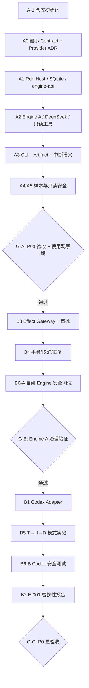
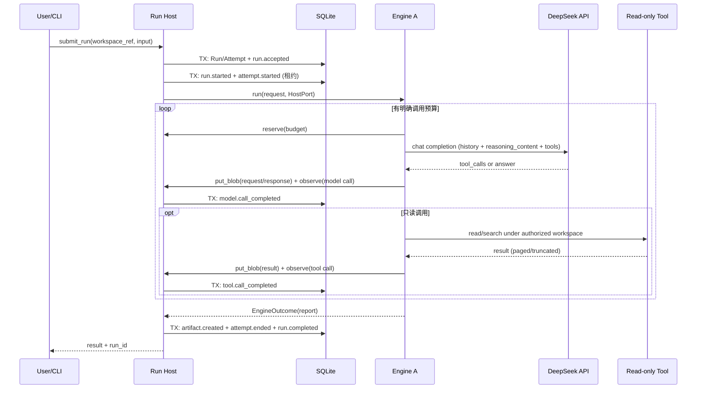

# FluxAxiom — P0 阶段执行方案 v1.1

> 规划日期：2026-10-20（v1.1 修订：2026-10-20）
> 依据：《个人 Agent 系统：总体架构与实施方案 V0.3》；《P0 阶段执行方案 v1.0》及其审查意见
> 命名：项目名定为 **FluxAxiom**；V0.3 中的工作代号 AgentOS 指同一项目，改名记录于 ADR-018
> 性质：执行计划，**不是对 V0.3 架构的重新冻结**
> 目标：先交付日常可用的仓库分析 Agent，再证明受控副作用与 Engine 替换能力
> 状态：**P0a 可启动；P0b 的沙箱、Codex 版本与治理等级待实测**

## 0. v1.1 修订记录

| 变更                                                                                                          | 位置                         |
| ------------------------------------------------------------------------------------------------------------- | ---------------------------- |
| 云模型 Provider 定为 **DeepSeek**（OpenAI 兼容 Chat Completions），具体型号为配置项                     | §1.1、§4.7、ADR-020        |
| 新增 `engine-api` crate，承载 `EngineAdapter` 与 `HostPort` 两个内部 trait，解决依赖方向                | §3、§4.6、ADR-019          |
|                                                                                                               |                              |
| P0a 事件词表新增 `model.call_completed` / `tool.call_completed`；模型请求以内容寻址 blob 存储，保证可重建 | §4.2、§6、A1.2 / A2.2 / A4 |
|                                                                                                               |                              |
| Attempt 状态机、Ctrl-C 与崩溃重启语义、执行租约；事件带 `schema_version`                                    | §4.2、§4.8、A3、ADR-021    |
| SQLite 多进程访问：`busy_timeout`、并发写测试、`events --follow` 轮询                                     | §4.5、§6、A1.1             |
| 只读工具分页与截断、输出 token 上限、预算耗尽的终态                                                           | §4.4、A2.2                  |
| §4.3 时序图修正：先提交 `run.started` / `attempt.started` 再启动 Engine                                  | §4.3                        |
| 使用观察期从“建议”改为 G-A 正式门槛                                                                         | §9                          |
| A0 先手写 serde 类型并以 JSON Schema 校验样例，暂不做代码生成                                                 | §4、A0                      |
| A-1 确定 `apps/cli` 包名 `fluxaxiom-cli`、二进制名 `flux`，Rust edition 为 2021                          | §3.1                        |
| A-1 的 CI 使用 `windows-latest`；Rust 版本只写在 `rust-toolchain.toml`，当前为 1.99.1                  | §3.1                        |
| A0 确定前缀 UUIDv7、`schema_version` 为 `0.3-draft`，手写类型并用 Draft 2020-12 校验样例                 | §4.2.1                      |
| A1.1 的 `engine-api` 使用 `async_trait` 与 `tokio_util::CancellationToken`                            | §4.6.1                      |
| A1.1 的 `run-host` 使用 bundled `rusqlite`、WAL、`busy_timeout` 5 秒；以 `request_id` 做创建幂等     | §4.6.2                      |
| A1.2 落地 ADR-014：状态与 durable event 同事务；blob 在 SQLite 事务外；`HostPortError` 区分存储失败 | ADR-014、§6、A1.2           |
| A1.2 的 `EngineObservation` 复用契约 `ModelUsage`；空字段为 `Invalid`，计数 0 合法                     | §4.6.3                      |
| A1.2 的 `run-host` 打开数据目录；event 事务用 `BEGIN IMMEDIATE`；`media_type` 不入库                   | §4.6.4                      |
| A2.1 第一刀只做 DeepSeek 请求类型与 Fake；400 不重试，429/5xx 最多重试 3 次                             | §4.7.1                      |
| A2.1 的 HTTP 客户端读 `DEEPSEEK_API_KEY`；超时与未完成的流不重试；工具分片暂不解析                     | §4.7.2                      |
| A2.1 客户端暂不依赖 `engine-api`；未知 `finish_reason` 保留原文；`Transport` 在 P0 不重试              | §4.7.1、§4.7.2              |
| A2.2 第一刀：`ChatTransport` 改为异步；按块读 SSE；取消令牌与退避等待可中断                         | §4.7.2                      |
| A2.2 只读工具：`WorkspaceRoot`、三个工具、分页与截断；不接 Loop 与预算                               | §4.7.3                      |
| A2.2 流式 `tool_calls` 按 index 拼接；`max_tokens` 暂定 32768；删 `UnsupportedDelta`           | §4.7.5                      |
| A2.2 Host `reserve` 按 `Run.budget` 在单次 drive 内存记账；Lease 等于 Request                 | §4.7.6                      |
| A2.2 Engine A Loop：`Malformed`/`Invalid` 带用量；Fake 覆盖工具批与预算止损                 | §4.7.5、§4.7.7              |
| A3a CLI 组合根 + Fake/`--follow`；`prepare_drive` 失败终态化；ADR-021                       | §4.7.4、§4.9、ADR-021       |
| A3b Ctrl-C / 租约续期 / `open` 孤儿扫描；先提交终态优先                                     | §4.8、§4.10、ADR-021        |
| A4 拆为 A4a / A4b：A4a 做 `flux trace` 与报告读取；A4b 做可重建性校验、样本记录、工作区版本、人工反馈与 `ArtifactDraft` 摘要分离；**离线回放不进 P0a** | §4.11、§4.12、ADR-023 |

## 1. 成功定义与边界

P0 不以“模块数量”为成功标准，而以三个可观察结果为准：

1. **可用**：CLI 能分析真实仓库，输出带文件证据的报告，并保留可重新查询的 Run 与事件。
2. **可信**：Run Host 对自己管理的状态、命令、Effect 和事件不作虚假承诺；异常发生后可以明确区分已确认和未知结果。
3. **可替换**：在同一个业务流程下更换 Engine A / Codex B，业务逻辑不需要随 Engine 特化；无法提供相同治理保证时必须明确拒绝或降级呈现。

### 1.1 P0a（第一交付物）

只读 Coding/Repository Agent。允许的工具原则上只有 `list_files`、`read_file`、`search_code` 一类受控读取；**不开放任意 Shell**，不修改工作区。

- 模型：**DeepSeek 云端 API**，型号由配置决定（见 §4.7）。
- 技术栈：Rust + Tokio，SQLite，CLI，无 Web。

可接受的最低使用场景：

> 读取指定仓库的 runtime 相关模块，输出职责、调用链、状态变化、风险和改进建议；报告中引用对应文件路径，并能够查看 Run、Attempt、durable events 和 Artifact。

### 1.2 P0b（第二交付物）

先在 Engine A 上加入 `write_file` / `apply_patch`、`scope=once` 审批、受控沙箱、Effect 状态机、取消与故障恢复；完成后接入固定版本 Codex app-server，以 T→H→D 探针验证第三方 Engine 治理能力，并完成 E-001 对照报告。

### 1.3 明确不做

P0a 不做 Codex、Web、MCP、Cordis、长期 Memory、Multi-Agent、Evolution、SGLang/vLLM、本地 GPU、Broker/Redis、通用插件容器、任意工具执行、写副作用恢复，也不启用 DeepSeek 的服务端 Search/Fetch 工具。P0b 也不承诺第三方 Engine 全部工具可被 Host 逐次审批，不承诺任意 Shell exactly-once，不默认开启实验性 Codex 接口。

## 2. 关键路径与阶段门禁



**执行纪律**：G-A 通过前不开始 B 系列正式开发；G-B 通过前不让 Codex 的行为决定我们对 Host-owned Effect 的定义。研究可并行阅读，但不作为正式代码依赖。

## 3. P0a 仓库初始布局

```text
FluxAxiom/
├── apps/cli/                   # Rust 可执行程序、composition root
├── crates/
│   ├── agent-contract/         # 对外契约的 Rust 类型（手写 serde）与 Schema 校验
│   ├── engine-api/             # EngineAdapter / HostPort trait 与内部共享类型（不对外）
│   ├── run-host/               # SQLite / Session / Run / Attempt / Event / Blob 存储
│   └── engine-custom/          # Agent Loop / DeepSeek 客户端 / 只读工具
├── contracts/
│   ├── schemas/                # 对外契约唯一语义源
│   └── examples/               # 请求/事件/响应样例
├── evaluations/
│   └── datasets/               # 真实任务输入和人工评价（脱敏）
├── docs/
│   ├── architecture/           # 存放 V0.3
│   ├── adr/                    # 必要决策记录
│   └── development/            # 本计划与操作手册
├── .github/workflows/          # 最小 CI
├── Cargo.toml
└── README.md
```

**依赖方向（ADR-019）**：

```text
apps/cli ──> run-host ──> engine-api ──> agent-contract
    └─────> engine-custom ──> engine-api
```

- `run-host` 与 `engine-custom` 互不依赖，只通过 `engine-api` 中的 trait 交互；CLI 负责组装。
- `engine-api` 是内部 Rust 接口，不进入对外 JSON Schema；`agent-contract` 只放对外契约。
- DeepSeek 客户端暂放在 `engine-custom` 内；出现第二个 Provider 时再拆出 `inference` crate。
- `storage`、`tool-gateway`、`engine-codex`、`research/*` 按真实需求后续创建；`research/*` 的实验不得成为正式 crates 的依赖。

### 3.1 A-1 已确定的实现选择

§4.5 规定命令名为 `flux`，没有规定 Cargo 包名和 Rust edition。A-1 确定：

- `apps/cli` 的包名为 `fluxaxiom-cli`，二进制名仍为 `flux`。
- Rust edition 为 2021。后续 workspace 成员使用同一 edition。
- CI 运行环境为 `windows-latest`，在推送到 `main` 和 pull request 时执行 §7 的三条质量命令，不连接付费模型。
- Rust 版本的唯一来源是仓库根目录 `rust-toolchain.toml`，当前为 1.99.1。本地进入仓库与 CI 都使用该文件，工作流不再单独写版本号。

## 4. P0a：按 Issue / PR 执行的工作包

每项建议一个 Issue、一个可审查 PR；如工作包过大，可拆成多个小 PR，但不允许跨越验收定义。

| ID             | 产出                                                                                                                                                     | 前置依赖    | 关键验收证据                                                                                                                                                                                |
| -------------- | -------------------------------------------------------------------------------------------------------------------------------------------------------- | ----------- | ------------------------------------------------------------------------------------------------------------------------------------------------------------------------------------------- |
| **A-1**  | Cargo Workspace、README、CI、PR/Issue 模板、架构文档、ADR-018                                                                                            | 无          | `cargo fmt --check`、`cargo clippy --workspace --all-targets -- -D warnings`、`cargo test --workspace` 全部通过；没有空插件模块                                                       |
| **A0**   | `Session/Run/Attempt/Event` 最小 Schema（含 `schema_version`）、ID 与错误语义、P0a 事件词表、契约样例；手写 serde 类型；ADR-020（DeepSeek Provider） | A-1         | 序列化后的样例通过 JSON Schema 校验；明确哪些字段是草案，不承诺完整 Contract v1                                                                                                             |
| **A1.1** | SQLite 版本化迁移 / WAL / `busy_timeout`；Session、Run、Attempt 创建；`engine-api` crate 与两个 trait；Fake Engine                                   | A0          | 重新打开数据库可查询同一 Session/Run；重复请求有确定结果；两个进程并发写入不因 `SQLITE_BUSY` 失败；Fake Engine 经 `HostPort` 跑通一次 Run                                               |
| **A1.2** | Run 状态变更与 durable fact **同事务**、单 Run sequence、RunSnapshot；内容寻址 Blob 存储                                                           | A1.1        | 注入事务失败后状态/事件一起回滚；同一 Run 序号连续、单调；可读 `after_sequence`；blob 按 hash 去重并可读回                                                                                |
| **A2.1** | DeepSeek 客户端：Chat Completions、流式 SSE、工具调用、`reasoning_content` 回传、usage（含缓存命中字段）、凭据隔离                                     | A0          | Fake Provider 覆盖消息、错误、超时、400（缺少 reasoning 回传）、429/5xx 退避；真实 DeepSeek 端到端成功；密钥不写入日志                                                                      |
| **A2.2** | 最小 Engine Loop、三个只读工具、预算止损、工具输出分页与截断                                                                                             | A1.2 + A2.1 | 在固定仓库完成分析；工具只能读取授权根；超大文件/目录被分页并标注 `truncated`；模型/工具调用次数与输出 token 上限生效；预算耗尽时 Run 为 `Failed(budget_exhausted)` 并保留部分 Artifact |
| **A3**   | CLI `run / status / events / artifacts`；Artifact 写入 Host 数据目录；中断与重启语义                                                                   | A2.2        | 新进程仍能读取上一个 Run 的持久记录及报告；Ctrl-C 后 Run 为 `Cancelled`；`kill -9` 后重启，租约过期的 Attempt 为 `Orphaned`、Run 为 `Failed(host_restart)`；工作区文件未被修改；§4.7.4 的遗留项已逐条决定      |
| **A4a**  | `flux trace`：把一次 Run 按“模型调用 → 它发起的工具调用”还原成时间线（token、缓存命中、耗时、`finish_reason`、工具与路径）；`flux run` 与 `flux artifacts --show` 能直接读到报告 | A3          | 对 Fake Run，`trace` 的轮次、工具数与合计和事件逐项一致；默认不输出 `reasoning_content`；`run` 不再输出 Debug 形式的报告；坏 blob 显示 `unavailable` 而不是让命令失败；详见 §4.11 |
| **A4b**  | 可重建性校验（`flux trace --verify`）、样本记录导出（`flux sample export`）、工作区 git 版本、人工反馈、`ArtifactDraft` 拆 `summary` / `body`；ADR-023 | A4a         | 每个样本能从 `request_ref` 重建该 Run 的全部模型请求，七条规则的反例均被识别；记录含仓库 commit 与 `dirty`、Prompt 布局版本、模型别名与文档版本、调用时间、Usage（缺失为 `unknown`）、耗时、人工反馈；事件与导出记录无报告正文和思维链；详见 §4.12 |
| **A5**   | 最低只读安全与负向测试                                                                                                                                   | A2.2        | 路径越界、符号链接逃逸、写工具请求、不允许的文件/凭据访问被拒绝；模型输出无法改变工具权限                                                                                                   |

### 4.1 第一周 / 第一批 PR 的执行建议

先做 **A-1 → A0 → A1.1**，然后用 Fake Engine 经 `HostPort` 跑通状态与事件的贯通测试。不要第一天就接云模型或写 Tool Gateway。这样能尽早确认 Contract、存储和 Engine–Host 边界。

A0 的目标是几天内完成：手写 serde 类型，再用 JSON Schema 校验序列化样例，字段稳定后再考虑代码生成。

### 4.2 P0a 最小 Contract（仅冻结用到的部分）

- **Session**：由 Host 创建、持久化、拥有主键。
- **Run**：`run_id`、可选 `session_id`、`status`、`terminal_reason`、`input_ref`、`workspace_ref`、`budget`、时间戳。
  - P0a 状态：`Accepted → Running → Completed / Failed`，以及 `Running → Cancelling → Cancelled`。
  - `terminal_reason` 候选：`completed`、`cancelled`、`budget_exhausted`、`host_restart`、`engine_error`、`provider_error`。预算耗尽不新增 Partial 状态，以 `Failed(budget_exhausted)` 加部分 Artifact 表达。
- **Attempt**：`attempt_id`、`run_id`、`engine_id/version`、`owner`（进程标识）、`lease_expires_at`、错误原因。
  - 状态：`Starting → Running → Ended(outcome)`，或 `Orphaned`（执行进程失联且租约过期）。
- **Event**：`event_id`、`schema_version`、`run_id`、单 Run `sequence`、事件类型、关联对象、时间戳、非敏感 payload。
- **Artifact**：`artifact_id`、`run_id`、类型、存储引用、内容摘要；写到用户仓库之外的 Host 数据目录。
- **RunSnapshot**：从权威表查询组装，而非另建一套权威存储。

**P0a durable event 词表**：

| 对象     | 事件                                                                                                                                                                                                                             |
| -------- | -------------------------------------------------------------------------------------------------------------------------------------------------------------------------------------------------------------------------------- |
| Run      | `run.accepted`、`run.started`、`run.cancelling`、`run.cancelled`、`run.completed`、`run.failed`                                                                                                                      |
| Attempt  | `attempt.started`、`attempt.ended`、`attempt.orphaned`                                                                                                                                                                     |
| 模型调用 | `model.call_completed`：模型别名、usage（`prompt_tokens`、`completion_tokens`、`prompt_cache_hit_tokens`、`prompt_cache_miss_tokens`，缺失为 `unknown`）、`finish_reason`、延迟、`request_ref`、`response_ref` |
| 工具调用 | `tool.call_completed`：工具名、规范化路径或查询、`result_ref`、返回给模型的字节数、`truncated`、耗时                                                                                                                       |
| Artifact | `artifact.created`                                                                                                                                                                                                             |

事件规则：

- 每个对象只发自己的状态事件；一个事务可以包含多个对象的事件。
- payload 只放引用与摘要，不放文件全文、prompt 原文或 `reasoning_content`。
- 只读工具调用与模型调用不是 Effect，不使用 `effect.*` 事件。

保留但不实现完全语义：Approval、Effect、CommandReceipt、复杂的取消保证、跨 Engine context portability。这些留待 P0b 进行行为测试后再进一步冻结。

### 4.2.1 A0 已确定的契约实现

- 包名 `fluxaxiom-contract`，目录 `crates/agent-contract`。JSON Schema 放在 `contracts/schemas/`，样例放在 `contracts/examples/`。
- ID 为带前缀的 UUIDv7：`sess_`、`run_`、`attempt_`、`evt_`、`artifact_`。
- `schema_version` 固定为 `0.3-draft`。这是草案，不是 Contract v1。
- JSON Schema 使用 Draft 2020-12。Rust 类型手写，测试用 `jsonschema` crate 校验样例，不做代码生成。
- Run 转移：`Accepted → Running`、`Accepted → Failed`、`Accepted → Cancelling`、`Running → Completed`、`Running → Failed`、`Running → Cancelling`、`Cancelling → Cancelled`、`Cancelling → Failed`。`Failed` 覆盖启动失败和 §4.8 的 `host_restart`。
- Attempt 转移：`Starting → Running`、`Starting → Orphaned`、`Running → Ended`、`Running → Orphaned`。

### 4.3 一个最小端到端调用链



**流程中唯一具有权威写入权的是 Run Host**。Engine 只通过 `HostPort` 提交观测、blob 和预算请求，不发 `run.*` / `attempt.*` 事件；Run 终态由 Host 根据 `EngineOutcome` 决定。中断与重启见 §4.8。

### 4.4 只读边界

- 不支持任意 shell、文件写操作、Git mutation 或网络工具；不启用 DeepSeek 服务端 Search/Fetch。
- 只读工具必须检查 Host 已授权工作区；规范化路径，安全处理符号链接与跨根访问。
- **工具输出上限**：
  - `list_files` 分页，单页条目有上限；
  - `read_file` 按行范围读取，单次字节有上限；
  - `search_code` 结果条数有上限；
  - 遵守 `.gitignore`，跳过二进制文件；用 Rust 的 `ignore` 与 `grep` 系列 crate 实现，不调用 shell；
  - 截断时在结果中显式标注 `truncated` 与续读方式，让模型可以继续翻页。
- 明确哪些仓库内容将发送到 DeepSeek 云端；默认不发送未授权的其他目录和 Secret；日志采用脱敏或引用。
- Prompt 内的 `AGENTS.md` / README 等视作任务输入和可能的注入来源，不是获取 Host 权限的途径。
- 工作区“只读”指 **FluxAxiom 提供的工具路径不允许写**；若需要抵御宿主代码执行，必须经过后续 OS 沙箱验证，不能靠 CLI 宣称已具备强 OS 隔离。

### 4.5 最小 CLI 验收示例（拟定接口，非已实现命令）

```bash
flux run --workspace /path/to/repo --prompt "分析 runtime 模块职责和关键调用链"
flux status <RUN_ID>
flux events <RUN_ID> --after-sequence 0
flux events <RUN_ID> --follow
flux artifacts <RUN_ID>
```

- CLI 可以同步等待最终结果，也可以打印进度；durable 事件先写库再显示。Token delta 可作为临时输出，不必每个 Token 入库。
- `status` / `events` 通常在另一个进程中读取正在运行的 Run。跨进程拿不到进程内推送，`--follow` 按 `after_sequence` **轮询** SQLite。
- 多个 `flux run` 可同时运行；SQLite 使用 WAL 与 `busy_timeout`，写事务保持短小。

### 4.6 Engine–Host 端口（`engine-api`，ADR-019 / ADR-021）

```rust
// 语义示意，签名在实现时确定
pub trait EngineAdapter: Send + Sync {
    fn descriptor(&self) -> EngineDescriptor; // engine_id / version / capabilities
    async fn run(&self, req: EngineRunRequest, host: Arc<dyn HostPort>) -> EngineOutcome;
}

pub trait HostPort: Send + Sync {
    /// 模型/工具调用观测；返回前 Host 已校验并提交为 durable fact
    fn observe(&self, o: EngineObservation) -> Result<()>;
    /// 内容寻址存储（请求、响应、工具结果、reasoning_content）
    fn put_blob(&self, bytes: Bytes, media_type: &str) -> Result<BlobRef>;
    /// pre_call 预算预留；耗尽时返回错误，Engine 应收尾并返回部分结果
    fn reserve(&self, b: BudgetRequest) -> Result<BudgetLease, BudgetExhausted>;
    fn cancellation(&self) -> CancellationToken;
    // P0b 实现；P0a 只定义签名，返回 Unsupported
    async fn propose_effect(&self, e: ProposedEffect) -> EffectOutcome;
    async fn request_input(&self, r: InputRequest) -> InputOutcome;
}

pub enum EngineOutcome {
    Completed { report: ArtifactDraft },
    Failed { reason: FailureReason, partial: Option<ArtifactDraft> },
    Cancelled { partial: Option<ArtifactDraft> },
}
```

规则：

- `observe` 同步提交。模型调用本身耗时远大于一次 SQLite 写入，同步提交可以保证“观测返回即已持久”，实现最简单。
- Engine 不直接写数据库、不发 `run.*` / `attempt.*` 事件。
- `propose_effect` 与 `request_input` 的签名现在就固定，避免 P0b 修改 Engine A 与 Host 之间最核心的接口。

### 4.6.1 A1.1 已确定的 engine-api 选择

- 包名 `fluxaxiom-engine-api`，目录 `crates/engine-api`。
- `EngineAdapter` 与 `HostPort` 的异步方法使用 `async_trait`，以便 `Arc<dyn HostPort>` 保持对象安全。
- 取消令牌使用 `tokio_util::sync::CancellationToken`，A3 的 Ctrl-C 沿用同一类型。
- P0a 中 `propose_effect` 与 `request_input` 返回 `Unsupported`。A1.1 HostPort 的 `observe`、`put_blob` 仍返回 `Unsupported`，见 §4.6.2。

### 4.6.2 A1.1 已确定的 run-host 选择

- 包名 `fluxaxiom-run-host`，目录 `crates/run-host`。
- SQLite 使用 `rusqlite` 的 bundled 构建，避免依赖本机 `sqlite.dll`。
- 打开数据库时启用 WAL，`busy_timeout` 为 5 秒，外键为 ON。
- 版本化迁移；A1.1 只建 `schema_migrations`、`sessions`、`runs`、`attempts`。不建 `events`、`effects`、`approvals`、`commands`。
- 创建 Run 使用 `request_id` 作为 Host 侧幂等键（UNIQUE）。重复请求返回已有 Run，不另建一条。该字段不是契约 `Run` 的成员。
- A1.1 把任务文本暂存在 `runs.input_ref`，drive 时原样交给 Engine。A1.2 改为内容寻址 blob 引用。
- Attempt.`owner` 为创建该 Attempt 的进程 PID 十进制字符串，表示执行进程身份，不是权限。
- Attempt.`lease_expires_at` 在创建时写入，TTL 为 60 秒。A1.1 不续期、不扫描过期、不标 `Orphaned`。
- HostPort 的 `observe` / `put_blob` 返回 `Unsupported`；`reserve` 返回 `BudgetExhausted`（本阶段不记账）。`propose_effect` / `request_input` 仍为 `Unsupported`。A1.2 起由 ADR-014 接管：`observe` / `put_blob` 落地；缺字段返回 `Invalid`，持久化失败返回 `Storage`。
- Fake Engine 只存在于 `run-host` 测试，不成为 crate，也不调用模型。
- `apps/cli` 本阶段仍不组装 Host。

### 4.6.3 A1.2 已确定的 engine-api 观测字段

- `EngineObservation::ModelCall` 增加 `usage`、`finish_reason`、`latency_ms`。`usage` 复用 `fluxaxiom-contract` 的 `ModelUsage` / `TokenCount`，并由 `engine-api` 再导出。缺失的 token 计数用 `Unknown`，不用 `0` 冒充。
- `EngineObservation::ToolCall` 增加 `normalized_path_or_query`、`byte_count`、`truncated`、`duration_ms`。`byte_count` 是返回给模型的字节数，与 `result_ref` 内容等长；`truncated` 为真时不另记截断前长度。
- 空字符串和空 `BlobRef` 视为缺字段。`latency_ms`、`byte_count`、`duration_ms` 允许为 0。
- 上述校验在 `run-host` 的 `observe` 实现里执行，本阶段只固定类型。缺字段返回 `HostPortError::Invalid`；持久化失败返回 `Storage`。两者都无载荷，枚举保持 `Copy`。
- `HostPort` 的方法签名不变。`A11HostPort` 在存储落地前仍返回 `Unsupported`。A1.2 起 `drive_run` 改用会落库的端口，见 §4.6.4。

### 4.6.4 A1.2 已确定的 run-host 落库选择

- `RunHost::open` 打开数据目录。SQLite 文件是目录下的 `host.db`。blob 路径是 `blobs/ab/cd/<64位hex>`。
- 引用字符串是 `sha256:` 加小写 hex。先写 `blobs/tmp` 再 rename。目标已存在则不写第二份。
- 调用方仍把任务文本放进 `CreateRun.input_ref`。Host 先写成 blob，库列里保存引用。`drive` 读回原文再交给 Engine。
- 写 event 的事务使用 `BEGIN IMMEDIATE`。状态能否迁移在该事务内判断，序号为 `MAX(sequence)+1`，并受 `UNIQUE(run_id, sequence)` 约束。快照用 `DEFERRED` 读事务和 `MAX(sequence)`，不把全部 event 读出来。
- `create_run` 写入 `run.accepted`。启动 Engine 前写入 `run.started` 与 `attempt.started`。`observe` 写入 `model.call_completed` 或 `tool.call_completed`。收尾写入 `artifact.created`（有报告时）、`attempt.ended` 和 Run 终态事件。
- `subject_id`：`run.*` 用 `run_id`，模型/工具调用和 `attempt.*` 用 `attempt_id`，`artifact.created` 用 `artifact_id`。
- `put_blob` 的 `media_type` 必须非空，不入库、不进文件名。
- 持久化失败的 SQLite / 路径细节用 `log` 记录。`HostPortError::Storage` 仍然无载荷。`RunHost::open` 在进程还没有日志后端时，把本 crate 的错误打到 stderr；CLI 要自己接管时，需先安装后端。
- `artifact_type` 为空时，Host 把这次返回记成 `Failed(engine_error)`，不把 Run 留在 `Running`。
- blob 写入发生在连接锁之外。P0 读 blob 时不重新计算哈希。
- 回滚测试分别打断 `prepare_drive` 和 `finish_drive` 的 COMMIT。不迁移 A1.1 旧库里的原文 `input_ref`。不实现 blob GC。

### 4.7 DeepSeek Provider（ADR-020）

**决定**：P0 唯一云 Provider 为 DeepSeek，使用 OpenAI 兼容的 Chat Completions 协议（`base_url = https://api.deepseek.com`）。Anthropic 兼容端点与 Responses API 不在 P0 实现。

**型号**：配置项 `model`，可随时切换。

- 截至 2026-10-20，官方文档列出 `deepseek-flash`（当前由 DeepSeek-V4.1-Flash-1017 提供）与 `deepseek-v4-pro`（DeepSeek-V4-Pro-0813）。两者均为 1M 上下文、支持工具调用与 JSON 输出，思考模式默认开启。
- 建议日常分析默认 `deepseek-flash`，需要对照时切换 `deepseek-v4-pro`。以上为文档快照，使用时以官方当前列表为准。

**别名漂移**：官方会把模型别名改指新版本（例如旧名 `deepseek-v4-flash` 已被路由到 V4.1 Flash）。因此：

- 每个样本记录请求的模型别名、调用时间戳，以及当时文档所列的模型版本；
- 评测比较时把模型版本作为一个维度，不跨版本混算。

**思考模式与工具调用（实现硬约束）**：

- 请求携带 `tools` 时，历史所有 assistant 消息的 `reasoning_content` 都必须完整回传，即使该轮没有调用工具；否则 API 返回 400。Engine A 每次请求都带工具，因此这条规则始终生效。
- assistant 消息结构始终保留 `reasoning_content` 字段；内容为空时也写入空字符串。社区已报告过因省略空字段触发 400 的问题，需有专门测试覆盖。
- 流式响应中 `reasoning_content`、`content`、`tool_calls` 分别以 delta 返回，需各自拼接。
- `reasoning_content` 属于 opaque provider state：
  - 存入 Host 的 blob 存储（重建上下文和回放都需要它）；
  - 不写入 durable event payload 与普通日志；
  - 保留期限与样本保留策略一致。

**参数**：

- 思考强度用 `reasoning_effort`（`low` / `high` / `max`，默认 `high`），取值记录到样本。
- 思考模式下 `temperature` 与 penalty 类参数不生效（不报错），`top_p` 行为因型号而异。P0a 不把这些参数当作实验变量。

**缓存**：

- 上下文硬盘缓存默认开启，按“缓存前缀单元”完整匹配才能命中；属于尽力而为，闲置后几小时到几天被清除。
- usage 中的 `prompt_cache_hit_tokens` / `prompt_cache_miss_tokens` 原样记录，缺失记为 `unknown`。
- Prompt 布局：system 与工具 schema 固定在前并版本化（`prompt_layout_version`），历史只追加不改写，以提高命中率。

**成本**：价格分峰谷时段，并可能调整。样本记录原始 usage 与调用时间戳，成本用版本化的价格表离线计算，不在运行时写死单价。

**Rust 客户端**：

- 自写薄客户端：reqwest + SSE 解析 + 自定义 serde 类型，类型中显式包含 `reasoning_content`、`prompt_cache_*` 等扩展字段。
- 通用 OpenAI 兼容 crate 未必保留这些字段，选用前需验证。
- 错误处理：429 / 5xx 退避重试；400 不重试，直接报告；流中断视为该次调用失败。

**数据出境**：仓库内容会发送到 DeepSeek 云端。只发送授权工作区的内容；敏感仓库在确认服务条款前不用于 P0a 样本。

**Fake Provider 必须覆盖**：缺少 reasoning 回传的 400、空 reasoning 字段、429 / 5xx、流中途断开、`tool_calls` 参数为非法 JSON、`finish_reason = length`。

### 4.7.1 A2.1 已确定的客户端第一刀

- 包名 `fluxaxiom-engine-custom`，目录 `crates/engine-custom`。这一刀依赖 `agent-contract`，不依赖 `run-host`，也不依赖 `engine-api`。接入 `EngineAdapter` 时再引用端口类型。
- 这一刀只提供请求/响应类型、重试规则和 Fake。不实现 `reqwest`，不读 `DEEPSEEK_API_KEY`，不实现 `EngineAdapter`。
- assistant 的 `reasoning_content` 在类型里是 `String`，序列化时键一定在。空内容写成 `""`。省略该键只出现在 Fake 的原始 JSON 里：请求带了 `tools` 时按 ADR-020 的假设返回 400。
- `tools` 不是请求类型的必填。`None` 不写出该键。空列表也不写成 `[]`。Engine A 每次分析都带工具，那是 Engine 的事实。工具声明和 `tool_calls` 按思考模式文档样例使用嵌套的 `function` 对象。
- 响应里缺这个键或值为 `null` 时不编成空串。带工具的回传才规范成 `""`，并标记为 Host 补写。失败和流中断的内容不进入历史。
- 429 与 5xx 最多重试 3 次，间隔依次为 200ms、400ms、800ms。400、流中断、非法工具参数不重试。
- 缓存用量缺字段记为 `unknown`。数字 0 仍是已知的 0。`reasoning_content` 不进日志和 event。

### 4.7.2 A2.1 已确定的 HTTP 流式调用

- `DeepSeekClient` 实现 `ChatTransport`。只有 `from_env` 读取 `DEEPSEEK_API_KEY`。构造时先去掉首尾空白；去掉后为空返回 `MissingCredential`，不发请求。中间仍有空白同样拒绝。
- 默认 `base_url` 为 `https://api.deepseek.com`，路径 `/chat/completions`。请求体加 `stream: true` 和 `stream_options.include_usage: true`。官方文档写明不设置时末块也会带 usage；这里仍显式打开，避免中间块的 `usage: null` 或文档变化把计数收成未知。不设整次响应的总超时。连接超时 10 秒；两个数据块之间空闲超过 60 秒才算停住。思考模型可以持续输出超过 60 秒。
- 连接超时、读空闲超时，以及在 `[DONE]` 前断开，都是 `StreamInterrupted`，不重试，不把已拼片段交给调用方。连接在拿到状态码之前的其他失败是 `Transport`，也不是 HTTP 状态。DNS 或连接抖动本来可以退避，P0 接受不重试，接入 Engine 前再决定。
- 非 2xx 不保留原始正文。错误值只带状态码，以及 JSON 里 `error.message` 或 `message` 去掉控制字符后的最多 160 个字符。
- SSE 的 `data:` 与 `[DONE]` 分帧没有出现在思考模式页面的原始样例里。delta 字段名 `reasoning_content` 与 `content` 来自该页 Python 循环。字段没出现保持 `Absent`。
- 流式 `delta.tool_calls` 的拼接见 §4.7.5。JSON `null` 不当成工具分片。思考模式页面没有真实工具分片样例。
- 未知 `finish_reason` 放进 `FinishReason::Other`，原文保留，供以后写入非空的 `EngineObservation.finish_reason`。`Debug` 不打印这段原文。空字符串不算结束。
- `ChatTransport::round` 与 `execute` 是异步方法。取消令牌使用 `tokio_util::sync::CancellationToken`，与 `HostPort::cancellation` 同类型。`DeepSeekClient` 不创建私有运行时；调用方提供 tokio 运行时。SSE 按块读取，块与块之间、发送请求时、退避等待时都检查取消。取消交回 `Round::Cancelled` / `ChatError::Cancelled`，与网络侧的 `Interrupted` / `StreamInterrupted` 分开，Host 据此走 `Cancelling → Cancelled` 而不是 `Failed`。连接超时、读空闲超时、`[DONE]` 前断开、响应体超过 16 MiB（非 2xx 为 64 KiB，超过则摘要为空）、正文不是 UTF-8，都是 `Interrupted`。均不附带半截文本。
- `ChatTransport` 与 `Backoff` 都要求 `Send`，`execute` 的 future 因此是 `Send`，可以放进 `EngineAdapter::run`，由编译期测试 `execute_future_is_send` 保证。生产退避用 `SleepBackoff`（tokio 计时器，可被令牌打断），测试用 `RecordingBackoff`。
- 默认 `cargo test` 用手写的 SSE 文本。这些样本编码的是当前假设，不是从 DeepSeek 录下来的响应；录到真实响应后再替换。真实调用是 `#[ignore]` 测试，没有密钥时不拨号。

### 4.7.3 A2.2 已确定的只读工具

- 这一刀只提供 `list_files`、`read_file`、`search_code`。不实现 `EngineAdapter::run`，不记账。流式 `delta.tool_calls` 的拼接见 §4.7.5。
- 工具不接收裸路径。`WorkspaceRoot` 在 `engine-api`。Host 在 `create_run` 就打开调用方给的目录，把规范化后的绝对路径存为 `workspace_ref`（P0a 为目录路径），目录打不开时不建 Run。`prepare_drive` 再打开存下的路径并核对没变，经 `EngineRunRequest` 交给 Engine。打开失败或路径已变时不进入 `Running`。模型给出的路径只能是相对路径，由 `resolve` 规范化。绝对路径、`..` 越界、以及指向根外的符号链接都拒绝。
- 三个工具使用同一套 `WalkBuilder`：`standard_filters`、没有 `.git` 也读 `.gitignore`、不读授权根上层的忽略文件、不读用户全局 gitignore、不跟随符号链接。`read_file` 只读这套遍历会交出的路径。路径中出现 `.git` 一律拒绝。含空字节的文件视为二进制，不把正文交给模型。搜索使用 `grep` 系列 crate，不调用 shell。
- 上限是暂定值，执行方案只要求有上限：`list_files` 每页 100 条；`read_file` 最多 2000 行，纳入正文的文件字节不超过 32 KiB。单行超过字节上限时截断该行并标出省略，续读从下一行开始；被截断的行同样占额度，前面已有内容而放不下时，这一行留给下一次调用作为首行。`search_code` 每页 100 条。目录条目以 `/` 结尾。
- 工具内部是结构体。交给模型的是固定格式的纯文本：头部、空行、正文、最后一行 `truncated`。截断时最后一行带 `next_page`、`next_start_line` 或 `next_offset`。`byte_count` 是这段渲染文本的字节数。

### 4.7.4 A2.2 遗留给 A3 的问题（A3a 已决定，见 ADR-021）

这几项曾是故意未处理的缺口。A3a 的决定如下；细节以 ADR-021 为准。

**1. `prepare_drive` 失败时 Run 永远停在 `Accepted`。→ 已关闭**

- **决定（方案 1）**：任务 blob 不可用、工作区打不开或规范化后与库存不一致时，同一事务将 Attempt `Starting → Ended(failed)`、Run `Accepted → Failed(engine_error)`，写 `attempt.ended` 与 `run.failed`。`drive_run` 返回 `Ok(Failed { EngineError })`，不调用 Engine。
- 测试：`workspace_removed_after_create_fails_the_run`、`workspace_swapped_for_a_symlink_is_rejected_at_drive`。
- 契约：允许 `Starting → Ended`（从未 Running 的 Attempt 直接收尾）。

**2. `read_file` 读大文件的时间与整个文件成正比。→ A3a 不改**

- 现状与触发条件不变。触发后再选上限或字节游标，另开改动。

**3. 同一个 Run 再次 drive 时预算计数会重置。→ A3a/A3b 禁止续跑**

- **决定**：本阶段仍仅 `Accepted` 可 drive；失败已终态化的 Run 不可重启。不入库已用量。若以后允许续跑，须先另写 ADR 在「已用量入库」与「新预算周期」之间选择。

### 4.9 A3a 已确定的 CLI 组合根

- `apps/cli`（二进制名 `flux`）组装 `RunHost` + `EngineA`。子命令：`run` / `status` / `events` / `artifacts`（§4.5）。
- **`flux run`**：同步等待终态；另开只读 `RunHost` 轮询打印已提交 event（进度）。`--engine fake`（默认）或 `deepseek`。同一 `request_id` 若已终态则幂等返回，不再 `drive_run`。
- **`events --follow`**：按 `after_sequence` 轮询 SQLite，直到 Run 终态（§4.5）。
- **数据目录**：`FLUXAXIOM_DATA_DIR` 或 `--data-dir`；默认 Windows `%LOCALAPPDATA%\FluxAxiom`，其它 `$XDG_DATA_HOME/fluxaxiom` 或 `~/.local/share/fluxaxiom`（ADR-021）。
- **本刀不做**：Ctrl-C → Host 取消、租约续期、启动孤儿扫描（A3b / §4.8）。
- **验收**：`apps/cli/tests/cli_fake.rs`；`cargo test -p fluxaxiom-cli`。

### 4.10 A3b 已确定的中断与租约

- **Ctrl-C 接线在 CLI**：`flux run` 用 `tokio::signal::ctrl_c` 调用 `RunHost::request_cancel`（放进阻塞线程）。`drive_run` 在 `prepare_drive` 之前登记 `CancellationToken`，所以 `Running` 提交后不存在丢取消的窗口；`Accepted` 且本进程已登记时只触发令牌。`Running` 时 Host 同事务写 `Cancelling` + `run.cancelling` 并触发令牌。Engine 在下一 await 点停止后，`finish_drive` 写成 `Cancelled`。同一进程内同一 Run 不能同时有两个 drive。
- **第二次 Ctrl-C**：CLI 直接 `exit(130)`，按崩溃处理（§4.8）；靠租约过期 + 下次 `open` 扫描收尾。
- **终态竞态**：已是终态时 `request_cancel` 忽略。若库中已是 `Cancelling`，`finish_drive` 把任意 Engine 结果收成 `Cancelled`。若扫描已写成 `Failed(host_restart)`，`finish_drive` 不再改写。`Cancelling` 下 Engine 收尾提交的观测仍被接受，`reserve` 不再发 lease。
- **租约**：TTL 60s；运行中每 20s 续期为 `now+60s`，**直到 `engine.run` 返回才停**（取消不停续期）。`RunHost::open` 扫描 `Running`/`Cancelling` 且 Attempt `Running`、租约已过期者 → Attempt `Orphaned` + Run `Failed(host_restart)`，并触发本进程令牌以免 drive 挂死；`orphan_drive` 在事务内重读 Attempt，租约已被续期则不动。单个 Run 回收失败只记日志，不阻断 `open`。
- **CLI**：Run 未以 `Completed` 结束则退出码非零；Engine 在 `create_run` 之前构造，缺密钥不留孤儿 Run。
- **验收**：`run-host/tests/interrupt.rs`（cancel、取消与启动竞态、取消期间观测、完成后 cancel 忽略、过期 reap、未过期不误杀、重复 drive 被拒绝、future 被丢弃后清理登记）；`host.rs` 单元测试覆盖 `orphan_drive` 事务内重查。细则见 ADR-021 §4。

### 4.7.5 A2.2 已确定的流式 tool_calls 与 max_tokens

- SSE 按 `index` 累积 `delta.tool_calls`：`id`、`type`、`function.name` 取第一个非空值，`arguments` 按到达顺序拼接，输出按 index 排序。依据是 create-chat-completion 的 chunk schema（`index` 为 required；其余字段无 required 标记）。页面只有 schema 模板和文本流样例，没有真实工具分片字节，规则标「待真实响应替换」。`#[ignore]` 测试 `live_tool_call_stream_when_key_present` 用于录流。
- `type` 若出现必须是 `function`。同 index 上后来又给出不同的非空 `id` 或 `name`、缺 `index`、拼完后缺 `id` 或 `name` 为空、同响应内 `id` 重复，都是 `ChatError::MalformedToolCall`，不是 `StreamInterrupted`。检查顺序：先畸形，再校验 `arguments` 为 JSON；空串 `""` 是 `InvalidToolArguments`。
- `index` 不要求连续（0 和 2 可以同时出现），输出按 index 排序。文档没有规定是否连续，这里不替服务端加限制。
- 分片错误（`MalformedToolCall`）先记下，读完整个流、确认 `finish_reason` 之后才报告；没有 `[DONE]` 时仍是 `StreamInterrupted`，优先于分片错误。
- **`finish_reason = length` 优先于分片错误和 `arguments` 校验。** 输出触顶时工具调用可能在任何位置被截断（`arguments` 不完整，甚至 `id` 还没到），这是额度耗尽，不是服务端违约。所以 `length` 时 `parse_sse` 与 Fake 都返回 `Completed`、`tool_calls` 为空，`content` 可能是半截文本；不检查也不交出工具调用，Loop 不会执行被截断的调用，也不会把它写进历史。测试：`length_with_truncated_tool_arguments_is_a_length_completion`、`length_ignores_malformed_tool_fragments`、`length_turn_drops_tool_calls_instead_of_failing`。
- 删除 `ChatError::UnsupportedDelta`。其它未知 delta 字段忽略，保持前向兼容。
- `ChatRequest.max_tokens` 为 `Option<u32>`，`None` 不写出该键。`ChatRequest::new` 默认 `Some(32768)`（未校准的暂定值）。`with_max_tokens` 只接受 `1..=393216`，越界为 `NotEncodable`。要用服务端默认档位须显式 `without_max_tokens`。`finish_reason = length` 时 Loop 定为 `Failed(budget_exhausted)`（`content` 非空时带部分 Artifact），见 §4.7.7。32768 的风险和文档没写的部分见 ADR-020 的 API 观察。
- **`MalformedToolCall` / `InvalidToolArguments` 携带 `usage`。** `Round` 与 `ChatError` 的这两个变体都带 `ModelUsage`，供 Loop 在 `Failed(provider_error)` 之前 `put_blob` + `observe` 一条 `model.call_completed`（`finish_reason` 为 `malformed_tool_call` / `invalid_tool_arguments`）。取消、流中断、HTTP 错误仍然没有用量。
- 流式拼接与 `max_tokens` 本刀不实现 `EngineAdapter::run`；Loop 见 §4.7.7。Host `reserve` 见 §4.7.6。

### 4.7.6 A2.2 已确定的 Host 预算预留

- `DrivePort` 在 `prepare_drive` 后用该 Run 的 `budget.max_model_calls` / `max_tool_calls` 初始化内存计数器 `Mutex<Remaining>`。已用量不入库；下一次 `drive_run` 新建端口，从上限重新开始。今天每个 Run 最多 drive 一次，所以不会绕过上限；A3 允许续跑同一个 Run 时这会变成漏洞，见 §4.7.4 第 3 项。
- `reserve`：先确认 Run 与 Attempt 均为 `Running`，再在同一把剩余额度锁里用 `checked_sub` 扣减两个维度（全有或全无）。成功时 `BudgetLease` 与 `BudgetRequest` 字段相等，不做部分批准。
- `reserve({0,0})` 允许，返回 `{0,0}`，不改计数器；余额为 0 时也如此。Run 不在 `Running` 时（含 `{0,0}`）返回 `BudgetExhausted`。该错误同时表示「没有额度」和「不再发 lease」；本阶段不扩展 `HostPort` 去区分。
- Engine 约定（本刀只写进方案，由 Loop 调用）：模型请求前 `reserve({1,0})`，`execute` 内 HTTP 重试不重复预留；一批 N 个工具前 `reserve({0,N})`；额度不够则整批不执行；工具失败也不归还。
- 验收：`run-host` 测试用 Fake Engine 显式调 `reserve`（恰好用完、超额后余额不变、`{0,0}`、并发不超发、非 Running、新 drive 重新计数）。不接真实模型；接 Loop 见 §4.7.7。

### 4.7.7 A2.2 已确定的 Engine A Loop

- `crates/engine-custom` 的 `EngineA<T, B>` 实现 `EngineAdapter`。`T: ChatTransport`，`B: Backoff`。测试注入 `FakeChat` + `RecordingBackoff`；生产由组合根注入 `DeepSeekClient` + `SleepBackoff`。不在本刀接 CLI。
- **Prompt 布局**：system 文本与三个工具 schema 固定在消息列表最前；`prompt_layout_version = p0a-loop-1`。历史只追加 assistant / tool，不改写 system。变更 system 或 schema 时递增版本号。
- **每轮顺序**：检查取消 → `reserve({1,0})` → `execute`（HTTP 重试不重复预留）→ `put_blob(request/response)` + `observe(ModelCall)` → 按 `finish_reason` 分支。一批 N 个工具前 `reserve({0,N})`；额度不够则整批不执行；工具失败也不归还额度。
- **终态**：
  - `stop` / 其它非 `tool_calls` 且非 `length`：`Completed`，`report.summary` = 最后一轮非空 assistant `content`（可能为空串）。
  - `length`：`Failed(BudgetExhausted)`；`content` 非空时带部分 Artifact。
  - 模型或工具批 `reserve` 失败：`Failed(BudgetExhausted)`，带已有 partial。
  - `MalformedToolCall` / `InvalidToolArguments`：先 observe（用量来自错误变体），再 `Failed(ProviderError)`。
  - HTTP 拒绝 / 不可用 / 流中断 / 传输失败：`Failed(ProviderError)`（无用量，不 observe）。
  - 缺密钥 / 本地不可编码：`Failed(EngineError)`。
  - 取消令牌：`Cancelled`，带已有 partial。
  - Host `put_blob` / `observe` 失败：`Failed(EngineError)`。
- **工具**：JSON 字段 `path` / `page` / `start_line` / `query` / `offset`。顺序执行。未知工具名仍 `observe`（正文含 `unknown tool`），写入 Tool 消息后继续 Loop。已知工具的 I/O / 参数错误写成结果正文并继续，不因此整次失败。
- **验收**：`engine-custom` 集成测试（Fake + 内存 `HostPort`）覆盖：无工具 stop、工具再 stop、`length`、模型额度、工具批额度、未知工具、非法 arguments 先 observe、预取消。不拨真实 DeepSeek；真实仓库端到端留给 A3 / 样本刀。

### 4.8 中断与重启语义（ADR-021）

P0a 中 Host、Engine 与 CLI 在同一进程内。

- **Ctrl-C（SIGINT）**：

  1. 用 `tokio::signal` 捕获，Host 提交 `run.cancelling`；
  2. 触发取消令牌，Engine 在下一个 await 点停止，进行中的 HTTP 请求被丢弃；
  3. Host 提交 `attempt.ended(cancelled)` 与 `run.cancelled`。

  进程内 Engine 是否停止可以直接观察到，因此 P0a 可以确认地进入 `Cancelled`。第二次 Ctrl-C 强制退出，按崩溃处理。
- **崩溃或 `kill -9`**：

  - Attempt 带执行租约（`owner` + `lease_expires_at`），运行中定期续期；
  - 任何 `flux` 命令启动时扫描 `Running` / `Cancelling` 的 Run，**只处理租约已过期的 Attempt**：Attempt 标为 `Orphaned`（`attempt.orphaned`），Run 标为 `Failed(host_restart)`；
  - 租约用于防止另一个进程中的 `flux status` 误把仍在运行的 Run 判为孤儿；
  - P0a 没有副作用，不进入 `NeedsReconciliation`。
- **已知限制**：不支持 CLI 退出后在后台继续执行；用户需重新提交 Run。

### 4.11 A4a 已确定的 Run 时间线与报告读取

**背景**：2026-10-26 第一次真实 DeepSeek 调用（`samples/workspaces/mini-inventory`，Run `run_01a175b8-…`）暴露两个缺口。其一，`flux events` 只打印 `seq / type / subject`，看不出第几轮模型调用、调了哪个工具、读了哪个路径、用了多少 token，要复原流程只能手查 SQLite 和 blob。其二，`flux run` 收尾把整份报告以 Debug 格式压成一行，`flux artifacts` 又只给 120 字符摘要，没有任何命令能读到完整报告。

- **只读，不新增存储**。只经 `RunHost` 已有的读取接口（`snapshot`、`events_after`、`get_attempt`、`list_artifacts`、`read_blob`）。不加迁移、不加事件类型、不改契约。与 `status` 一样，`RunHost::open` 仍会扫描过期租约。
- **`RunTrace` 放在 `run-host`**，只理解事件与 `*_ref`，不解析 Provider 的 JSON，所以不依赖 Engine。按 sequence 遍历分组：每个 `model.call_completed` 开一个轮次 `#k`（k 从 1 起）；其后直到下一个 `model.call_completed` 之前的 `tool.call_completed` 属于该轮；`artifact.created` 与终态事件归 Run 尾部。第一个模型调用之前若出现工具事件，归入 `#0`，不丢弃。
- **新命令**：

  ```text
  flux trace <run_id> [--data-dir D] [--json]
                      [--show-request N] [--show-response N] [--include-reasoning]
  ```
- **默认输出**每轮一行模型调用，其下缩进列出它发起的工具调用。以下取自 2026-10-26 那次 Run（省略了中间轮次）：

  ```text
  run_id=run_01a175b8-… status=Completed terminal_reason=Completed
  workspace=…\samples\workspaces\mini-inventory
  engine=engine-a 0.1.0 attempt=attempt_01a175b8-… outcome=completed
  #1 model=deepseek-flash seq=4 finish=tool_calls latency=2256ms prompt=527 hit=0 miss=527 completion=71
       tool list_files "." seq=5 bytes=95 truncated=false 5ms
       tool list_files "." seq=6 bytes=95 truncated=false 3ms
  #2 model=deepseek-flash seq=7 finish=tool_calls latency=1410ms prompt=692 hit=512 miss=180 completion=99
       ...
  #6 model=deepseek-flash seq=20 finish=stop latency=15382ms prompt=3309 hit=2944 miss=365 completion=2351
  artifact report artifact_01a175b9-… storage_ref=sha256:015d162f… bytes=5307
  totals model_calls=6/8 tool_calls=11/32 prompt=11425 hit=8192 miss=3233 completion=2822 wall=24s
  ```
- **字段规则**：
  - token 缺失打印 `unknown`，不写 0。`totals` 中任何一轮为 `unknown` 的项，合计也是 `unknown`。
  - 预算上限取自 `RunSnapshot.budget`，已用数取自事件计数。
  - `wall` 是 `run.started` 到终态事件的 `occurred_at` 之差。`Timestamp` 精度为秒，所以只显示秒；单轮耗时用事件里的 `latency_ms` / `duration_ms`。
  - 同一轮内相同的工具名与 `normalized_path_or_query` 重复出现时照实列出，不去重，这是排查“模型重复调用”的依据（上例第 1 轮并发调了两次 `list_files "."`）。
- **`--json`**：输出 `RunTrace` 的 serde JSON，字段名固定。A4b 的样本记录在它之上扩展，不另起一套字段。
- **`--show-request N` / `--show-response N`**：N 从 1 起，按该轮的 `request_ref` / `response_ref` 读 blob 并格式化输出。`reasoning_content` 默认替换为 `[reasoning_content: <n> chars]`，只有 `--include-reasoning` 才输出原文（ADR-020 第 4 条：思维链只存 blob，不进 event 与普通日志）。工具消息正文是工作区文件内容，会原样出现在请求里；这是用户主动查看，不属于日志。
- **读到报告**：
  - `flux artifacts <run_id> --show [artifact_id]` 把 Artifact 正文原样写到 stdout；省略 `artifact_id` 时依次输出该 Run 的全部 Artifact，每份前加一行分隔头。
  - `flux run` 收尾删除 `outcome={outcome:?}`。状态行（`status=… terminal_reason=… last_sequence=…`）保持不变。随后若 Run 有 Artifact，则在一行 `--- report <artifact_id> ---` 之后输出正文；`budget_exhausted` 带部分报告时头改为 `--- partial report <artifact_id> ---`。正文放在所有 `key=value` 行之后，方便脚本只读前面的行。
- **blob 不可用**：某个 `*_ref` 读不到（文件被删、数据目录被移动）时，该项显示 `unavailable`，其余照常输出，退出码仍为 0。A4a 不判断一致性，一致性由 A4b 的校验负责；诊断命令宁可显示不完整，也不因一个坏 ref 整个失败。
- **Run 不存在**：返回非零并给出与 `status` 相同的错误文案。

**验收**（`apps/cli/tests/` 与 `run-host` 单元测试）：

1. Fake 脚本含两轮工具调用后 `stop`：`trace` 的轮次数、每轮工具数、`totals` 与事件逐项一致；`--json` 能被 `RunTrace` 反序列化回同一值。
2. 分组边界：工具事件出现在首个模型调用之前（`#0`）；Run 在工具批中途取消或预算耗尽；`length` 收尾带部分报告。
3. token 为 `unknown` 的轮次打印 `unknown`，合计为 `unknown`。
4. 默认输出与 `--show-request` 都不含脚本里 `reasoning_deltas` 的文本；加 `--include-reasoning` 后才出现。
5. `run` 的 stdout 不再含 `ArtifactDraft`；`Completed` 时正文完整出现在 `--- report` 之后，`artifacts --show` 的输出与它字节相同。
6. 不存在的 Run 非零退出；删除一个请求 blob 后 `trace` 仍退出 0，并在对应位置显示 `unavailable`。
7. 手动：对开发者本机 2026-10-26 的那次 Run 执行 `flux trace`，应得到 6 次模型调用、11 次工具调用，`prompt=11425 hit=8192 miss=3233 completion=2822`。这条记录在本机数据目录，不入库，仅作人工核对。

**不做**：不改事件词表；不做彩色或交互界面；不提供 `--follow`（`events --follow` 已覆盖进度）；不做跨 Run 汇总（样本汇总见 A4b）。

### 4.12 A4b 已确定的可重建性校验与样本记录

**目标**：把方案 §6 的“完整请求可从 blob 重建”从一句承诺变成可执行的检查，并把一次 Run 导出成可长期保存的样本记录。**离线回放（用记录下的响应驱动 Engine 重跑并比对）不在 P0a 范围内**，见 §4.12.8。

#### 4.12.1 可重建性校验

- **含义**：设一次 Run 有 n 次模型调用，第 k 次请求为 `req_k`，响应为 `resp_k`，第 k 轮的工具结果 blob 依次为 `tool_k,1 … tool_k,m`。则对每个 k < n，要求
  `req_{k+1}.messages == req_k.messages ++ [assistant(resp_k)] ++ [tool(tool_k,1) … tool(tool_k,m)]`。
  这是 2026-10-26 那次 Run 实际呈现的形状，也是 ADR-020 第 6 条“历史只追加”的可检验形式。
- **逐项规则**：
  1. `assistant` 消息的 `content` 与 `reasoning_content` 等于 `resp_k` 的同名字段；请求带 `tools` 时 `reasoning_content` 键必须存在，空内容为 `""`（ADR-020 第 4 条）。
  2. `assistant.tool_calls` 与 `resp_k.tool_calls` 的 `id`、`name`、`arguments` 逐项相等，顺序相同。
  3. 第 j 条 `tool` 消息的 `tool_call_id` 等于第 j 个 `tool_call` 的 `id`；`content` 的 UTF-8 字节等于该轮第 j 个 `tool.call_completed` 的 `result_ref` blob。
  4. 该轮 `tool.call_completed` 事件个数等于 `resp_k.tool_calls` 个数，顺序一致。
  5. 所有请求的 `model`、`reasoning_effort`、`max_tokens`、`tools` 完全相同；首条 `system` 消息相同。
  6. 最后一次调用 n：`finish_reason` 为 `tool_calls` 时（取消、预算耗尽、工具批额度不足会让 Run 停在这里），工具事件个数只需不超过 `tool_calls` 个数，且是它的前缀，并且不存在 `req_{n+1}`；其它 `finish_reason` 要求没有工具事件。
  7. 事件的 `usage`、`finish_reason` 与 `resp_k` 里记录的同名字段相同。
- **结论三态**：`consistent`；`inconsistent`（附第一处不符的调用序号和规则号）；`unverifiable`（某个 blob 读不到或不是预期的 JSON，附缺哪一项）。读不到时不猜成一致。
- **代码位置**：校验针对 Chat Completions 的消息形状，所以放在 `engine-custom` 的 `rebuild` 模块。输入是已经读出的 `serde_json::Value` 和字节，不依赖 `run-host`；由 CLI 用 `RunTrace` 取数后调用。Host 保持不理解 Provider JSON。
- **CLI**：`flux trace` 增加 `--verify`，在输出末尾追加一行 `rebuild=consistent`、`rebuild=inconsistent call=#k rule=3 …` 或 `rebuild=unverifiable missing=request_ref#4`；后两种退出码非零。`--json` 里同一结果放在 `rebuild` 字段。

#### 4.12.2 样本记录

- **性质**：样本记录是**从已提交事实和 blob 派生的导出物**，不是新的 durable fact，不进 `events`。同一 Run 可重复导出，结果相同（除 `exported_at`）。
- **命令**：

  ```text
  flux sample export <run_id> [--data-dir D] [--out FILE]
  flux sample feedback <run_id> --verdict usable|needs_edit|redo [--note TEXT] [--data-dir D]
  ```
  `export` 省略 `--out` 时写 stdout。
- **记录字段**（契约类型放 `agent-contract`，`schema_version` 沿用 `SCHEMA_VERSION`；JSON Schema 为 `contracts/schemas/sample.schema.json`，样例为 `contracts/examples/sample.json`，并加入 `schema_examples.rs` 的校验）：
  - `run`：`run_id`、`status`、`terminal_reason`、`started_at`、`ended_at`、`wall_seconds`、`budget` 与已用数。
  - `workspace`：`path`（规范化绝对路径）、`revision`（见 §4.12.3）。
  - `model`：`provider`（`deepseek`）、`alias`（取自请求 `model`）、`doc_version`、`doc_checked_at`（见下）、`reasoning_effort`、`max_tokens`、`prompt_layout_version`、`engine_id`、`engine_version`。
  - `calls[]`：每次模型调用的 `index`、`seq`、`occurred_at`、`finish_reason`、`latency_ms`、`usage`（四个计数，缺失为 `unknown`）、`request_ref`、`response_ref`，以及该轮 `tools[]`（`tool_name`、`normalized_path_or_query`、`result_ref`、`byte_count`、`truncated`、`duration_ms`）。
  - `totals`：四个 token 合计，任一轮为 `unknown` 则合计为 `unknown`；另有 `model_calls`、`tool_calls`。
  - `artifacts[]`：`artifact_id`、`artifact_type`、`storage_ref`、`bytes`。
  - `rebuild`：§4.12.1 的三态结论。
  - `feedback[]`：按时间顺序的全部人工反馈（见 §4.12.4）。
  - `exported_at`。
- **只含引用，不含正文**：记录里没有 prompt、工具结果、`reasoning_content` 或报告正文，只有 `*_ref`。所以导出的 JSON 本身不含工作区内容，可以贴进 Issue 或评测表。随记录搬走 blob 的“自包含包”不在 P0a 做。
- **`model.doc_version`**：ADR-020 第 3 条要求记录当时文档所列的模型版本，但运行时不猜“最新”。做法是在 `engine-custom` 放一张随 ADR-020 更新的小表（别名 → 文档版本、核对日期），初始只有 `deepseek-flash → DeepSeek-V4.1-Flash-1017（2026-10-21）`。别名不在表里时写 `unknown`。表与 ADR-020 在同一次提交里更新。
- **费用不入记录**：按 ADR-020 第 7 条，费用用版本化价格表离线计算，记录只保存原始 usage 与调用时间。
- **`prompt_layout_version`** 目前只存在响应 blob 里，事件里没有；导出时从 blob 读取。读不到记 `unknown`。

#### 4.12.3 工作区版本

样本必须能对应“当时分析的是哪一版代码”；现在只存了工作区路径，同一路径内容变了就对不上。

- **采集时机与位置**：`prepare_drive` 在打开并核对工作区之后、开启提交 `run.started` / `attempt.started` 的事务之前采集，不在持有 SQLite 写锁时启动子进程；采集在阻塞线程里执行。结果写进 `attempt.started` payload 新增的可选字段 `workspace_revision`，与“这次执行开始”同事务提交，不会出现事实与版本对不上的窗口。旧事件没有这个字段，读取时为 `None`，历史事件不改写。`event.schema.json` 与样例同步更新。
- **取值**：`{ "vcs": "git", "commit": "<40 位 hex>", "dirty": true|false, "prefix": "<工作区相对仓库根的路径，根上为空串>" }`；非 git 目录、找不到 `git`、命令超时或失败（含没有任何提交的新仓库）时为 `{ "vcs": "unknown" }`。采集失败不得使 Run 失败。
- **怎么采集**：由 Host 直接执行 `git`，不经 shell，不属于 Agent 的工具；Engine 和模型不能触发它。固定参数：
  - `git -C <root> rev-parse HEAD`、`git -C <root> rev-parse --show-prefix`；
  - `git -C <root> status --porcelain -- .`，输出非空即 `dirty=true`。`-- .` 限定在工作区子目录内，所以工作区是仓库的一个子目录时（如 `samples/workspaces/mini-inventory`），仓库别处的改动不算脏。
  - 每条命令设环境变量 `GIT_OPTIONAL_LOCKS=0`，并设 5 秒超时。`git status` 默认会尝试刷新 `.git/index`，这是对仓库的写；A3 验收要求“工作区文件未被修改”，所以必须关掉。
- **含义**：`dirty=true` 说明 `commit` 不足以还原当时内容，样本在评测汇总里标为不可复现，但仍保留。未跟踪文件也算脏（`status --porcelain` 会列出）。被 `.gitignore` 忽略的文件不算，这与只读工具一致：工具本来就读不到它们。

#### 4.12.4 人工反馈

- **存储**：新迁移 `0003_sample_feedback.sql`，表 `sample_feedback(feedback_id, run_id → runs, created_at, verdict, note)`。只追加，不更新、不删除；同一 Run 可有多条，导出时按 `created_at` 顺序全部列出。
- **`verdict`**：`usable`（可直接用）、`needs_edit`（需要修改后才能用）、`redo`（需要完全重做）。对应 §9 观察期“多数结果需要完全重做”的判据，不引入 1–5 分制。`note` 可选，限 2000 个字符，由人工填写；文档要提醒不要把密钥粘进去。
- **写入路径**：`RunHost::add_feedback`，仍由 Host 持有写入。Run 必须存在，状态不限（失败的 Run 同样需要被评价）。它不是 Run 生命周期事实，不写 event，也不改 `last_sequence`。
- **与 `cases/` 的关系**：`samples/cases/*.md` 里的事实核对清单和运行记录表仍由人手写；`verdict` 是结构化的总评，不替代逐项核对。

#### 4.12.5 Artifact 的 `summary` 与正文分离

- **问题**：`ArtifactDraft` 只有 `artifact_type` 和 `summary` 两个字段，Host 把 `summary` 同时当 Artifact 正文写入 blob，又原样放进 `artifact.created` 事件和 Artifact 索引。2026-10-26 那次 Run 的事件里因此含有 5 KB 的完整报告。这违背“事件只保存 `*_ref`”（§6），让 `events`、`artifacts` 的输出和库体积被报告正文撑大；报告由工作区内容派生，放进事件还会扩大敏感内容的落点。
- **决定**：`ArtifactDraft` 改为 `artifact_type`、`summary`、`body`。`body` 是完整正文，Host 只把它写进 blob；`summary` 由 Engine 取 `body` 首个非空行，截断到 200 个字符，只进事件与索引。`engine-api` 的这一改动属于边界变更，写入 ADR-023。
- **兼容**：已有事件里的长 `summary` 不改写，读取照常通过；新增测试用旧格式事件 JSON 反序列化。`flux artifacts` 的单行摘要仍截到 120 字符。

#### 4.12.6 验收

`engine-custom` 的 `rebuild` 为纯函数，所以大部分测试不需要网络或 Host。

1. **正向**：Fake 脚本含多轮工具调用并以 `stop` 结束，经内存 `HostPort` 取出 blob，`rebuild` 为 `consistent`。
2. **反向（每条规则各一例）**：丢掉一条 `tool` 消息；交换两条 `tool` 消息；改某条 `tool` 内容一个字节；改 `tool_call_id`；中途改 `max_tokens`；带 `tools` 时 `assistant` 缺 `reasoning_content` 键；事件的 `finish_reason` 与响应不一致。每例得到 `inconsistent` 且规则号正确。
3. **三态**：删掉一个请求 blob 得到 `unverifiable`，不是 `consistent`。
4. **尾部**：取消在工具批中途、预算耗尽、`length` 三种收尾，均为 `consistent`。
5. **样本导出**：输出通过 `sample.schema.json` 校验；`unknown` 计数传播到 `totals`；导出两次除 `exported_at` 外相同；输出中不含 `reasoning_content` 文本和报告正文。
6. **工作区版本**（测试用临时 git 仓库，要求 `git` 可用，缺失时测试失败而不是静默通过）：干净仓库得到 `commit` 与 `dirty=false`；改一个已跟踪文件、或新增未跟踪文件得到 `dirty=true`；工作区是子目录时 `prefix` 正确，且仓库别处的改动不触发 `dirty`；非 git 目录得到 `vcs=unknown`；采集前后 `.git/index` 字节不变；`attempt.started` 旧格式事件仍可反序列化。
7. **反馈**：多条按时间顺序保留；非法 `verdict` 被拒；`note` 超长被拒；不存在的 Run 返回 `NotFound`；重新打开数据目录仍可读到；写反馈前后 `last_sequence` 不变。
8. **摘要分离**：`artifact.created` 的 `summary` 不超过 200 字符；blob 为完整 `body`；`flux artifacts --show` 输出完整正文；旧格式长 `summary` 事件仍可读。
9. **无敏感明文**：对一次 Fake Run，遍历全部 event 的 JSON，断言不含 `reasoning_content` 文本和超出摘要长度的报告正文；API 密钥不出现在任何 event、blob 与 `sample export` 输出中（请求体由 `ChatRequest` 序列化，本不含凭据，该测试防止回归）。工作区文件里的敏感内容归 A5 的路径与文件拒绝规则，A4b 只保证 Host 与 CLI 自己不新增泄露点。
10. **手动**：对 2026-10-26 那次真实 Run 执行 `flux trace --verify`，应得 `rebuild=consistent`；再对一次新的真实 Run 执行 `sample export` 并 `feedback`，把结果记进 `samples/cases/mini-inventory.md` 的运行记录表。

#### 4.12.7 ADR-023 与迁移

- **ADR-023（样本记录与可重建性）**，与 A4b 同一个 PR 提交，内容：样本记录是派生导出物而非 durable fact；`workspace_revision` 放入 `attempt.started` 及采集规则（不经 shell、`GIT_OPTIONAL_LOCKS=0`、子目录 pathspec、5 秒超时、失败记 `unknown`）；反馈表只追加；`ArtifactDraft` 拆 `summary` / `body`；`doc_version` 表的维护方式；校验规则 1–7。
- **迁移**：只新增 `0003_sample_feedback.sql`。`attempt.started` 的新字段是可选的，不需要迁移；`events` 表结构不变。
- **契约**：`attempt.started` payload 增加可选 `workspace_revision`；新增 `Sample` 类型与 schema。`schema_version` 仍是 `0.3-draft`，这属于草案内的增量，不承诺 Contract v1。

#### 4.12.8 不做

- **离线回放**：用记录下的响应驱动 Engine 重跑并比较事件与请求。它要求工作区内容不变（依赖本节的 `workspace_revision` 先稳定）、需要改变 Engine 的注入方式，工作量接近一次 A2 的切片，而 P0a 的目标是积累样本而不是评测。Evolution 评测需要时另立工作包；A4b 已保证它需要的输入：可重建的请求、响应与工具结果，以及工作区版本。
- 自包含样本包（随记录搬走 blob）；blob 的保留期与删除命令（方案 §6 已写“与样本采用同一保留策略”，策略本身留到有样本量之后再定）；`sample list` 与跨样本汇总；费用换算；多 Attempt 的 Run（今天每个 Run 只有一个 Attempt）。

## 5. P0b：可靠性先行，第三方接入随后

| ID             | 产出                                                                                                                                      | 主要验证                                                                                                                      |
| -------------- | ----------------------------------------------------------------------------------------------------------------------------------------- | ----------------------------------------------------------------------------------------------------------------------------- |
| **B3**   | Host Effect Gateway / 最小确定性 Policy / `write_file` 与 `apply_patch` / `Approval(scope=once)`；实现 `HostPort::propose_effect` | 意图先于执行落库；参数摘要绑定；拒绝、过期、取消不落地；敏感操作仅在可丢弃工作区执行                                          |
| **B4.1** | Effect 状态与事件词表 / 事务一致性                                                                                                        | `IntentRecorded / AwaitingApproval / Ready / Dispatching / Unknown / ...` 的合法转移和 durable event 一一对应；投影对照测试 |
| **B4.2** | 崩溃点与取消 / 对账                                                                                                                       | Dispatch 后失联进入 Unknown；不盲重试；新操作引用 `supersedes_effect_id`；取消结果分等级陈述                                |
| **B6-A** | Engine A 安全回归                                                                                                                         | 越权路径、symlink/TOCTOU、伪造 approval、并行审批、凭据、网络、进程残留                                                       |
| **B1**   | 固定版本 Codex app-server Adapter                                                                                                         | 独立 `CODEX_HOME`、沙箱配置、RPC 白名单、Thread/Turn 映射、Schema 版本锁定                                                  |
| **B5-T** | T 信任分区实验                                                                                                                            | 可丢弃工作区 + OS/原生沙箱；真实记录 native operations 与受限执行能力                                                         |
| **B5-H** | H Host 裁决实验                                                                                                                           | 接收审批、禁止扩大授权、统计自动放行覆盖缺口、准确声明 `binding` 等级                                                       |
| **B5-D** | D 委托执行探针                                                                                                                            | 测试 Dynamic Tools 或 Host MCP 路径，并实证是否能关闭原生敏感旁路；无法证明则判未通过                                         |
| **B6-B** | Codex 安全回归                                                                                                                            | 禁特权 RPC、沙箱/凭据隔离、取消后后台进程核查、无误报保证等级                                                                 |
| **B2**   | E-001 报告                                                                                                                                | 固定任务集 A/B、业务修改量、UI 特化、映射和模拟语义、成本质量与风险                                                           |

P0b 引入写操作后，§4.8 的崩溃路径需扩展：存在未决 Effect 的 Run 进入 `NeedsReconciliation`，不再直接判为 `Failed(host_restart)`。

### 5.1 B3/B4 的严格阶段门禁

在 Engine A 上达到以下条件，才进入 B1：

1. 每个 Host-owned Effect 的外部副作用执行前均有持久化意图和执行记录。
2. `scope=once` Approval 被完整绑定到操作参数、工作区和权限范围。
3. 已记录派发但结果不明时进入 `Unknown`，不会默认重复执行。
4. 取消指令的受理与真实执行停止分开报告，停止不可确认时使用 `unknown`。
5. 状态表变化与 durable event 在同一事务提交，并有事件投影一致性与故障注入测试。

### 5.2 P0b 沙箱决策属于真正的前置工作

P0a 可以跨系统推进；**P0b 的强保证需要先确定实际开发宿主 OS**。在进入 B3 前完成 OS 专项 ADR：沙箱类型、文件写范围、网络出口、环境变量/凭据隔离、测试子进程权限、进程组终止与可观测证据。若 OS 环境暂不支持安全验证，不得对不可信真实仓库启用写操作或宣布 sandbox verified。

### 5.3 E-001 不以“API 能调用”为通过标准

- 同一业务任务、相同 commit / 可比较预算、相同业务 UI。
- A 与 B 的事件/命令/上下文/取消/审批逐项映射，按 `native / adapter_derived / simulated / unsupported / unknown` 分类。
- 统计业务代码修改文件数和 UI Engine 专用分支数，目标均为 **0**。
- 输出每种模式的授权覆盖率、沙箱与恢复保证等级、未知项及可重复证据。
- **允许部分通过**：例如 B 只有 T 可用，则明确写“业务可替换但治理不等价”。

## 6. 数据与事件的最小落地规则

依据 V0.3：`runs / attempts / effects / approvals / commands / events` 在 P0b 中是事务性权威表；**P0a 只实现当前需要的权威表，不提前建满空逻辑**。`Session` 同样属于 Host，需有对应持久化。Artifact 使用索引表加受控文件目录。

- **迁移**：SQLite 从第一天起使用版本化迁移；历史事件不原地改写，读取时按 `schema_version` 向前兼容。P0a 的样本会长期使用，不能因格式变化丢失。
- **并发**：WAL 模式、`busy_timeout`、短写事务；允许多个进程同时读、多个 `flux run` 同时写。
- **序号**：单 Run `sequence` 在同一数据库事务中分配，不要求跨 Run 的全局总序。
- **提交顺序**：`run.started` 一类事实与状态更新同事务提交；COMMIT 后才能向订阅者发布。
- **补读**：durable facts 可以按 `after_sequence` 补读；token delta 仅临时输出，断线后获取完成文本/快照，不保证逐 token 回放。
- **Blob 存储**：Host 数据目录下按 sha256 内容寻址，存放模型请求/响应、`reasoning_content`、工具结果与 Artifact 正文；事件只保存 `*_ref`。Blob 与样本采用同一保留与删除策略。
- **可重建性**：每次模型调用的完整请求（prompt 各段、工具 schema 版本、模型参数、历史消息含 `reasoning_content`）都必须能从 blob 重建。这是 A4 样本可回放、后续 Evolution 评测成立的前提。A4b 把它落成可执行的校验（§4.12.1）；用记录下的响应驱动 Engine 重跑的离线回放不在 P0a 范围内。
- **外部操作**：SQLite 事务不涵盖 Shell/文件写等外部操作，因此 P0b 必须保留 Unknown/核对。
- **幂等**：命令使用 `command_id` 幂等；P0a 优先验证创建 Run 的请求幂等或重复 ID 防护，P0b 才完整实现命令受理机制。

## 7. 验收测试矩阵

| 测试层        | P0a 必须具备                                                                                                                           | P0b 增补                                               |
| ------------- | -------------------------------------------------------------------------------------------------------------------------------------- | ------------------------------------------------------ |
| 单元测试      | Run/Attempt 合法状态转移、ID、错误、预算计数、路径边界、工具分页截断                                                                   | Effect 状态机、Policy、审批绑定、模式 Capability       |
| 数据库测试    | 同事务状态+事件、sequence、重新打开数据库、重复创建、多进程并发写、租约过期判定、迁移升级、blob 去重读回、反馈只追加、`workspace_revision` 采集（临时 git 仓库，`.git/index` 不变）                               | write-ahead intent、审批过期、并行审批、结果状态一致性 |
| Provider 测试 | Fake DeepSeek：reasoning 回传（含空值）、400 / 429 / 5xx、流中断、非法 tool 参数、`finish_reason=length`；usage 字段解析             | —                                                     |
| 集成测试      | fake LLM + fake file tools + CLI，失败/超时；Ctrl-C → Cancelled；`kill -9` → Orphaned + Failed(host_restart)；从 blob 重建模型请求（A4b 七条规则的正反例）；`flux trace` 分组与 `unknown` 传播；样本导出通过 schema | fake executor 故障注入 + Codex 锁定版本互操作          |
| 安全负向测试  | 越界读、符号链接、禁止写、日志脱敏、`reasoning_content` 不进入事件与日志，`trace` 默认不输出思维链，事件不含报告正文                                                             | 路径 TOCTOU、沙箱逃逸边界、特权 RPC 白名单、凭据泄露   |
| 手动真实验证  | 使用观察期内的真实仓库分析样本及人工质量记录                                                                                           | 独立 worktree 写入、取消、崩溃核对、A/B 对照报告       |

质量命令（依赖存在时）：

```bash
cargo fmt --all -- --check
cargo clippy --workspace --all-targets -- -D warnings
cargo test --workspace
```

CI 不应要求连接真实付费模型：默认单测使用 Fake Provider；真实 DeepSeek 端到端调用归独立的手工或受控 CI 环境。

## 8. 工作量管理与开发节奏

以**验收门禁**而不是日历日期作为阶段切换条件。仅作初步容量参考：P0a 大约 **2–4 周**、P0b 很可能需要更长，实际受 Rust 熟悉程度、DeepSeek 工具调用兼容性、OS 沙箱与 Codex 版本影响；这不是进度承诺。

建议滚动管理：

- 同时保持 **1 个主实现 Issue + 1 个并行研究/验收任务**，避免多路线同时编码。
- 每个 PR 最好围绕一个可运行闭环，不为了目录规划创建空抽象。
- 一次只冻结会被下一个工作包直接依赖的接口，重要边界变化另写 ADR。
- 每周短评审：本周是否能真实使用、失败最多在哪里、下一步是否必须做、有哪些假设被否证。

### 8.1 建议的首批 GitHub Issue（可直接复制标题）

| 顺序 | Issue 标题                                                                            | 标签                               |
| ---- | ------------------------------------------------------------------------------------- | ---------------------------------- |
| 1    | `P0a/A-1 Bootstrap Cargo Workspace and CI`                                          | `phase:p0a`, `area:host`       |
| 2    | `P0a/A0 Define minimal Session-Run-Attempt-Event contract and P0a event vocabulary` | `phase:p0a`, `area:host`       |
| 3    | `P0a/A0 ADR-020 DeepSeek as P0 inference provider`                                  | `phase:p0a`, `area:engine`     |
| 4    | `P0a/A1 Add engine-api crate with EngineAdapter and HostPort`                       | `phase:p0a`, `area:host`       |
| 5    | `P0a/A1 Persist Run transitions, durable facts and blobs atomically`                | `phase:p0a`, `area:host`       |
| 6    | `P0a/A2 Implement DeepSeek client with reasoning_content passback`                  | `phase:p0a`, `area:engine`     |
| 7    | `P0a/A2 Implement read-only Engine A with paged tools and budgets`                  | `phase:p0a`, `area:engine`     |
| 8    | `P0a/A3 CLI repository analysis end-to-end with cancel and restart semantics`       | `phase:p0a`, `area:experience` |
| 9    | `P0a/A4a Add flux trace for run timeline and report reading`                        | `phase:p0a`, `area:experience` |
| 10   | `P0a/A4b Verify request rebuild and record evaluation samples`                      | `phase:p0a`, `area:evaluation` |
| 11   | `P0a/A5 Prove read-only workspace boundaries`                                       | `phase:p0a`, `area:host`       |

### 8.2 ADR 清单

| ADR     | 内容                                                                         | 时机           |
| ------- | ---------------------------------------------------------------------------- | -------------- |
| ADR-014 | 事务状态 + 事实事件                                                          | A1.2           |
| ADR-018 | Monorepo 结构；项目名 FluxAxiom（原代号 AgentOS）                            | A-1            |
| ADR-019 | 依赖方向；新增 `engine-api`                                                | A1.1           |
| ADR-020 | DeepSeek 作为 P0 推理 Provider；型号配置化；reasoning 回传与 opaque 状态存储 | A0             |
| ADR-021 | Attempt 租约 / 中断语义；`prepare_drive` 失败终态；数据目录；续跑禁令       | A3a（实现扫描在 A3b） |
| ADR-022 | 授权工作区根的交接（`workspace_ref` 到 `WorkspaceRoot`）                     | A2.2           |
| ADR-023 | 样本记录与可重建性：派生导出、`workspace_revision`、反馈表、`summary` / `body` 分离 | A4b            |
| ADR-015 | 沙箱 / 凭据 / 网络隔离的实机选择                                             | P0b 前必须落地 |
| ADR-006 | D/H/T 保证划分的实机选择                                                     | P0b 前必须落地 |

未触发新的跨模块决策时不增加 ADR 数量。

## 9. P0a 验收卡（真正的 Done Definition）

- [ ] 从干净环境构建 CLI，`fmt/clippy/test` 通过。
- [ ] 在用户明确授权的工作区完成真实仓库分析，给出带证据的报告。
- [ ] 用户关闭 CLI、重新启动后，可以查询 Run 状态、已提交事件和 Artifact。
- [ ] Ctrl-C 得到 `Cancelled`；进程被强杀后重启，Run 显示为 `Failed(host_restart)`，不误判仍在运行的 Run。
- [ ] `prepare_drive` 失败（任务 blob 缺失、工作区打不开）的 Run 有明确终态或明确的处理命令，不会永远停在 `Accepted`（§4.7.4）。
- [ ] Session、Run、Attempt、Event 的权威写入只经过 Host；状态与 durable event 同事务；Engine 只经 `HostPort` 交互。
- [ ] 只读权限、路径与敏感信息边界具有自动化负向测试。
- [ ] `flux trace` 能还原一次 Run 的模型调用与工具调用时间线，`flux run` / `flux artifacts --show` 能读到完整报告（A4a）。
- [ ] 能记录模型别名与文档版本、调用时间、Prompt 布局版本、工作区 commit 与 `dirty`、Token 与缓存命中（缺失时 `unknown`）、延迟与人工评价；样本中的模型请求可从 blob 重建，`flux trace --verify` 对真实 Run 为 `consistent`（A4b）。
- [ ] **使用观察期**：通过以上各项后，安排 5 个实际使用日，累计至少 10 次有记录的仓库分析任务。若使用价值低或多数结果需要完全重做，先修复 Agent 质量和工具能力，不进入 P0b。

## 10. P0b 与 P0 总验收卡

- [ ] Host Effect Gateway 实现审批 `once`、digest 绑定与写前意图，单独通过故障注入。
- [ ] `Dispatching → Unknown` 与 `Unknown → reconciled` 有可重复证据；不自动重复执行未知副作用。
- [ ] 取消报告至少区分 `no_more_steps / interrupt_requested / executor_stopped / effects_reconciled`，不可观察处为 `unknown`。
- [ ] Codex Adapter 使用独立 `CODEX_HOME`、锁定 Schema、方法白名单和可丢弃工作区。
- [ ] T/H/D 的每一项实际保证由实测验证；D 若存在敏感工具旁路则明确失败。
- [ ] E-001 报告保留 A/B 映射覆盖、模拟语义、业务代码特化数量、安全、成本和效果。
- [ ] 未经验证的 Capability 不作为强执行保证；正式 Run 需求高于实际能力时拒绝启动。

## 11. 阶段风险与退出策略

| 风险                              | 处理                                                                            |
| --------------------------------- | ------------------------------------------------------------------------------- |
| 过早设计 Provider/插件通用体系    | 只做当前单实现需要的 trait；第二实现出现才抽象                                  |
| 只读 Agent 缺乏实际价值           | 使用观察期内真实使用，先修复工具与 Prompt，再扩安全写操作                       |
| Event Log 变成全量 Event Sourcing | 保持状态表为权威，事件只承担 durable 审计与关键投影验证                         |
| Host 变成巨大业务组件             | Host 只持有生命周期/治理/事实，不实现规划和 Prompt                              |
| DeepSeek 别名改指或 API 行为变化  | 样本记录别名与调用时间；Fake Provider 覆盖已知 400 场景；行为变化时更新 ADR-020 |
| 早期样本因格式变化不可用          | 版本化迁移 + `schema_version` + blob 可重建，历史事件不原地改写               |
| Codex 兼容复杂或安全保证不足      | 允许 T/H 先落地、D 失败；E-001 如实报告部分通过                                 |
| 宿主 OS 无法达到声明的沙箱保证    | 暂停对应高权限写功能，采用更强隔离环境或收缩能力                                |
| AI Coding 使源码认知失控          | 每个关键 PR 保留状态变化、调用链、测试证据和人工确认                            |

## 12. 立即执行的下一步

**启动 A-1**：创建本地 Monorepo（GitHub 远端路径需你最终确认），加入 V0.3 架构基线与本执行计划，完成 Cargo Workspace + CLI 空命令 + CI 测试。不要在这个 PR 中接模型、写 SQLite 或建未来所有模块。

A-1 合并之后进入 A0（含 ADR-020）。A0 通过后，建 `engine-api`，用 Fake Engine 经 `HostPort` 驱动 A1 的事务存储与事件恢复测试；确认这套底座真实可用，再接入 A2 的 DeepSeek 客户端与只读工具。

---

**需要在进入 B3 前确认的唯一外部环境信息**：实际开发与执行不可信仓库的宿主系统（Windows、WSL2、Linux 或 macOS），因为这会改变 OS 沙箱、网络隔离与进程组清理方案。P0a 的最小开发可以先行，不必等待。

## 附录：DeepSeek 参考资料（2026-10-20 核对）

- 快速开始与 base_url：[https://api-docs.deepseek.com/](https://api-docs.deepseek.com/)
- 模型与价格：[https://api-docs.deepseek.com/quick_start/pricing](https://api-docs.deepseek.com/quick_start/pricing)
- 思考模式与工具调用（reasoning_content 回传规则）：[https://api-docs.deepseek.com/zh-cn/guides/thinking_mode](https://api-docs.deepseek.com/zh-cn/guides/thinking_mode)
- 上下文硬盘缓存与 usage 字段：[https://api-docs.deepseek.com/zh-cn/guides/kv_cache](https://api-docs.deepseek.com/zh-cn/guides/kv_cache)
- 社区报告的空 reasoning 字段 400 问题：[https://github.com/deepseek-ai/deepseek-harness/discussions/1850](https://github.com/deepseek-ai/deepseek-harness/discussions/1850)
