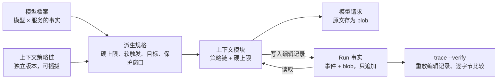
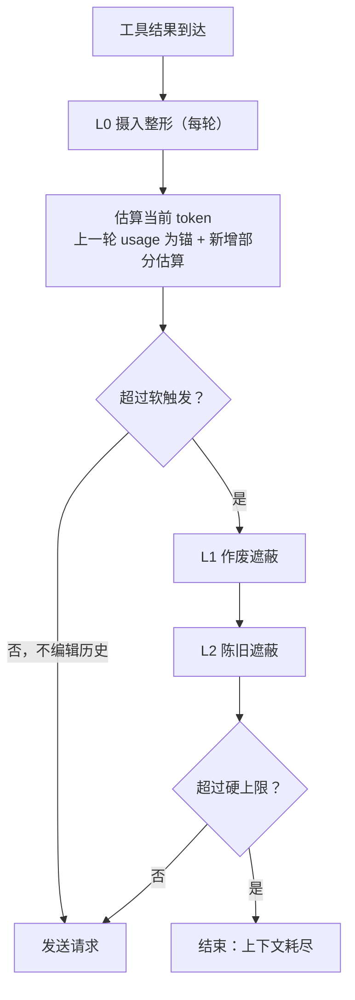
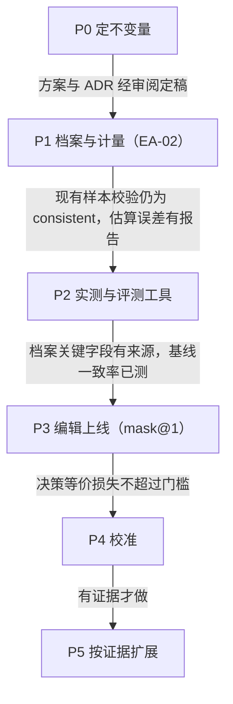

# FluxAxiom 上下文压缩专题方案（EA-CTX）v0.1

> 日期：2026-10-29 起草，2026-10-30 审核通过　性质：专题讨论定稿（设计依据）。
> 正式决策以 [ADR-026](../adr/ADR-026-context-module.md) 与 [EA-CTX 执行方案](../development/上下文压缩专题执行方案（EA-CTX）.md) 为准；两者与本文不一致处，以前者为准。

本方案把上下文压缩从 EA-02 中拆成独立专题：先改不变量、建模型档案和计量，再按测量结果引入压缩；第一期不做 LLM 摘要。

## 状态与依据

- **性质**：讨论定稿，2026-10-30 审核通过，已拆为 ADR-026 与 EA-CTX 执行方案。
- **源码基线**：`main@299e784`（Engine A、`engine-custom::rebuild`、ADR-020/023/025）。
- **与 EA-02 的关系**：EA-02 只交付本方案第一期（计量、硬上限、记录、校验器扩展的基础），不改变现有请求。遮蔽等编辑行为在专题后续阶段交付。
- **证据来源**：行业调研（Anthropic、OpenAI、Google ADK、Claude Code、Codex、Gemini CLI、OpenHands、OpenCode、Cursor、Amp、Letta、OpenClaw、Manus）、DeepSeek Harness 源码（`f3803c9`）、DeepSeek-V3.2 报告、JetBrains《The Complexity Trap》、Chroma《Context Rot》、ACON / AgentFold / Context-Folding / MEM1 / ACE。
- **范围外**：跨任务记忆（M 线）。

## 目标与非目标

专题的主目标是：上下文变长时，模型的下一步决策不因历史膨胀而变差；容量和成本只需守住边界。

**目标**

1. **容量**：任何模型、任何预算下，请求都不会因超出窗口而被服务端拒绝；超出时以明确原因结束，不发请求。
2. **质量**：压缩前后，模型在同一位置做出相同决策的比例可测量，并达到约定门槛。
3. **成本可预期**：每次编辑历史的缓存代价可计算、被记录，不出现频繁的缓存失效。
4. **可重建**：压缩后的每一次请求仍能从事实（事件 + blob）重建，`trace --verify` 能区分合法编辑和不一致。
5. **多模型**：接入新模型只需填写模型档案，策略和代码不改。

**非目标（本专题第一期不做）**

- LLM 摘要压缩：现有证据不支持它比遮蔽更好，且引入不确定内容和额外调用。
- 模型主导的折叠（AgentFold、MEM1 一类）：依赖专门训练，现成模型不可靠。
- 厂商不透明的服务端压缩（如 OpenAI 加密压缩块）：无法重建验证。
- 跨任务记忆：属于 M 线。

## 第一性原理

在有前缀缓存的推理服务上，压缩的真正理由是注意力质量，不是省钱；所以最有价值的压缩发生在内容进入上下文之前。

### 推理层与 Agent 层的分工

推理层已经在压缩。DeepSeek V4 公开版的注意力分三档：128 token 原始窗口、每 4 token 压一条并按查询选 top-512、每 128 token 压一条近乎全量参与。它按查询动态选择、粒度到 token、训练时见过。

Agent 层不做一个更差的注意力机制，只做推理层做不到的三件事：

- **语义判断**：知道哪份观察已作废（同一文件被重读、结果重复）。
- **外部寻址**：把内容移出上下文，留下能取回的地址。
- **对齐计费**：知道缓存在哪里断、编辑代价多大。

### 四种成本

| 成本 | 性质 | 本专题的态度 |
| --- | --- | --- |
| 容量 | 超窗口则请求失败 | 守硬上限，不追求更多 |
| 钱 | 编辑深处历史会让其后全部缓存失效 | 只算清楚，不作为压缩动机 |
| 注意力 | 长度增加、相似干扰项让决策变差 | 唯一主动优化的目标 |
| 协议 | 思维链回传、工具配对等规则限定可编辑内容 | 由档案给出可编辑集合 |

编辑历史的回本条件（P 为当前 prompt，从深度 d 删去 S，之后还剩 R 轮）：

```latex
R > (\text{cache\_ratio} - 1) \cdot \frac{P - S - d}{S}
```

DeepSeek Flash 的 cache\_ratio 为 50：从 100K 删 50K 需要约 47 轮才回本，一个 Run 远不到。所以按钱算，编辑深处历史几乎永远不划算；编辑点越靠近末尾越便宜，摄入时为零。

### 组织原则

1. **按变化频率排序，只在前沿编辑**：恒定部分（system、工具）→ 任务 → 状态 → 只追加日志。深处编辑要批量、低频。
2. **压缩在摄入时做**：内容进入上下文前决定形状，是唯一零成本的压缩点。工具设计本身就是压缩。
3. **先清作废，再清陈旧**：按“被取代”清理，不按“时间久远”。最伤注意力的是与正确内容相似但已作废的副本。
4. **不对称保留**：可重新取回的观察可以移走；模型自己的动作、推理和失败只存在于上下文，不动。
5. **压缩留地址**：移走的内容留存根，写明是什么、怎么取回。
6. **模型参与需记录**：模型做出的折叠或笔记必须成为可重建的事实。

### 质量的定义：决策等价

压缩的质量 = 压缩后的上下文让模型做出与完整上下文相同的下一步决策的程度。它可以用已存的请求 blob 离线测量（见“评测”）。

## FluxAxiom 现状与问题

当前配置下不会超窗口，但这是调用次数预算的副作用，不是设计出来的保护；换模型、放大预算或接入记忆召回后就失效。

| 项 | 现状 | 问题 |
| --- | --- | --- |
| 历史规则 | ADR-020 第 6 条“历史只追加”；§4.12.1 规则 1 是逐字前缀检查 | 任何压缩都会被判 `inconsistent` |
| 摄入上限 | `read_file` 32 KiB / 2000 行；`list_files` 100 条；`search_code` 100 条 × 200 字符 | 按字节和条数，与模型无关 |
| 预算 | 默认 8 次模型、32 次工具 | 同时兼管成本和上下文，数值按单一模型拍定 |
| 计量 | 只记录服务端 usage，无运行时估算 | 发请求前不知道会不会超窗口 |
| 模型信息 | `doc_version` 小表：别名 → 文档版本 | 没有窗口、缓存、协议等字段 |
| 真实负载 | 2026-10-26 的 Run：6 次调用，末轮 prompt 3309 token | 任务太短，压缩相关现象尚未出现 |

按默认预算估算的最坏情况：工具结果约 31 万 token，加上每轮最多 32768 的思维链回传约 26 万，合计约 58 万，低于 1M 窗口。

## 架构：档案、策略、派生值三层分离

阈值不手写：它是“模型事实 × 我们的取舍”算出来的结果，每次 Run 计算并记录。



组装只读派生规格和事实，把编辑记录写回事实；校验器用同一份记录重放，所以压缩不破坏可重建性。

| 层 | 内容 | 谁决定 | 何时变化 | 版本标识 |
| --- | --- | --- | --- | --- |
| 模型档案 `ModelProfile` | 模型 × 服务的客观事实 | 文档或实测 | 换模型、换服务商、厂商更新 | `profile_version` + 文件 hash |
| 上下文策略链 `ContextStrategy` | 取舍：编辑种类、保护窗口、滞回比例 | 本专题 | 策略调整或新增技术 | `context_strategy`（如 `mask@1`） |
| 派生规格 `ContextSpec` | 硬上限、软触发、目标、保护范围 | 由前两层计算 | 每次调用 | 随 context 记录保存 |

**设计约束**

- 调用次数预算从上下文约束中剥离，只管成本与失控；上下文约束只来自档案。上下文模块不读、也不改调用预算。
- 档案描述“模型 × 服务”，同一权重在不同服务商下是不同档案。
- 档案、策略、估算器都归独立的上下文模块；Provider 协议细节由档案的能力字段表达，Chat Completions 的序列化留在 `engine-custom`。Host 仍不理解 Provider JSON。
- 上下文策略有自己的版本 `context_strategy`，与 `prompt_layout_version`（只管 system 与工具 schema）分开递增。

### 模块边界

上下文管理是一个独立 crate（暂名 `fluxaxiom-context`），其余代码只通过一个窄接口使用它；以后替换或新增技术，只改这个 crate 内部。

**依赖方向**：上下文 crate 只依赖 `agent-contract` 的基础类型，不依赖 `engine-custom`、`run-host`；`engine-custom` 依赖它；Host 不知道它存在，只保存 blob 和事件里的引用。

**接口草图**

```rust
/// 与 Provider 协议无关的对话记录，由已提交的事实构造：
/// system、user、各轮 assistant（文本、思维链、工具调用）、
/// 工具结果（call_id、工具名、参数、result_ref、字节数）、各轮 usage。
pub struct Transcript { /* … */ }

/// 实际发给模型的视图：Transcript 的条目，部分被替换为存根。
pub struct View { /* … */ }

pub trait ContextStrategy: Send + Sync {
    /// 稳定标识与版本，如 "mask@1"，写进记录。
    fn id(&self) -> &str;
    /// 在视图上执行编辑，并把每次编辑追加到记录。
    fn apply(&self, view: &mut View, spec: &ContextSpec, record: &mut ContextRecord);
    /// 依据记录确定性地重放，供校验器使用。
    fn replay(&self, view: &mut View, record: &ContextRecord) -> Result<(), ReplayError>;
}

pub struct ContextManager { /* 档案 + 有序策略链 */ }

impl ContextManager {
    /// 估算、按链执行策略、检查硬上限；返回视图与记录，或上下文耗尽。
    pub fn prepare(&self, t: &Transcript) -> Result<Prepared, ContextExhausted>;
    /// 校验入口：由事实和记录重建视图。
    pub fn replay(t: &Transcript, r: &ContextRecord) -> Result<View, ReplayError>;
}
```

**策略链**：管理器按顺序运行链上的策略，降到目标即停；链跑完仍超过硬上限，才返回上下文耗尽。P1 的链为空（恒等策略），v1 的链为 L0 前向去重 → L1 作废遮蔽 → L2 陈旧遮蔽。

**以后引入新技术的方式**：清旧轮思维链、复用前缀的摘要、折叠、记忆召回注入、厂商原生压缩，都实现为新的策略，加进链里。

- 输出不确定的策略（如摘要）把输出存成 blob，记录里引用它，重放仍是确定的。
- 无法重放的策略（如厂商加密压缩）在记录里标 `replayable=false`，校验结论为 `unverifiable`。

**对现有代码的固定接触点**（一次性改动，与具体技术无关；以后新增技术不再碰它们）

| 位置 | 改动 |
| --- | --- |
| `engine-custom` 循环 | 每次调用前执行 `prepare`，把视图序列化为 Chat Completions；耗尽时返回失败 |
| `engine-api` `FailureReason` | 新增 `ContextExhausted` |
| 事件 `model.call_completed` | 可选字段 `context_ref`、`context_strategy` |
| `rebuild` 校验器 | 规则 1、3 改为与 `replay` 结果逐字节比较 |
| CLI `trace` | 显示 `context_strategy` 与估算值（从记录 blob 读取） |

## 模型档案 v1

DeepSeek Flash 的档案目前只能填出不到一半，其余取保守值并标为未知；第一批工作就是把未知项测出来。

每个字段带三项元数据：来源（文档链接加核对日期，或实测 Run 与方法）、可信度（文档 / 实测 / 假设 / 未知）、所属档案版本。未知字段取保守值，并记录所取的值。

| 组 | 字段 | 含义 | 推出什么 | deepseek-flash 当前值 | 可信度 |
| --- | --- | --- | --- | --- | --- |
| 身份 | `provider` / `alias` / `doc_version` | 服务商、别名、文档所列版本 | 样本分组 | deepseek / deepseek-flash / V4.1-Flash-1017 | 文档 |
| 容量 | `context_window` | 窗口 token 数 | 硬上限起点 | 1,048,576 | 文档 |
| 容量 | `window_counts_output` | 窗口是否包含输出 | 是否扣输出预留 | 假设“是” | 未知 |
| 容量 | `max_output` | 单次输出上限 | 输出预留上界 | 393,216 | 文档 |
| 容量 | `reasoning_in_output` | 思维链是否计入输出上限 | 预留是否另算 | 假设“是” | 未知 |
| 测量 | `tokenizer` | 可否离线精确计数 | 估算或精确 | 官方提供离线包，未接入 | 文档 |
| 测量 | `token_ratio` | 每字符 token：英文、中文分开 | 新增内容估算 | 英文 0.3，中文 0.6 | 文档 |
| 测量 | `usage_fields` | 响应可靠返回的用量项 | 能否以服务端为锚 | prompt / completion / 缓存命中与未命中 | 实测 |
| 测量 | `estimate_error` | 估算与实际的偏差（p99） | 硬上限余量 | 暂取 10% | 未知 |
| 经济 | `price_miss` / `price_hit` / `price_output` | 三种单价 | 绝对成本 | 见官方价格页 | 文档 |
| 经济 | `cache_ratio` | 未命中价 ÷ 命中价 | 编辑回本条件 | 50 | 文档 |
| 经济 | `cache_mode` | 自动前缀缓存或显式断点 | 能否控制断点 | 推测为自动前缀 | 待核 |
| 经济 | `cache_granularity` | 命中的块大小 | 编辑点是否对齐块 | — | 未知 |
| 经济 | `cache_ttl` | 缓存保留时长 | 何时编辑“免费” | — | 未知 |
| 更新语义 | `system_update` | 能否追加新 system 而不改首条 | 中途改提示不破缓存 | DSH 在 Messages 接口上声明支持；Chat Completions 未验证 | 未知 |
| 更新语义 | `tool_update` | 能否追加工具声明而不改首部列表 | 中途加工具不破缓存 | 同上 | 未知 |
| 注意力 | `effective_context` | 在指定任务类型上质量开始下降的长度 | 软触发 | — | 未知 |
| 注意力 | `context_awareness` | 模型是否感知并响应自身窗口 | 是否告知剩余空间 | — | 未知 |
| 协议 | `reasoning_passback` | 思维链回传规则 | 思维链是否可清 | 带 tools 时工具循环内必须回传；新用户消息到来时才丢弃 | 文档 |
| 协议 | `tool_pairing` | 调用与结果配对、结果可否换占位 | 遮蔽的合法形式 | 必须配对；占位内容可接受 | 假设 |
| 协议 | `native_context_mgmt` | 厂商原生压缩及其透明度 | 能否使用、能否重建 | Chat Completions 上未知有 | 假设 |

`effective_context` 必须注明测量所用的任务集；不同任务类型的退化曲线不同。

## 策略 v1：分层压缩流水线

策略 v1 有四层，全部是确定性规则，不调模型；只有摄入层每轮运行，编辑历史的两层只在触发后批量执行。



大多数轮次只经过 L0 和估算就发出；服务端报超限时的兜底路径未画出，见下文“溢出兜底”。

### L0 摄入整形（每轮，零缓存代价）

- **前向去重**：新工具结果与本 Run 早先某个结果完全相同（同工具、同规范化参数、同字节 hash），新消息内容写成指针存根，例如 `[unchanged: same result as round #3 call 2]`。只改新消息，不动历史。工作区在 Run 内只读且版本固定，判断是确定的。
- **按 token 的输出预算**：工具输出上限由档案的 `token_ratio` 换算成 token 预算；现有字节和条数上限保留为外层保险。
- **截断标注**：被截断的结果写明取回方式（分页参数），沿用现有 `truncated` / `continuation`。

### L1 作废遮蔽（达到软触发后）

- **作废的定义**（只读分析场景）：同一文件后来再次读取，且后读的范围覆盖先读的范围，则先读的结果作废。
- **存根**：`[superseded: read_file "src/x.rs" L1-200, 6.1 KiB, sha256:…; see round #7]`。

### L2 陈旧遮蔽（L1 不足以降到目标时）

- 从最旧开始，遮蔽保护窗口之外的工具结果。
- 存根写明工具名、参数、大小、hash，以及“需要时重新调用该工具”。
- **永不遮蔽**：system、user、所有 assistant 消息（`content`、`reasoning_content`、`tool_calls`）。

### L3 硬上限（每轮发请求前）

估算值超过硬上限时不发请求，Run 以明确原因结束。不再向下砍。

### 溢出兜底

服务端报告上下文超限时，归类为 `context_window_exceeded`，强制执行一次 L1 + L2（忽略软触发，只保护最近 1 轮）。**只有请求确实变化才重试**，最多 1 次；否则失败。这一判据借鉴 DeepSeek Harness，用于防止“报告成功、其实没改”的死循环。

### 上下文耗尽与产品式压缩的区别

方案里的“上下文耗尽”指 L0–L2 都已执行、估算仍超过硬上限的时刻。Cursor、Claude Code 提示“压缩”后继续对话，对应的是 v1 没有的 LLM 摘要层，不是这个时刻。

| 阶段 | Cursor / Claude Code 一类 | 方案 v1 |
| --- | --- | --- |
| 进入上下文前截断 | 有：大结果落盘、留预览 | L0 |
| 清理旧工具结果 | 有：microcompact、prune | L1 作废遮蔽、L2 陈旧遮蔽 |
| 用模型把旧历史写成摘要 | 有，即用户看到的“压缩” | 无，推迟到 P5 |
| 仍然超限 | 失败，如 Claude Code 连续失败 3 次后熔断 | L3 停止，原因为上下文耗尽 |

**“一直聊下去”的代价**

- 每次摘要都丢细节，多次压缩后摘要叠摘要。Codex 官方提示长对话加多次压缩会降低准确性。
- Amp 因此取消了自动压缩，改为用户主动交接到新会话。
- 并非不会失败：摘要加保留的最近消息仍放不下时同样卡住。Codex 出过压缩后只剩约 12% 空间、反复压缩的问题。
- 这是交互式产品的取舍：用户在场，宁可质量慢慢下降，也不让对话中断。

**FluxAxiom 何时会真的耗尽**

L2 只能遮工具结果。遮完后仍在上下文里的有：system 与用户消息；全部 assistant 消息，含思维链（协议要求工具循环内回传，v1 不动）；存根，每条约几十 token；最近 2 轮的工具结果原文。

因此主要驱动因素是**思维链的累积**。每轮最多 32,768 token，1M 窗口约能容纳 28 轮满额思考。默认 8 次模型调用到不了；调用次数放开到几十上百轮时会碰到。

**耗尽前还能加的手段（按代价从低到高）**

1. 清旧轮思维链：效果最大；需先用真实 API 确认置空可通过（T7），并测决策等价。
2. 复用前缀的摘要：照 DeepSeek Harness 的做法，摘要请求几乎全部命中缓存，输入成本接近零。
3. 交接：把当前状态写成新起点，开新的分段继续。
4. 停止并交出部分报告：v1 的做法。

v1 选第 4 种：Run 是有边界的任务，不是开放式对话；决策等价评测出来之前，不引入有损摘要。继续运行的能力由策略链提供：以后加入第 1–3 种手段只是往链里加策略，不改其他模块（见“模块边界”与决策第 8 项）。

### 派生公式

| 派生值 | 计算 | v1 取值说明 |
| --- | --- | --- |
| 输出预留 | 请求的 `max_tokens`（窗口不含输出时为 0） | 当前 32768 |
| 硬上限 | (窗口 − 输出预留) × (1 − `estimate_error`) | 约 914K |
| 当前估算 | 上一轮服务端 prompt + completion + 新增内容按 `token_ratio` 估算；无 usage 时全量估算 | 记录估算来源 |
| 软触发 | min(硬上限, `effective_context` × α)，α = 0.8 | `effective_context` 未测前暂定 128K，标注“未校准” |
| 目标 | 软触发 × β，β = 0.5 | 暂定 64K |
| 最少腾出 | max(32K, 0.25 × 当前估算)，达不到则不编辑（超硬上限除外） | 保证一次 Run 只触发一两次缓存失效 |
| 保护窗口 | 最近 K = 2 个模型轮的工具结果 ∪ 协议保护集 | 同时保证每条工具结果至少以原文出现一次，规则 3 仍可核对 |
| 冷缓存窗口 | 距上次响应超过 `cache_ttl` 时，允许在软触发以下执行 L1 | `cache_ttl` 测出前关闭 |

## 可重建性：不变量、规则与记录

“只追加”从请求层移到事实层：事件和 blob 仍只追加、不删；每次请求是“事实 + 档案 + 策略”的确定函数。OpenHands 和 DeepSeek Harness 都是这个形状。

### 规则 1 修订

```latex
req_{k+1}.messages = \mathrm{serialize}\big(\mathrm{replay}(T_{k+1},\ R_{k+1})\big)
```

T 是由第 1 至 k 轮事实（system、user、各轮响应、工具结果 blob）构造的对话记录，R 是该次调用的 context 记录。`replay` 由上下文模块提供，校验器只做逐字节比较，不理解任何编辑种类。恒等策略下 replay(T) = T，上式退化为现行规则 1。

v1 策略的编辑种类为 `dedupe_forward`、`mask_superseded`、`mask_aged`，它的 `replay` 额外检查：

1. 被编辑的是 `tool` 消息，不在保护窗口内。
2. 存根文本等于由记录渲染出的文本。
3. 记录中的 `result_ref` 与被替换消息的原始内容一致。
4. 遮蔽是单调的：遮过的消息之后一直保持同一存根。
5. 有编辑记录就必须有请求变化；没有记录的差异仍报 `inconsistent rule=1`。

规则 3 并入上式：未编辑的 tool 消息由 `replay` 取自结果 blob，被编辑的由记录渲染，二者都在逐字节比较中覆盖。记录不可重放，或记录中的策略标识在当前代码中不存在时，结论为 `unverifiable`，不猜。

### 记录字段

context 记录存为独立 blob，结构归上下文模块所有，带自己的 schema 版本。`model.call_completed` 只新增两个可选字段：`context_ref`（记录 blob）与 `context_strategy`（策略链标识，如 `mask@1`）。记录只有引用和数值，不含正文：

- `schema_version`、`profile_version`、`profile_hash`、策略链标识
- `spec`：硬上限、软触发、目标、保护范围
- `estimate`：数值、来源（`usage` / `estimated`）、锚点轮次
- `edits[]`：各策略自定义的条目；v1 为 `op`、目标（轮次 #k : 序号 j）、`result_ref`、原始估算 token、原因
- `replayable`：能否确定性重放

兼容：旧事件没有这两个字段，读出为 None，按恒等策略校验；`event.schema.json` 与样例同步更新。记录 blob 的 schema 随上下文模块维护，不进入 `agent-contract`，换技术时不改事件 schema。

### 版本号

- `prompt_layout_version`：只管 system 与工具 schema，上下文策略变化不再递增它。
- `context_strategy`：策略链标识与版本（如 `mask@1`）；阈值、存根文本、保护窗口任一变化递增。
- `profile_version`：档案任一字段变化递增，独立记录。
- 单次编辑不递增任何版本，它是事实，记在记录的 `edits[]`。

### 需要修订的文档

- ADR-020 第 6 条：“历史只追加”改为“事实只追加，请求为事实的确定函数”。
- ADR-023 与执行方案 §4.12.1：规则 1、规则 3 按上文修订。
- 新增 ADR-026：上下文模块边界、三层分离与可重建编辑。

## 评测：决策等价

压缩策略的好坏用“决策等价率”衡量：同一位置上，压缩后的请求让模型做出与完整请求相同下一步的比例，并与“完整对完整”的自一致率对比。

### 方法

1. 从真实 Run 的请求 blob 取第 k 轮请求，分别构造完整版与按某策略压缩后的版本。
2. 同一模型、同一参数，各采样 N 次（N 待定，初定 5）。
3. 比较下一步：工具调用集合（工具名 + 规范化参数）、是否结束、结论中引用的路径。
4. **基线**：完整版对完整版的一致率。思考模式下采样本身有随机性，压缩损失 = 基线一致率 − 压缩版一致率，而不是 1 − 一致率。

### 失败挖掘

参考 ACON：收集“完整版行为正确、压缩版行为不同”的样本，人工归因压缩丢了什么（被遮的文件、被去重的结果、存根措辞），据此修订策略。每次修订递增 `context_strategy`。

### 指标

| 指标 | 来源 | 用途 |
| --- | --- | --- |
| 决策等价率（相对基线） | 离线回放 | 主指标 |
| 重复调用率 | `trace` 已列出同轮重复调用 | 存根是否诱发重新读取 |
| 任务事实正确率 | EA-04 固定任务集 | 端到端质量 |
| 缓存命中率、单次 Run 成本 | 事件 usage | 编辑的实际代价 |
| 编辑次数、腾出 token | `context.edits` | 策略是否按预期低频批量 |

### 前提

现有真实任务太短（约 6 轮、1.2 万 token），触发不了压缩。需要一组长任务：更大的仓库、更高的调用预算，并在 EA-04 的任务集中单列。

### 工具

新增离线命令（暂名 `flux ctx replay <run> --call k --policy <ver> --samples N`），读 blob 构造请求、调用模型、输出比较结果。属于评测工具，不进入 Run 事实。

## 实测计划

七项实测按“便宜且解锁多”的顺序排列；T1–T3 不需要新的长任务，可以先做。

| 编号 | 测什么 | 方法 | 成本 | 解锁 |
| --- | --- | --- | --- | --- |
| T1 | 上下文构成与作废比例 | 对已有样本的 blob 离线统计：system、user、assistant、思维链、各类工具结果的占比；同一文件被读两次以上、完全相同结果的比例 | 无 API 调用 | L0/L1 是否值得做 |
| T2 | `estimate_error` | 对比每轮估算值与下一轮服务端返回的 prompt 用量，分中英文内容统计 | 无 API 调用 | 硬上限余量 |
| T3 | `cache_ttl`、`cache_granularity`、`cache_mode` | 固定前缀分别间隔 1/5/15/60 分钟重发；按不同前缀长度截断；读 `prompt_cache_hit_tokens` | 少量调用 | 编辑成本模型、冷缓存窗口 |
| T4 | `window_counts_output`、`reasoning_in_output` | 先查文档；不足时在接近上限处做少量探测 | 每次接近 1M token，次数需控制 | 输出预留 |
| T5 | `system_update`、`tool_update` | Chat Completions 上中途追加 system 或工具声明，看模型是否遵循、缓存是否命中 | 少量调用 | 中途改提示是否破缓存（当前不改，优先级低） |
| T6 | `effective_context` | 在固定任务上用无关内容与相似干扰内容分别填充到 16K、64K、256K、512K，测决策等价率曲线 | 最贵 | 软触发校准 |
| T7 | 旧轮 `reasoning_content` 置空 | 真实 API 验证可接受性，再测决策等价 | 少量调用 | 是否允许清思维链 |

每项实测产出一份记录（方法、样本、结果、核对日期），档案字段的来源指向这份记录。

## 分期、交付与验收

EA-02 只交付 P1，它不改变任何现有请求；所有编辑历史的行为都在 P3，并且要先通过决策等价门槛。



每道门槛不过，就不进入下一阶段；P5 的每一项都需要独立证据。

**各阶段验收**

- **P0**：ADR-026 合入；ADR-020、ADR-023、执行方案 §4.12.1 的修订合入。
- **P1**：上下文模块以恒等策略接入 Engine A，现有全部样本的请求逐字节不变；依赖检查确认该 crate 不依赖 `engine-custom` 与 `run-host`，`trace --verify` 仍为 `consistent`；硬上限与溢出归类有单元测试（构造超限请求、构造服务端超限响应）；旧事件可读；`context` 记录 blob 及事件的 `context_ref`、`context_strategy` 字段出现在新事件与样本中；`trace` 显示每轮估算值与上限。
- **P2**：T1–T3、T7 各有实测记录，档案对应字段指向它；`flux ctx replay` 能在至少一组样本上输出完整对完整的自一致率。
- **P3**：遮蔽后的 Run `trace --verify` 为 `consistent`；篡改存根、遮蔽保护窗口内的消息、未记录的删除、有记录但请求未变，均报 `inconsistent rule=1`；长任务集上决策等价损失不超过门槛；记录触发前后的缓存命中率。
- **P4**：`effective_context` 有测量记录与任务集说明；软触发改为由它派生；两种遮蔽顺序的对比结果入档。

**与其他开发包的关系**：EA-03 的大文件分页与工具设计属于 L0 的上游；EA-04 提供固定任务集，P2 起需要在其中单列长任务。

## 多模型接入流程

接入新模型只做三件事：填档案、跑两项便宜的实测、在样本里按档案版本分组；策略与代码不改。

1. **填档案**：按文档填写可得字段，未知字段取保守值并标注。
2. **便宜实测**：T2（估算误差）与 T3（缓存规则）。
3. **自动派生**：硬上限、软触发等由档案和现有策略算出；`effective_context` 未测时沿用暂定值并标注“未校准”。
4. **评测隔离**：样本记录 `profile_version`，不同档案的样本不混合统计（延续 ADR-020 第 3 条）。
5. **协议适配**：若新模型的协议字段（思维链回传、配对规则、原生压缩）不同，由适配器给出可编辑集合；策略只读这个集合。

厂商原生压缩（如 Anthropic 服务端清除、OpenAI 压缩块）只作为可选后端。启用后，对应轮次的校验结论为 `unverifiable`，并在样本中标注。

## 风险与决策

最大的风险是存根本身：它是模型训练时没见过的形状，可能诱发重复读取或误判；所以遮蔽上线前必须先有决策等价评测。

### 风险

| 风险 | 表现 | 应对 |
| --- | --- | --- |
| 存根在训练分布之外 | 模型反复重读被遮的文件，或把存根当成内容 | 监控重复调用率；存根措辞纳入失败挖掘 |
| 前向去重的指针离原文太远 | 模型需要回看很远的内容，注意力反而分散 | T1 先看重复比例；评测中单独对比开关 |
| 决策等价有随机性 | 小样本下结论不稳 | 用自一致基线做相对比较；N 按方差调整 |
| T6 成本高 | 填充到 512K 的采样费用可观 | 先做 16K–128K 段，按需扩展 |
| 硬上限触发即失败 | 长任务在有预算时被中断 | 失败原因明确记录；见“上下文耗尽与产品式压缩的区别”；后续手段以新策略加入策略链 |
| 中文估算偏差 | 固定比例低估或高估 | 按字符类别估算；T2 分语种统计 |

### 决策（按独立模块原则）

原则：上下文压缩是可独立迭代的模块，尽量不与现有代码耦合，保留以后引入其他技术的余地。由此，只有与具体技术无关的事项升为系统决策；其余都是策略内部参数，改动只产生新的策略版本。

| # | 事项 | 决定 | 依据 |
| --- | --- | --- | --- |
| 1 | 专题范围 | EA-02 只交付 P1，其余在专题内迭代 | 已由你确认 |
| 2 | 硬上限的失败原因 | 新增通用的 `ContextExhausted`；是哪条策略、估算多少写在 context 记录里 | 复用 `BudgetExhausted` 会把上下文和调用预算绑在一起；枚举只加一次，与技术无关 |
| 3 | 保护窗口按轮数还是 token | 策略内部参数；v1 按模型轮数 K = 2 | 改动只递增 `context_strategy`，不涉及其他模块 |
| 4 | 软触发 128K / 目标 64K / 最少腾出 32K | 接受为未校准暂定值，写在 v1 策略配置中；每次调用的派生值随记录保存 | 同上 |
| 5 | context 记录位置 | 独立 blob；事件只加 `context_ref` 与 `context_strategy` 两个可选字段 | 记录结构归模块所有、独立版本化，换技术不改事件 schema；也符合“事件只存引用” |
| 6 | 档案形式 | 每个“模型 × 服务”一份数据文件，归上下文模块，编译时嵌入；`doc_version` 暂不合并 | 接入新模型只加文件；不动样本导出现有逻辑 |
| 7 | 调用预算形式 | 移出本专题；上下文模块不读也不改调用预算 | 两者解耦后各自演进 |
| 8 | Run 是否“一直跑下去” | 由策略链提供这种能力；v1 链到 L2 为止，耗尽即停并交出部分报告；清思维链、摘要等作为新策略加入，按证据启用 | 继续运行是链的组成问题，不是核心结构问题 |

仍待定：P3 门槛的数值（决策等价损失上限），等 P2 测出自一致基线后再定。
